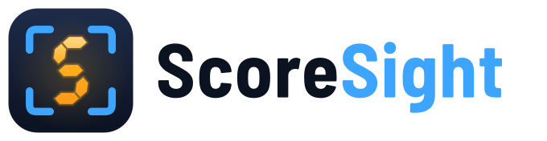
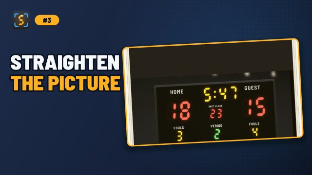
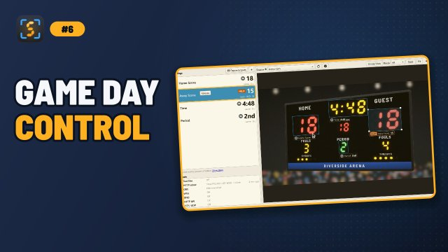
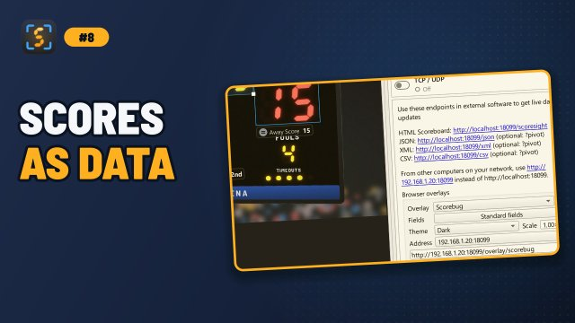
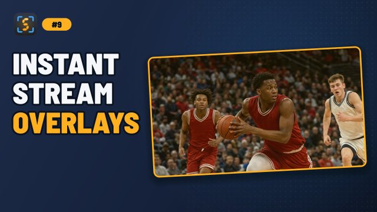
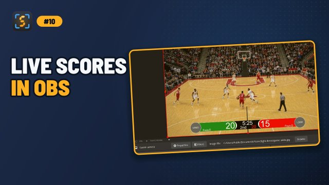
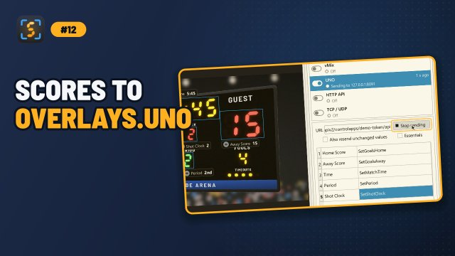
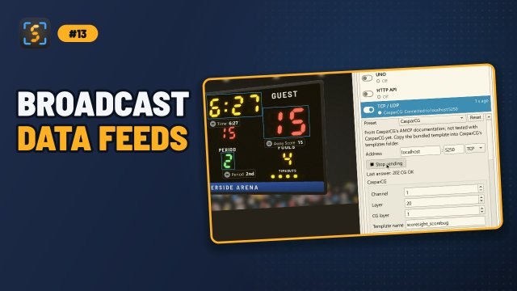
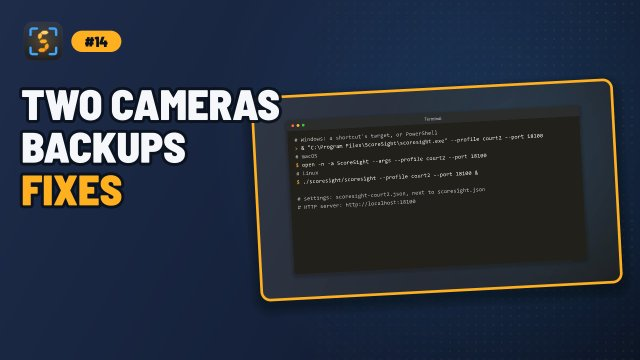

<div align="center">

<h1>
<picture>
  <source media="(prefers-color-scheme: dark)" srcset="docs/logo-dark.png"/>
  
</picture>
</h1>

**Real-time scoreboard OCR for live production. Free, open source, cross-platform.**

Point a camera, capture card, NDI feed, RTSP stream, screen or video file at any scoreboard.<br/>
ScoreSight reads the scores, clocks and periods many times per second and sends them to OBS, vMix, overlays.uno, browsers, files and your own apps.

[](https://github.com/royshil/scoresight/actions/workflows/ci.yml)
[](https://github.com/royshil/scoresight/actions/workflows/release.yml)
[](https://github.com/royshil/scoresight/releases/latest)
[](https://github.com/royshil/scoresight/releases)
[](https://royshil.github.io/scoresight/)
[](LICENSE)

[**Download**](https://github.com/royshil/scoresight/releases/latest) ·
[**Documentation**](https://royshil.github.io/scoresight/) ·
[**Quickstart**](https://royshil.github.io/scoresight/quickstart.html) ·
[**Ask a question**](https://github.com/royshil/scoresight/discussions) ·
[**Report a bug**](https://github.com/royshil/scoresight/issues/new/choose)

<a href="https://youtu.be/21LhNHbH9gU" target="_blank"></a>

</div>

## Why ScoreSight

Our goal is simple: to be the best scoreboard-reading software on the planet, and to keep it free and open for everyone who produces live sports, from community leagues to stadium broadcasts.

- **Free and open source**: MIT licensed. No watermark, no paid tier, no account.
- **Runs on your machine**: Windows, macOS (Apple Silicon and Intel) and Linux. No cloud, no internet required.
- **Real time**: up to 15 readings per second for every box, with outputs that never stall the app.
- **Built for scoreboards**: OCR models trained on LED, LCD and 7-segment scoreboard digits, plus per-box image processing and validation rules that keep wrong numbers off air.
- **Plugs into your production**: OBS, vMix, overlays.uno, browser overlays, text files and any HTTP endpoint, all at the same time.

## Features

- **Any source**: USB cameras and capture cards, NDI®, RTSP/HTTP streams, screen or window capture, and video files (with x1–x32 fast-forward for tuning on recordings).
- **Picture correction**: 4-corner perspective correction, crop, 90° rotation and stabilization against camera bumps and drift.
- **Unlimited boxes**: seven standard fields (scores, time, period, fouls, shot clock) plus any number of custom fields.
- **Per-box tuning**: field type (number/time/text), format presets and custom regular expressions, confidence threshold, global/local/adaptive binarization, cleanup, dilate, skew, vertical scale, auto-crop, rescale, invert, output averaging, leading-zero removal, ordinals (1st, 2nd...) and more.
- **Dot counter**: count indicator lights such as balls/strikes/outs, possession arrows or bonus lights.
- **Template fields**: combine fields and text, for example `{{Home Score}} - {{Away Score}}` or `Q{{Period}}`.
- **Game & sports**: choose the sport (basketball, soccer, ice hockey, American football, volleyball) and ScoreSight follows the game: each score, the start and end of each period, the clock, the final buzzer and the points of each period, with misreads filtered out, at `/game`.
- **OCR models**: PaddleOCR's PP-OCRv6 recognition models (automatic, accurate and fast: about 95% of real scoreboard values read right), four bundled Tesseract models (General Scoreboard, General Scoreboard Large, Daktronics, General Fonts) or your own `.traineddata`.
- **Training tools**: collect OCR samples from your own scoreboard and annotate them in the built-in Training Dojo.
- **Multiple instances**: run several ScoreSight windows side by side with `--profile` and `--port`, for example one per camera.
- **13 languages**: English, French, Spanish, German, Italian, Japanese, Korean, Dutch, Polish, Portuguese (Brazil and Portugal), Russian and Chinese (Simplified), with System/Light/Dark appearance.

## Sources and outputs

| Sources | Windows | macOS | Linux |
|---|:---:|:---:|:---:|
| USB camera / capture card | ✔ | ✔ | ✔ |
| NDI® | ✔ | ✔ | ✔ |
| URL: RTSP / HTTP stream | ✔ | ✔ | ✔ |
| Screen / window capture | ✔ | ✔ | ✘ |
| Video file (`.mp4`, `.avi`, `.mov`) | ✔ | ✔ | ✔ |

| Outputs | How | Guide |
|---|---|---|
| Text files | `<Box Name>.txt`, `results.csv`, `results.xml` (atomic writes) | [Text files](https://royshil.github.io/scoresight/text-files.html) |
| Built-in HTTP server | HTML, JSON, XML and CSV on port 18099 | [HTTP API](https://royshil.github.io/scoresight/http_server.html) |
| OBS Studio | OBS WebSocket v5, updates text sources | [OBS](https://royshil.github.io/scoresight/obs.html) |
| vMix | vMix Web API (port 8088), `SetText` on title fields | [vMix](https://royshil.github.io/scoresight/vmix.html) |
| overlays.uno | UNO control app API, including Essentials | [UNO](https://royshil.github.io/scoresight/uno.html) |
| Browser overlays | Transparent scorebug, lower third and clock pages, pushed live | [Browser overlays](https://royshil.github.io/scoresight/overlays.html) |
| Your own endpoint | HTTP POST/PUT/GET with JSON, XML or CSV | [Outbound API](https://royshil.github.io/scoresight/out_api.html) |
| TCP / UDP | Text lines from a template, with presets for CasparCG, Chyron PRIME, Vizrt and more | [TCP / UDP](https://royshil.github.io/scoresight/tcp-output.html) |
| Wirecast, XSplit, TriCaster, CasparCG, Chyron, XPression, Vizrt, CharacterWorks, NewBlue... | through the outputs above: 33 products, with a guide for each | [Works With…](https://royshil.github.io/scoresight/integrations.html) |
| Streamlabs, Home Assistant, Node-RED, spreadsheets... | via text files or the HTTP server | [Other software](https://royshil.github.io/scoresight/other-software.html) |

## Install

Download the latest version for your system from the **[Releases page](https://github.com/royshil/scoresight/releases/latest)** (`<version>` is the release number, for example `0.2.0`):

| System | File |
|---|---|
| Windows 10 (1809 or newer) / 11, 64-bit | `scoresight-<version>-windows-x64-setup.exe` (installer) or `scoresight-<version>-windows-x64-portable.zip` |
| macOS 15 or newer, Apple Silicon (M1 and later) | `scoresight-<version>-macos-arm64.dmg` |
| macOS 15 or newer, Intel | `scoresight-<version>-macos-x64.dmg` |
| Linux x86_64 with glibc 2.35 or newer (Ubuntu 22.04+, Debian 12+) | `scoresight-<version>-linux-x64.tar.gz` (extract and run `scoresight/scoresight`) |

Every release includes `SHA256SUMS.txt` so you can verify your download. Download ScoreSight only from GitHub: the project's former website domain (`scoresight[.]live`) is no longer controlled by the project. The [installation guide](https://royshil.github.io/scoresight/INSTALL.html) covers SmartScreen, the portable version, macOS permissions and Linux details.

## Quickstart

1. **Open a source**: pick your camera, NDI feed, URL, screen or video file in the **Source** drop-down, or with the buttons of the first-run card in the viewer.
2. **Straighten the picture** (optional): rotate, crop, or click **4-corner** and the four corners of the scoreboard.
3. **Add boxes**: select *Home Score* in the field list, click **Place on picture**, and drag the box over the digits. Repeat for the other values, or click **+** for custom fields.
4. **Check the readings**: each box's label shows ✓ for a new value, = for an unchanged one, ! when a filter rejected it and ∅ when nothing was read. Use **Binary View**, the box **Type** and a **Format** preset to make readings solid.
5. **Send them out**: open [http://localhost:18099/json?pivot](http://localhost:18099/json?pivot) in a browser, or turn on Text files, OBS, vMix, UNO or HTTP API in the **Outputs** list, which shows whether each output works.

The full walkthrough is in the [Quickstart guide](https://royshil.github.io/scoresight/quickstart.html).

## Video tutorials

A short series on the current version, from the first source to your graphics:

<div>
<a href="https://youtu.be/21LhNHbH9gU" target="_blank"></a>
<a href="https://youtu.be/6P1K4CpHUwM" target="_blank"></a>
<a href="https://youtu.be/XUPebWz5Cuc" target="_blank"></a>
<a href="https://youtu.be/fwKIpfiTbCo" target="_blank"></a>
<a href="https://youtu.be/ZOoNYqGhmmI" target="_blank"></a>
<a href="https://youtu.be/1HRfxRJHBKk" target="_blank"></a>
<a href="https://youtu.be/OrIesDf_fsY" target="_blank"></a>
<a href="https://youtu.be/tKA6UBqcDC0" target="_blank"></a>
<a href="https://youtu.be/2i_7QR6-yKY" target="_blank"></a>
<a href="https://youtu.be/anQl1D921O0" target="_blank"></a>
<a href="https://youtu.be/vMrr92-3LeI" target="_blank"></a>
<a href="https://youtu.be/HaWNl92JLBE" target="_blank"></a>
<a href="https://youtu.be/FVqdjvmnFIU" target="_blank"></a>
</div>

Older videos, about earlier versions of ScoreSight: [ScoreSight with vMix](https://youtu.be/yowoYzBWrps) (vMix now uses port **8088**; see the [vMix guide](https://royshil.github.io/scoresight/vmix.html)), [ScoreSight with NewBlue Captivate](https://youtu.be/ptR-Yh5FSPg) and [collecting OCR training data](https://youtu.be/QO76EFmJ7Ig).

## Documentation

The full documentation is at **[royshil.github.io/scoresight](https://royshil.github.io/scoresight/)**:

- **Getting started**: [Installation](https://royshil.github.io/scoresight/INSTALL.html), [Quickstart](https://royshil.github.io/scoresight/quickstart.html)
- **Guides**: [Video Sources](https://royshil.github.io/scoresight/sources.html), [Viewer & Image Tools](https://royshil.github.io/scoresight/view-tools.html), [Boxes & Templates](https://royshil.github.io/scoresight/boxes.html), [Recognition Tuning](https://royshil.github.io/scoresight/recognition-tuning.html), [Performance Tuning](https://royshil.github.io/scoresight/performance.html), [Multiple Instances & Profiles](https://royshil.github.io/scoresight/profiles.html), [OCR Training Data](https://royshil.github.io/scoresight/data_annotation.html), [Game & Sports](https://royshil.github.io/scoresight/game.html)
- **Outputs**: [overview](https://royshil.github.io/scoresight/outputs.html), [Text files](https://royshil.github.io/scoresight/text-files.html), [HTTP API](https://royshil.github.io/scoresight/http_server.html), [OBS](https://royshil.github.io/scoresight/obs.html), [vMix](https://royshil.github.io/scoresight/vmix.html), [UNO](https://royshil.github.io/scoresight/uno.html), [Outbound API](https://royshil.github.io/scoresight/out_api.html), [TCP / UDP](https://royshil.github.io/scoresight/tcp-output.html), [Browser overlays](https://royshil.github.io/scoresight/overlays.html)
- **Works With…**: [33 broadcast, streaming and graphics products](https://royshil.github.io/scoresight/integrations.html), with a setup guide for each
- **Reference**: [Per-Box Settings](https://royshil.github.io/scoresight/box-settings.html), [Settings, Files & Command Line](https://royshil.github.io/scoresight/configuration.html), [Keyboard & Mouse](https://royshil.github.io/scoresight/keyboard-mouse.html)
- **Help**: [Troubleshooting](https://royshil.github.io/scoresight/troubleshooting.html), [FAQ](https://royshil.github.io/scoresight/faq.html)
- **Development**: [Developer Guide](https://royshil.github.io/scoresight/development/)

What's new: see the [CHANGELOG](CHANGELOG.md).

## Build from source

ScoreSight is a Python 3.13 app built with PySide6 (Qt 6), OpenCV, onnxruntime (PP-OCR) and Tesseract. In short:

```bash
git clone https://github.com/royshil/scoresight.git
cd scoresight
uv venv --python 3.13 && source .venv/bin/activate   # Windows: .venv\Scripts\activate
uv pip install -r requirements-dev.txt -r requirements-mac.txt   # or -r requirements-win.txt on Windows; nothing extra on Linux
python scripts/compile_ui.py
python scripts/fetch_models.py   # the PP-OCR models (not in git)
python src/main.py
```

Windows needs one extra step, building the camera enumerator: `uv pip install -r requirements-build.txt` and then `python src/win32DeviceEnum/setup.py build_ext --inplace`. The [Developer Guide](https://royshil.github.io/scoresight/development/building.html) covers platform details, tests, packaging with PyInstaller and the release process.

## Contributing

Contributions are very welcome: bug reports, documentation, translations, scoreboard samples and code. Read [CONTRIBUTING.md](CONTRIBUTING.md) to get started, and follow our [Code of Conduct](CODE_OF_CONDUCT.md).

- Questions, ideas and your setups: [Discussions](https://github.com/royshil/scoresight/discussions). We'd love to hear what you broadcast with ScoreSight.
- Bugs: [GitHub Issues](https://github.com/royshil/scoresight/issues/new/choose) (please attach your logs)
- Security issues: see [SECURITY.md](SECURITY.md)

If ScoreSight helps your productions, you can support its development through [GitHub Sponsors](https://github.com/sponsors/royshil) or [Patreon](https://www.patreon.com/RoyShilkrot).

## License

ScoreSight is released under the [MIT License](LICENSE).

It builds on great open-source projects, each under its own license, including [Qt for Python (PySide6)](https://www.qt.io/qt-for-python) (LGPLv3), [OpenCV](https://opencv.org/) (Apache 2.0), [PaddleOCR's PP-OCRv6 models](https://github.com/PaddlePaddle/PaddleOCR) (Apache 2.0) and [ONNX Runtime](https://onnxruntime.ai/) (MIT), [Tesseract OCR](https://github.com/tesseract-ocr/tesseract) and [tesserocr](https://github.com/sirfz/tesserocr), [cyndilib](https://github.com/cyndilib/cyndilib), [FastAPI](https://fastapi.tiangolo.com/) and [obsws-python](https://github.com/aatikturk/obsws-python).

NDI® is a registered trademark of Vizrt NDI AB. vMix, OBS Studio, overlays.uno, NewBlue and other product names are trademarks of their respective owners. ScoreSight is not affiliated with or endorsed by them.
