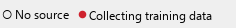

# OCR Training Data Collection and Annotation
{: .no_toc }

ScoreSight can save the image of every new reading together with the text it recognized. You can correct and approve those samples in the built-in **Training Dojo**, and then use them to train a Tesseract model for your scoreboard (see [OCR Models](ocr-models.md#training-a-model-for-your-scoreboard)).

  
On this page

  {: .text-delta }
1. TOC
{:toc}

## 1. Set up the training data folder

Open **File** > **OCR Training Data Setup**:

| Control | What it does |
|---|---|
| **Save Folder** | Where samples are saved. Click **...** to choose a folder. The default is the `ocr_training_data` folder inside the ScoreSight [settings folder](configuration.md#where-scoresight-keeps-its-files). |
| **Open Folder** | Opens the folder in your file manager. |
| **Save Zip File** | Packs the whole folder into a `.zip` file wherever you choose. |
| **Max Size** | The maximum size of the folder in MB (default 10). When the folder reaches it, ScoreSight stops saving new samples and writes an error to the log. |
| **Open OCR Training Dojo** | Opens the annotation tool (see below). |

Click **OK** to apply your changes.

{: .new }
In ScoreSight 0.1.x a changed **Save Folder** was ignored and samples always went to the default folder ([#52](https://github.com/royshil/scoresight/issues/52)). This is fixed in 0.2.0.

## 2. Collect samples

Click **Save OCR Training Data** (top right of the main window) to start collecting, and click it again to stop:

While it is on, every reading that is neither empty nor unchanged saves three files per box into the training data folder. That includes readings rejected by a filter (yellow), which are often the most useful ones to annotate:

| File | Content |
|---|---|
| `<id>.png` | The black-and-white image of the box, as the OCR saw it |
| `<id>_gray.png` | The grayscale image of the box |
| `<id>.txt` | The text ScoreSight recognized (you correct it in the Training Dojo) |

Collect samples from a real game or a recording, so you capture all digits and the conditions you care about (lighting, angles, changing digits). A few hundred samples per box type is a good start.

## 3. Annotate in the Training Dojo

Click **Open OCR Training Dojo** in the setup dialog.

- **Left**: all samples. Approved samples are shown first, in green with a ✓.
- **Right**: the current image and a text box with its annotation. When a sample is approved, the image and text box are outlined in green.

For each image:

1. Check the text. If it is wrong, type the correct text.

   

2. Press **Enter** to approve it and move to the next image.

Tick **Only Undone** to show only samples you haven't approved yet. Your approvals are stored in `approved_annotations.json` in the training data folder, and corrected text is written back to the sample's `.txt` file.

### Keyboard shortcuts

| Key | Action |
|---|---|
| **Enter** | Approve the annotation and go to the next image |
| **Shift + Enter** | Go to the previous image |
| **Up** / **Down** | Previous / next image |
| **Ctrl + Up** / **Ctrl + Down** | Jump to the previous / next unapproved image |
| **N** / **B** | Next / back |
| **U** | Remove the approval from the current image |

{: .note }
**N**, **B** and **U** are navigation shortcuts. Scoreboard annotations are normally digits, `:` and `.`, so they rarely get in the way. If you annotate text that contains these letters, type it in a text editor and paste it into the annotation box.

## 4. Export and use the data

1. In **OCR Training Data Setup**, click **Save Zip File** and choose where to save the archive.
2. Use the approved samples (each `.png` with its `.txt`) to train or fine-tune a Tesseract model with [tesstrain](https://github.com/tesseract-ocr/tesstrain). Then load it with **OCR Model** > **Load External OCR Model**.

If you'd like your data to help improve the models bundled with ScoreSight, [open an issue](https://github.com/royshil/scoresight/issues/new/choose) describing your scoreboard and the size of your dataset, and the maintainers will reply there. Please don't attach large archives to an issue without asking first.

## Best practices

1. Annotate regularly, a few hundred samples at a time.
2. Use the keyboard shortcuts. **Enter** to approve and continue is the fastest workflow.
3. Double-check before approving. One wrong label teaches the model the wrong thing.
4. Use **Only Undone** when you're nearly done to find the remaining samples.
5. Set a reasonable **Max Size** so collection doesn't fill your disk during a long game.
