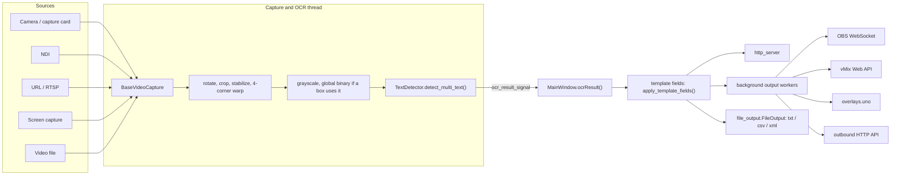

# Architecture
{: .no_toc }

  
On this page

  {: .text-delta }
1. TOC
{:toc}

## Overview

All application code is a flat set of modules in `src/` that import each other by bare module name (`from storage import fetch_data`), not as a package. Running `python src/main.py` puts `src/` on `sys.path`. The test configuration (`pythonpath = ["src", "."]` in `pyproject.toml`) does the same for pytest, and also puts the repository root on the path for the OCR evaluation harness, the `ocr_eval` package (see [OCR Evaluation](ocr-eval.md)).

## Frame → OCR → outputs pipeline

1. **Source discovery**: `get_camera_info.py` enumerates devices per OS (a DirectShow extension in `src/win32DeviceEnum` on Windows, AVFoundation on macOS, `/dev/video*` capture nodes via V4L2 on Linux) plus NDI sources (`ndi.py`, via cyndilib) into `CameraInfo` objects. `CameraInfo.CameraType` distinguishes OpenCV devices, NDI, files, URLs and screen capture. `MainWindow` runs the discovery on a worker thread (`mainwindow.run_in_background`) and gets the result back through a signal, so the window appears immediately. The startup OBS connection and the update check run the same way.
2. **Capture thread**: `source_view.ImageViewer` extends `camera_view.CameraView` (a `QGraphicsView`), which owns a `camera_thread.TimerThread` (a `QThread`). The thread chooses a `BaseVideoCapture` implementation:
   - `OpenCVVideoCaptureWithSettings` for cameras (with the stored Video Settings applied at open; DirectShow is the default backend on Windows, and a stored backend that can't open the device falls back to the default one), files, and URLs (FFmpeg, with 5 s open/read timeouts and `OPENCV_FFMPEG_CAPTURE_OPTIONS` defaulting to `rtsp_flags;prefer_tcp`: RTSP over TCP first, falling back to UDP, which is also OpenCV's behaviour when the variable is unset),
   - `ndi.NDICapture` for NDI,
   - `screen_capture_source.ScreenCapture`, which resolves to the macOS or Windows implementation, or a dummy on Linux.

   Closing a viewer disconnects the thread's signals, unsubscribes it from storage and waits at most 3 s (`STOP_TIMEOUT_MS`) before letting it finish in the background. An `atexit` handler gives threads still running at exit a bounded wait.
3. **Per-frame processing** in `TimerThread.run()`: rotate and crop (`FrameCropAndRotation`) → optional stabilization (`frame_stabilizer.py`, ORB features + affine warp) → optional perspective homography from the user's four corners → grayscale (plus a global Otsu binary, computed only when a box uses Global binarization) → `TextDetector.detect_multi_text()`. The loop reads frames at up to ~33 fps, runs OCR at the "detection cadence" (Detections / s, clamped to at least 0.1/s), and emits a preview frame about once per second, independently of the cadence. Timing uses `time.monotonic()`. A per-frame error is logged and shown in the view (at most every 5 s, through `processing_error`, which doesn't disable the view tools the way a failed source's `update_error` does) and the loop keeps running.
4. **OCR** (`tesseract.py`): `TextDetector` holds a single `tesserocr.PyTessBaseAPI`, using PSM 8 (single word) and the models in `tesseract/tessdata/*.traineddata`. The whole Tesseract sequence for a box runs under one lock, and a model change builds the new API outside the lock and swaps it in. For each box it clamps the box to the frame (without changing the stored box), preprocesses its own copy of the patch (`preprocess_patch`: binarization, cleanup, vscale, skew, dilate; the same function renders Binary View), inverts, returns `Empty` for a blank patch (`0` for a dot counter), applies skip-similar (against the patch of the box's last `Success` read), autocrop, rescale and W/H normalization, then runs the dot counter or OCR with a character whitelist from the `FieldType`, and post-filters the text (format regex, confidence threshold against Tesseract's 0–100 confidence, whole-string smoothing, leading zeros, ordinal suffix). Results are `TextDetectionResult` objects, which `TimerThread` wraps into `TextDetectionTargetWithResult` (publishing a box skipped by skip-similar, and with "update on change" a repeated reading, as `SameNoChange`: the box's last good reading) and emits through `ocr_result_signal`.
5. **Fan-out** (`MainWindow.ocrResult` in `mainwindow.py`, on the GUI thread):
   - evaluates template fields: `template_fields.apply_template_fields(results)` sets each template's text from the last good readings and its state (`Success`, `SameNoChange` or `Empty`),
   - updates the field table: every reading is stored in its box's Value item (`readings_view.record_reading`: the last good text, the state, the time of the last good reading, a rejected text), which `readings_view.ReadingDelegate` paints,
   - publishes to `http_server.update_http_server` (which snapshots the results), the outbound API (`api_output.update_out_api`), the vMix and UNO updaters (owned by `vmix_ui_handler` / `uno_ui_handler`), OBS text sources (`obs_websocket.update_text_source`, for good values that changed) and `file_output.FileOutput` (txt/csv/xml).
   - Network outputs hand their payload to background workers (`output_worker.OutputWorker`, one daemon thread per output) that coalesce pending items per key (latest value wins), use request timeouts, back off while the target is unreachable and throttle their error logging, so the GUI thread never blocks on I/O.
   - File output is state-based and atomic: `FileOutput.record()` remembers every box's last good reading, and `flush()` (at most **Save / s** times per second, with a `QTimer` for the pending change) writes only files whose content changed or that are missing.

`mainwindow.py` is the central hub. It wires the UI, sources, the OBS connection, import/export and language/appearance switching. The window is three panes in `splitter_main`: the Fields pane (`tableWidget_boxes` with its header, footer buttons, context menu and keys), the viewer column (`frame_source_view`) and the Inspector (`tabWidget_inspector`: the **Box** tab with the selected field's settings and **All boxes**, the **Outputs** tab with the destinations). The side panes can be hidden; their widths are saved as `main_splitter_sizes`. While **Pause outputs** is on, `ocrResult` still updates the field table but returns before the outputs; on resume, vMix and UNO also get each box's next good reading when it is unchanged (`resend_unchanged`, the boxes in `resendAfterPause`). A 1-second timer refreshes the outputs' statuses, the status bar (`status_bar.MainStatusBar`, from a `StatusSnapshot` of what the window already knows: the capture thread's counters, the pause, `get_http_server_port()`, the outputs) and the readings' ages. Texts set at runtime (the pause button and banner, slider readouts, the Box tab's notes, badge and format message, the status bar, the OBS buttons, the destinations' names, the Appearance items, shortcut hints in tooltips) are set again by `applyRuntimeTexts()` after `retranslateUi` on a language change; state that `retranslateUi` doesn't touch (the selected field and tab, the open Image cleanup section, the footer buttons) stays as it was.

### Output status

The **Outputs** list (`listView_destinations`, with `destinations_view.DestinationsModel` and `DestinationDelegate`), in the Inspector's Outputs tab, has a row per output over `stackedWidget_outputs` (a vertical `splitter_outputs` divides them), whose pages are the output settings (the old tabs, with their objectNames). Once a second (and when an output is switched), `MainWindow.destinationStatuses()` builds a `output_status.DestinationStatus` for every output from cheap, thread-safe snapshots, never from the network:

- `OutputWorker.status()`: a `WorkerStatus` taken under the worker's lock: items sent and failed, consecutive failures, whether the endpoint is being retried (and the backoff), the keys whose latest item was sent or dropped, the last success and failure times, and the last error as an `ErrorInfo` (the exception's type, message and HTTP status or OBS code, without the exception object). `reset_status()` starts over when an output is stopped or sends somewhere else; `forget_keys()` drops a closed OBS connection's text sources. A send function raises `SendSkipped` for an item it deliberately didn't send.
- `http_server.http_server_stats()`: a request counter (an ASGI middleware), the time of the last request, the clients seen in the last 10 s, and why the server couldn't start.
- `FileOutput.status()`: the folder, the files written, the last write, and the files whose last write failed (GUI thread only, like `FileOutput`).
- the OBS client, the attempt running and why the last one failed (`obs_websocket.last_connect_error()`, recorded on the connecting thread).

`output_status.describe_error()` turns a failure into a short line and what to do, for the documented cases (vMix's TCP API port, HTTP 401/403/404/429/5xx per output, refused, timed-out or unknown hosts, OBS password and missing-source errors). Secrets are redacted (`url_secrets`, `redact`). The switches never change an output themselves: `DestinationsModel.setData(CheckStateRole)` emits `toggleRequested`, and `MainWindow.destinationToggleRequested` operates the output's own control, which stays the source of truth.

## HTTP server

`http_server.py` runs a FastAPI app under uvicorn in a daemon thread, bound to `0.0.0.0` (IPv4) on the port given by `--port` (default 18099). The API is `start_http_server(port)`, `stop_http_server(timeout)`, `update_http_server(results)` and `get_http_server_port()` (the running port, or `None`). `start_http_server` binds the socket itself (exclusively on Windows), logs and returns if the port is busy, and accepts port 0 for a free port. The server is stopped in-process (uvicorn's `should_exit`, then `force_exit`, with a bounded join) when the app quits, and `stop_http_server` never touches another process's server. There is no HTTP shutdown endpoint. See the [HTTP Server API](../http_server.md) for the public endpoints.

## Detection boxes and their settings

- `TextDetectionTarget` (in `text_detection_target.py`) subclasses `QRectF` and adds a `name`, a `settings` dict and optional `mini_rects`.
- All boxes live in `storage.TextDetectionTargetMemoryStorage`, a singleton `QObject` whose `data_changed` signal drives both the field table and the viewer overlay (`resizable_rect.py`).
- The standard boxes and the format presets are defined in `defaults.py`. Every other name is a custom box.

**Adding a new per-box setting** requires changes in several places:

1. `defaults.normalize_settings_dict`: the canonical key and its default. Nothing needs to change in `storage.py`: `TextDetectionTargetMemoryStorage.getBoxesForStorage` saves exactly what `normalize_settings_dict` returns (`tests/test_storage.py` checks this).
2. `box_settings_ui_handler.py` (connect it, set it in `populateSettings`, and add it to `settingsWidgets()`; an Image cleanup setting also goes in `IMAGE_CLEANUP_SETTINGS`, which the section's "changed" badge counts), plus the widget in its section of the Box tab in `src/mainwindow.ui` (then regenerate the UI, see [Building from Source](building.md#compile-the-ui-files)).
3. `tesseract.py`, if the setting affects processing.
4. `docs/box-settings.md`, so users know what it does.

If the meaning of a stored value changes, bump `storage.BOXES_SCHEMA_VERSION` and extend `storage.migrate_boxes`, which migrates boxes saved by older versions once when they are loaded.

## Persistence and settings pub/sub

`storage.py` keeps app state as named documents in a JSON file in the user data directory (`platformdirs.user_data_dir("scoresight")`, overridable with `SCORESIGHT_DATA_DIR`). The file is `scoresight.json`, or `scoresight-<profile>.json` with `--profile` / `SCORESIGHT_PROFILE`.

- `store_data(file, key, value)`, `fetch_data(file, key, default)` and `remove_data(file, key)` read and write documents. Writes are atomic (temporary file + `os.replace`) and thread-safe. A corrupt file is backed up as `<name>.corrupt-<timestamp>` instead of being overwritten silently.
- `subscribe_to_data(file, key, callback)` registers a callback that runs after a successful `store_data` of that key, **synchronously, on whichever thread stored the value**. `unsubscribe_from_data(file, key, callback)` removes it. Components that are created and destroyed (captures, threads, output updaters) must unsubscribe, or they stay alive through the callback list.
- Many components read their settings once at construction and then stay current through subscriptions.
- `MainWindow` loads the boxes once at startup and saves them 500 ms after the last change (`BOXES_SAVE_DELAY_MS`), so switching sources never reloads stale boxes from disk.
- One-time migrations are recorded in the settings file itself: `vmix_port_migrated` (a stored vMix port 8099 becomes 8088) and `boxes_schema_version` (boxes saved before 0.2.0 get `conf_thresh` 0, because the threshold had no effect before the confidence-scale fix).

Logging goes through `from sc_logging import logger`. It writes to `platformdirs.user_log_dir("scoresight")` (overridable with `SCORESIGHT_LOG_DIR`) and keeps the most recent log files. `SCORESIGHT_DEBUG` mirrors the log to the console.

## Versioning and resources

- `src/version.py` (`__version__`) is the single source of truth for the version: the window title, About dialog, update check, PyInstaller spec, installer and release workflow all read it.
- `resource_path(...)` (`src/resource_path.py`) resolves bundled resources (`tesseract/`, `translations/`, `icons/`, `obs_data/`). When frozen, it uses PyInstaller's `sys._MEIPASS`. From source, it resolves against the repository root, so `python src/main.py` works from any working directory.

## Module map

| Module | Responsibility |
|---|---|
| `main.py` | Entry point: CLI options (`--profile`, `--port`, `--self-test`), QApplication, translation, appearance, main window |
| `mainwindow.py` | Main window: UI wiring, sources, outputs fan-out, OBS connection, import/export, menus |
| `version.py` | `__version__` |
| `defaults.py` | Field types, format presets, standard boxes, `normalize_settings_dict` |
| `storage.py` | JSON settings storage, pub/sub, box storage singleton |
| `sc_logging.py` | Logger setup and log rotation |
| `resource_path.py` | Locating bundled resources (frozen or from source) |
| `camera_info.py`, `get_camera_info.py` | Source descriptions and device enumeration |
| `base_video_capture.py` | Common capture interface |
| `camera_thread.py` | Capture + processing + OCR loop (`TimerThread`), OpenCV capture with settings, crop/rotation |
| `camera_view.py`, `source_view.py` | Viewer widgets: preview, OSD, zoom/pan, 4-corner selection, box overlay |
| `resizable_rect.py` | Interactive box items (move, resize, labels, per-character sub-boxes) |
| `frame_stabilizer.py` | ORB-based frame stabilization |
| `ndi.py` | NDI discovery and capture (cyndilib) |
| `screen_capture_source*.py` | Screen/window capture for macOS and Windows (dummy on Linux) |
| `video_settings.py` | Video Settings dialog (FPS, resolution, FOURCC, backend) |
| `tesseract.py` | `TextDetector`: preprocessing, Tesseract OCR, post-filters |
| `text_detection_target.py` | Box and result types, per-character smoother |
| `template_fields.py` | `{{Box Name}}` template evaluation |
| `box_settings_ui_handler.py` | The Inspector's Box tab: shows the selected field (a box, a field not on the picture, a template) and binds its settings, the sliders' readouts, the matching Format preset and invalid expressions, Image cleanup's changed badge and Insert field |
| `readings_view.py` | The field table's Value column: the readings' data roles and `ReadingDelegate` |
| `status_bar.py` | The main window's status bar (source, OCR rate, paused, the outputs' states, HTTP address) |
| `theme.py` | State and paused colours for light and dark palettes, state glyphs, media icons |
| `output_status.py` | Every output's `DestinationStatus` (state, line, hint, last activity) and the plain error messages |
| `destinations_view.py` | The Outputs list: `DestinationsModel` and `DestinationDelegate` (switch, glyph, status line) |
| `http_server.py` | Built-in FastAPI/uvicorn HTTP server, and its request statistics |
| `output_worker.py` | Background, latest-value-wins sender used by the network outputs, and its `status()` |
| `api_output.py` | Outbound HTTP API (JSON/XML/CSV/GET) |
| `obs_websocket.py` | OBS WebSocket client helpers and scene creation |
| `vmix_output.py`, `vmix_ui_handler.py` | vMix Web API sender and its settings page |
| `uno_output.py`, `uno_ui_handler.py` | overlays.uno sender and its settings page |
| `file_output.py` | Text, CSV and XML file output |
| `ocr_training_data.py`, `training_dojo.py` | Training data collection and the annotation tool |
| `log_view.py` | Log viewer dialog |
| `update_check.py` | Update check against GitHub Releases (semantic-version comparison, runs on a worker thread) |
| `ui_*.py` | **Generated** from `*.ui` by `scripts/compile_ui.py`. Never edit by hand |

## Packaging gotchas

- `scoresight.spec` has a single entry script, `src/main.py`, and PyInstaller follows its imports, so new modules are bundled automatically. Modules imported only dynamically need a hidden import in the spec.
- Data files (icons, tessdata models, translations, OBS assets) come from the `DATA_GLOBS` list in the spec. A resource that isn't matched there is missing from the built app even though everything works from source. `tests/test_packaging.py` checks every `resource_path(...)` reference in `src/` against `DATA_GLOBS`, so add a glob together with any new resource.
- Platform-specific modules (`screen_capture_source_windows.py`, `screen_capture_source_mac.py`, the win32 extension) are hidden imports on their own platform and excluded on the others. The spec finds the `win32DeviceEnumBind` `.pyd` for the running interpreter.
- When adding a module to `src/`, also add it to `SELF_TEST_MODULES` in `src/main.py` (a test enforces this), so `--self-test` imports it in the frozen app.
- Load bundled resources through `resource_path(...)`, never through paths relative to the current directory.
- `tesserocr` must be imported first from the main thread (newer versions install signal handlers). Keep the module-level import chain from `main.py`.
