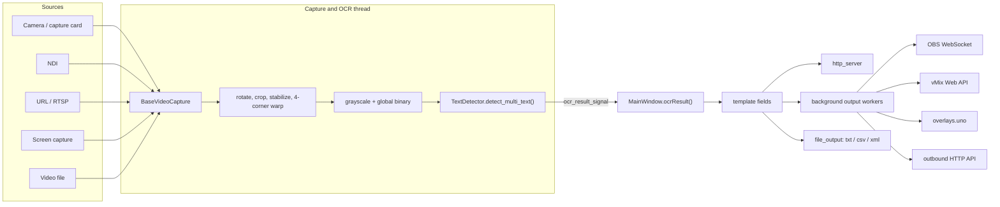

# Architecture
{: .no_toc }

  
On this page

  {: .text-delta }
1. TOC
{:toc}

## Overview

All application code is a flat set of modules in `src/` that import each other by bare module name (`from storage import fetch_data`), not as a package. Running `python src/main.py` puts `src/` on `sys.path`. The test configuration (`pythonpath = ["src"]` in `pyproject.toml`) does the same for pytest.

## Frame → OCR → outputs pipeline

1. **Source discovery**: `get_camera_info.py` enumerates devices per OS (a DirectShow extension in `src/win32DeviceEnum` on Windows, AVFoundation on macOS, `/dev/video*` on Linux) plus NDI sources (`ndi.py`, via cyndilib) into `CameraInfo` objects. `CameraInfo.CameraType` distinguishes OpenCV devices, NDI, files, URLs and screen capture.
2. **Capture thread**: `source_view.ImageViewer` extends `camera_view.CameraView` (a `QGraphicsView`), which owns a `camera_thread.TimerThread` (a `QThread`). The thread chooses a `BaseVideoCapture` implementation:
   - `OpenCVVideoCaptureWithSettings` for cameras (DirectShow on Windows), files and URLs (FFmpeg),
   - `ndi.NDICapture` for NDI,
   - `screen_capture_source.ScreenCapture`, which resolves to the macOS or Windows implementation, or a dummy on Linux.
3. **Per-frame processing** in `TimerThread.run()`: rotate and crop (`FrameCropAndRotation`) → optional stabilization (`frame_stabilizer.py`, ORB features + affine warp) → optional perspective homography from the user's four corners → grayscale plus a global Otsu binary → `TextDetector.detect_multi_text()`. The loop reads frames at up to ~33 fps, runs OCR at the "detection cadence" (Detections / s), and emits a preview frame about once per second.
4. **OCR** (`tesseract.py`): `TextDetector` holds a single `tesserocr.PyTessBaseAPI` guarded by a lock, using PSM 8 (single word) and the models in `tesseract/tessdata/*.traineddata`. For each box it applies the preprocessing selected by the box's settings (binarization, cleanup, vscale, skew, dilate, invert, skip-similar, autocrop, rescale, W/H normalization, dot counter), sets a character whitelist from the `FieldType`, then post-filters the text (format regex, confidence threshold, smoothing, leading zeros, ordinal suffix). Results are `TextDetectionResult` objects, which `TimerThread` wraps into `TextDetectionTargetWithResult` (adding the `SameNoChange` state when "update on change" is on) and emits through `ocr_result_signal`.
5. **Fan-out** (`MainWindow.ocrResult` in `mainwindow.py`, on the GUI thread):
   - evaluates template fields (`template_fields.py` substitutes `{{Box Name}}`),
   - updates the field table,
   - publishes to `http_server.update_http_server`, the outbound API (`api_output.update_out_api`), the vMix and UNO updaters (owned by `vmix_ui_handler` / `uno_ui_handler`), OBS text sources (`obs_websocket.update_text_source`) and `file_output` (txt/csv/xml).
   - Network outputs hand their payload to background workers (`output_worker.py`) that keep only the latest value per target and use request timeouts, so the GUI thread never blocks on I/O. File output is state-based and atomic.

`mainwindow.py` is the central hub. It wires the UI, sources, the OBS connection, import/export and language/appearance switching.

## HTTP server

`http_server.py` runs a FastAPI app under uvicorn in a background thread, bound to `0.0.0.0` on the port given by `--port` (default 18099). The API is `start_http_server(port)`, `stop_http_server(timeout)` and `update_http_server(results)`. The server is stopped in-process (uvicorn's `should_exit` plus a bounded join) when the app quits. There is no HTTP shutdown endpoint. See the [HTTP Server API](../http_server.md) for the public endpoints.

## Detection boxes and their settings

- `TextDetectionTarget` (in `text_detection_target.py`) subclasses `QRectF` and adds a `name`, a `settings` dict and optional `mini_rects`.
- All boxes live in `storage.TextDetectionTargetMemoryStorage`, a singleton `QObject` whose `data_changed` signal drives both the field table and the viewer overlay (`resizable_rect.py`).
- The standard boxes and the format presets are defined in `defaults.py`. Every other name is a custom box.

**Adding a new per-box setting** requires changes in several places:

1. `defaults.normalize_settings_dict`: the canonical key and its default.
2. `storage.TextDetectionTargetMemoryStorage.getBoxesForStorage`: the serialized key list.
3. `box_settings_ui_handler.py`, plus the widget in `src/mainwindow.ui` (then regenerate the UI, see [Building from Source](building.md#compile-the-ui-files)).
4. `tesseract.py`, if the setting affects processing.
5. `docs/box-settings.md`, so users know what it does.

## Persistence and settings pub/sub

`storage.py` keeps app state as named documents in a JSON file in the user data directory (`platformdirs.user_data_dir("scoresight")`, overridable with `SCORESIGHT_DATA_DIR`). The file is `scoresight.json`, or `scoresight-<profile>.json` with `--profile` / `SCORESIGHT_PROFILE`.

- `store_data(file, key, value)`, `fetch_data(file, key, default)` and `remove_data(file, key)` read and write documents. Writes are atomic (temporary file + `os.replace`) and thread-safe. A corrupt file is backed up as `<name>.corrupt-<timestamp>` instead of being overwritten silently.
- `subscribe_to_data(file, key, callback)` registers a callback that runs after a successful `store_data` of that key, **synchronously, on whichever thread stored the value**. `unsubscribe_from_data(file, key, callback)` removes it. Components that are created and destroyed (captures, threads, output updaters) must unsubscribe, or they stay alive through the callback list.
- Many components read their settings once at construction and then stay current through subscriptions.

Logging goes through `from sc_logging import logger`. It writes to `platformdirs.user_log_dir("scoresight")` (overridable with `SCORESIGHT_LOG_DIR`) and keeps the most recent log files. `SCORESIGHT_DEBUG` mirrors the log to the console.

## Versioning and resources

- `src/version.py` (`__version__`) is the single source of truth for the version: the window title, About dialog, update check, PyInstaller spec, installer and release workflow all read it.
- `resource_path(...)` (`src/resource_path.py`) resolves bundled resources (`tesseract/`, `translations/`, `icons/`, `obs_data/`). When frozen, it uses PyInstaller's `sys._MEIPASS`. From source, it resolves against the repository root, so `python src/main.py` works from any working directory.

## Module map

| Module | Responsibility |
|---|---|
| `main.py` | Entry point: CLI options (`--profile`, `--port`, `--self-test`), QApplication, translation, appearance, main window |
| `mainwindow.py` | Main window: UI wiring, sources, outputs fan-out, OBS connection, import/export, menus |
| `version.py` | `__version__` |
| `defaults.py` | Field types, format presets, standard boxes, `normalize_settings_dict` |
| `storage.py` | JSON settings storage, pub/sub, box storage singleton |
| `sc_logging.py` | Logger setup and log rotation |
| `resource_path.py` | Locating bundled resources (frozen or from source) |
| `camera_info.py`, `get_camera_info.py` | Source descriptions and device enumeration |
| `base_video_capture.py` | Common capture interface |
| `camera_thread.py` | Capture + processing + OCR loop (`TimerThread`), OpenCV capture with settings, crop/rotation |
| `camera_view.py`, `source_view.py` | Viewer widgets: preview, OSD, zoom/pan, 4-corner selection, box overlay |
| `resizable_rect.py` | Interactive box items (move, resize, labels, per-character sub-boxes) |
| `frame_stabilizer.py` | ORB-based frame stabilization |
| `ndi.py` | NDI discovery and capture (cyndilib) |
| `screen_capture_source*.py` | Screen/window capture for macOS and Windows (dummy on Linux) |
| `video_settings.py` | Video Settings dialog (FPS, resolution, FOURCC, backend) |
| `tesseract.py` | `TextDetector`: preprocessing, Tesseract OCR, post-filters |
| `text_detection_target.py` | Box and result types, per-character smoother |
| `template_fields.py` | `{{Box Name}}` template evaluation |
| `box_settings_ui_handler.py` | Binds the per-box settings panel to the selected box |
| `http_server.py` | Built-in FastAPI/uvicorn HTTP server |
| `output_worker.py` | Background, latest-value-wins sender used by the network outputs |
| `api_output.py` | Outbound HTTP API (JSON/XML/CSV/GET) |
| `obs_websocket.py` | OBS WebSocket client helpers and scene creation |
| `vmix_output.py`, `vmix_ui_handler.py` | vMix Web API sender and tab |
| `uno_output.py`, `uno_ui_handler.py` | overlays.uno sender and tab |
| `file_output.py` | Text, CSV and XML file output |
| `ocr_training_data.py`, `training_dojo.py` | Training data collection and the annotation tool |
| `log_view.py` | Log viewer dialog |
| `update_check.py` | Update check |
| `ui_*.py` | **Generated** from `*.ui` by `scripts/compile_ui.py`. Never edit by hand |

## Packaging gotchas

- `scoresight.spec` defines what PyInstaller bundles. Data files (icons, tessdata models, translations, OBS assets) must be included there, or they will be missing from the built app even though everything works from source.
- Platform-specific modules (`screen_capture_source_windows.py`, `screen_capture_source_mac.py`, the win32 extension) are only included on their platform.
- Load bundled resources through `resource_path(...)`, never through paths relative to the current directory.
- `tesserocr` must be imported first from the main thread (newer versions install signal handlers). Keep the module-level import chain from `main.py`.
