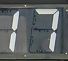
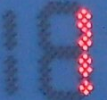
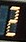
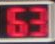
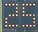

# Which OCR engine should ScoreSight use? (2026-10-11)

A measurement-only comparison of ScoreSight's Tesseract setup with every other engine that has an adapter in `ocr_eval/`, on 2,320 real scoreboard crops from 358 photos (or groups of photos of one board) from two independent sources, plus a synthetic control. The primary measure is what a ScoreSight user boxes: the Commons fields and TextOCR's scoreboard values, 2,040 crops from 305 photos, also on their test split alone. Everything here is recomputed from the files in this folder by `tables.py` (see [Reproducing](#reproducing)).

## Summary

- **PaddleOCR's PP-OCRv6 recognizers beat every other engine, by a wide margin.** With the decoder limited to the box's characters (`-wl`), `v6-small` reads **95.1%** of the user-relevant crops exactly (95% CI 93.8–96.3, photos resampled), `v6-medium` 96.4% and `v6-tiny` 90.0%; on the Commons fields alone (1,044 boxes drawn the way a user draws them, 139 photos) `small` reads 94.8% (92.6–96.7) and `tiny` 88.1% (85.1–91.1). ScoreSight's current default (`tesseract:scoreboard_general`) reads **31.2%** of the user-relevant crops, the best of the 8 untuned Tesseract presets (`eng-nobin`) 45.9%, and Tesseract with settings tuned on the dev split (`tesseract:tuned`) 56.8%. The best other engine, OnnxTR's PARSeq, reads 86.4% at 3 times `small`'s CPU cost.
- **Is PP-OCR `tiny` the clear winner? Over Tesseract and everything at its cost, yes; over `small`, no.** `tiny` reads 33 points more than the tuned Tesseract and 11 more than OnnxTR's CRNN. But `v6-small-wl` is significantly more accurate on **both** real datasets, also with photos resampled: +4.0 points on TextOCR (95% CI +2.5 to +5.7) and +6.7 on Commons (+4.3 to +9.6), p < 10⁻⁴ for each, with half of `tiny`'s errors (121 against 242 of 2,320 crops). `tiny` falls off where scoreboards are hard: clocks (79–80% against 84–94%) and team names on Commons (78% against 90%), and, on fewer photos (8 to 29 each, so exploratory), bulb boards and LCDs. `tiny`'s advantage is cost: 3.0–3.5 ms of CPU per crop against 16.5–17.
- **The small vision-language models lose on cost, not accuracy.** The best of them, Qwen3-VL-2B with the whitelist decoder, and `v6-small-wl` are statistically tied on TextOCR (93.5% against 94.7%; 47 against 63 crops that only one of them reads, McNemar p = 0.15, p = 0.20 with photos resampled). `v6-medium-wl` beats both Qwen models, and `v6-small-wl` beats Qwen3.5-0.8B (p ≤ 0.007 with photos). The VLMs took 0.4–0.9 s per crop, measured with fp32 eager PyTorch on 24 threads (no int8, llama.cpp or OpenVINO), which likely overstates their cost several times; but even 10 times faster, the default 50 crops a second would need 2 to 4.5 seconds of that per second.
- **Recommendation: add PP-OCRv6 with the whitelist decoder as an engine next to Tesseract, and default to `tiny` until `small` has been measured on a laptop-class CPU, with `small` as the accuracy option (or choose between them automatically from the measured OCR time); run OCR off the capture thread; keep Tesseract.** At the default load (10 boxes read 5 times a second) `small` uses 83–87% of one i9-14900K performance core, on the capture thread; on one of the same CPU's efficiency cores it needs 213%, and a laptop core about half as fast as this desktop's would need about 170%: the capture thread couldn't keep up. `tiny` needs 15–17% of the performance core (43% of the efficiency core). Give the recognizer the raw colour crop, not ScoreSight's binarized patch (which costs 28–44 points). Details in [Recommendation](#recommendation).
- **Tesseract's own defaults leave points on the table.** Both models tried read better without the default dilation (on the dev split, `eng-nobin` 50.7% instead of 41.7%, `scoreboard_general` 33.4% instead of 24.9%); the tuned variant (no binarization, no dilation, dark text on light, 24 px) is +11 points over `eng-nobin` on both real datasets. Worth changing for new boxes, after a check on video; not changed here.

## Methodology

- **Harness.** `python -m ocr_eval run` (harness version 1). Every engine reads every crop of every dataset once, as a fresh box: the crop is a raw colour image as a user's box would cut it from the frame, the engine gets the crop and the box's field type, and returns its reading and a confidence. Engines return their raw reading; the harness applies ScoreSight's post-filter itself (the box's character whitelist and format regex, from `src/defaults.py`), so every engine is also scored as ScoreSight would publish it ("post-filter"). A Commons crop whose role has one of ScoreSight's preset boxes (Home/Away Score, Time, Period, Home/Away Fouls, Shot Clock) is filtered with that preset, as a user would box it; the others with their field type's box.
- **Scoring.** Exact match after Unicode NFKC and removing spaces (case-insensitive for text); a clock's separator must match (`12:34` ≠ `12.34` ≠ `1234`). Character error rate (CER) = edits / ground-truth characters.
- **Statistics.** The crops aren't independent: a photo gives several, and crops of one photo tend to be read alike. The 2,320 real crops come from 358 clusters: TextOCR's 219 photos, and Commons' 186 photos in 139 groups (photos of the same board and game count as one). Every interval on the real datasets is a 95% percentile bootstrap that resamples these photos (2,000 resamples, fixed seed), not the crops; `synthetic_7seg`, which has no photos, gets Wilson intervals. Paired comparisons give McNemar's exact test (which treats crops as independent) and a sign-flip test on the per-photo differences (20,000 random sign patterns, so it can't go below 5×10⁻⁵, shown as "<1e-4"); where the two disagree, the photo test is the one to believe. Table headers give each group's crops and photos; the breakdowns by display technology rest on as few as 8 to 29 photos for flip cards, LCDs, video boards and bulbs, so their differences are exploratory. The report shows 55 paired comparisons and corrects none of them for multiplicity (see [Paired tests](#paired-tests)).
- **Primary measure.** The user-relevant crops: all Commons fields, and TextOCR's scoreboard values, without TextOCR's static captions (words printed or lit on the boards: BALL, PERIOD, R, H, E, OUT, FOULS...) and without the photos TextVQA tagged only "Digital clock" (clock radios, thermometers, appliance displays). The test split of those is the cleanest single number: nothing was tuned on it.
- **Engines and variants.** Tesseract: ScoreSight's real `TextDetector` with each bundled model and the box presets' default settings, with and without binarization: the best of these 8 untuned presets is `eng-nobin` (dilation stays on in all of them, and none evens out light text on dark boards), and `tesseract:tuned` is the pipeline with settings chosen on the dev split (see [Tesseract with tuned settings](#tesseract-with-tuned-settings)). PP-OCR: PP-OCRv6 `tiny`, `small`, `medium` raw and `-wl`, PP-OCRv5 `en-mobile-wl` (and, for the preprocessing question, `-gray`). OnnxTR: every `-wl` model plus raw PARSeq. Windows OCR: its best variant (`tile-digits`). VLMs: not re-run; their committed results (`ocr_eval/baselines/vlm/`) are reference rows on `textocr_scoreboards` and `synthetic_7seg`.
- **Machine and runs.** Windows 11 Pro (build 26200), Intel Core i9-14900K (8 performance + 16 efficiency cores, 32 threads), 64 GB, Python 3.13.2, onnxruntime 1.31.0, onnxtr 0.9.0, tesserocr 2.10.0 (Tesseract 5.5.2), pywinrt 3.2.1. The accuracy run (`results.json.gz`) read everything in one process on all cores (predictions don't depend on the thread count); it was re-run after the Commons label fix and gave the same texts and confidences as before on every crop. Its predictions equal the committed references crop for crop on 68 of the 69 runs they share (`baselines/tesseract.json` and `tesseract-commons.json` were made on Linux; `ppocr`, `onnxtr` and `windows-ocr` on Windows); the exception is one Commons crop of `tesseract:eng`, which Tesseract 5.5.2 on Windows and 5.5.1 on Linux read differently, both wrong. The PP-OCR variants CI checks (`v6-small-wl`, `v6-tiny-wl`) gave the same texts and confidences on Linux (WSL Ubuntu, the manylinux onnxruntime 1.31.0 wheel) as on Windows for all 4,752 predictions, so their CI baseline (`baselines/ppocr-ci.json`, made on Linux) holds on both.
- **Timing.** Other sessions were using this machine. The timing runs (`latency.json.gz`) read a stratified sample of 300 `commons_scoreboards` crops (seed 0), one crop per call (all 300) and in batches of 16, after 3 warm-up calls, on one onnxruntime thread and on all cores, **3 repeats**, while sampling every 0.25 s how busy the rest of the machine was. Each row below is the repeat during which the rest of the machine was **least** busy (3–9% of its CPU, given in the tables); on one thread the repeats' medians were within 3% of each other for every PP-OCR model and within 8% for every engine. The PP-OCRv6 models were also timed on 2 and 4 threads, and with onnxruntime's thread spinning off (2 repeats, 7–12% background load). CPU time is the process's CPU time (all its threads) per crop, from `time.process_time()`, which on Windows advances in 15.6 ms ticks: over 300 crops that is 0.05–0.1 ms per crop, a few percent of Tesseract's 2 ms and under 1% of `small`'s 17 ms. The timing processes weren't pinned to a core, so Windows could run them on a performance or an efficiency core; a later spot check (`pinned.json.gz`, [below](#latency-cpu-time-and-the-cpu-budget)) pinned to one performance core gave the same CPU times within 0.3 ms, so the tables' figures are performance-core figures.

## Datasets

| Dataset | Crops | Photos | Splits | Field types | Display technologies | Labels | License |
|---|---:|---|---|---|---|---|---|
| `textocr_scoreboards` | 1,276 | 219 (Open Images, tagged "Scoreboard" or "Digital clock" by TextVQA) | dev 268, test 1,008 | number 948, text 185, clock 139, other 4 | dot matrix 458, 7-segment 353, printed 168, flip 94, LCD 74, video board 69, bulb 60 | TextOCR's **human** transcriptions; which words to keep, and display technologies, reviewed with a model's help | CC BY 2.0 photos (checked per photo), CC BY 4.0 transcriptions |
| `commons_scoreboards` | 1,044 | 186 (Wikimedia Commons), in 139 groups of the same board and game | dev 142, test 902 | number 359, score 309, clock 156, text 134, period 78, other 8 | 7-segment 411, dot matrix 304, video board 216, bulb 54, flip 51, printed 8 | **`model-assisted-unverified`**: boxes drawn and texts transcribed with a model's help (Claude), every field checked zoomed in and on contact sheets; not yet checked by a person | Per photo: CC BY-SA (747 crops), CC BY (224), CC0 (46), public domain (27) |
| `synthetic_7seg` | 56 | – | – | score 28, clock 20, period 8 | 7-segment LED and LCD | synthetic | CC0 |

The two real sets differ in a useful way: TextOCR's crops are single words cut around TextOCR's word boxes (a "number" is often a lone digit; 619 crops are one character), while each Commons crop is one scoreboard field boxed the way a ScoreSight user would box it, with its role (home score, game clock, shot clock, period...). TextOCR also holds words a user never boxes: 183 static captions (BALL, PERIOD, R, H, E, OUT, FOULS...) and 97 crops of photos tagged only "Digital clock" (clock radios, thermometers, appliance displays); the [primary results](#primary-results) leave them out. No engine was trained on either set for this evaluation; only Windows OCR's preprocessing geometry (TextOCR's `dev` split) and `tesseract:tuned`'s settings (both `dev` splits) were chosen on them.

Label quality: TextOCR's transcriptions are human; the Commons labels are not yet human-verified. Only the Commons crops the engines disagreed on were checked again: the 32 where three or more of the strongest engines agreed on a reading other than the label. One of those labels was still wrong (`cm1368756_away_score`, a 5×7 dot-matrix `19` labelled `18`, found by a methodology review and fixed); most of the others are engines reading unlit segments as lit, a neighbour's digit, or letters outside ASCII. No other label has been re-checked, the human review pass is still to do, and residual label errors would lower every engine alike. `synthetic_7seg` is a control: every PP-OCRv6 `-wl` model reads all of it.

**Contamination.** PaddleOCR doesn't publish its training data, and the PP-OCRv6 model card lists "digital displays" and "dot-matrix characters" among its scenarios. TextOCR (on Open Images photos) is part of the standard real-data training mixes for text recognizers, so PP-OCRv6 may well have been trained on these very TextOCR words, and that crops of TextOCR's train and val photos read alike (`v6-small-wl` 94.6% and 95.8%) proves nothing. The evidence that the numbers carry over rests on `commons_scoreboards` instead: photos that aren't in those mixes, cut by boxes and labelled for this evaluation, on which `small` reads 94.8%, as on TextOCR. The synthetic control is read perfectly, and the only fully clean measure is new footage (see [What to measure next](#what-to-measure-next)).

## Primary results

Exact match on the crops a ScoreSight user boxes (Commons' fields and TextOCR's scoreboard values) and on Commons alone, on the test split and on all crops; 95% intervals with photos resampled.

<!-- tables:primary -->
| Engine:variant | User-relevant, test (n=1686, 250 photos) | User-relevant, all (n=2040, 305 photos) | Commons, test (n=902, 120 photos) | Commons, all (n=1044, 139 photos) |
|---|---:|---:|---:|---:|
| `ppocr:v6-medium-wl` | 96.3 (95.2–97.5) | 96.4 (95.4–97.4) | 95.9 (94.3–97.3) | 96.2 (94.7–97.4) |
| `ppocr:v6-small-wl` | 95.0 (93.4–96.5) | 95.1 (93.8–96.3) | 94.1 (91.7–96.3) | 94.8 (92.6–96.7) |
| `ppocr:v6-tiny-wl` | 89.8 (87.5–92.0) | 90.0 (88.0–92.0) | 87.4 (83.8–90.6) | 88.1 (85.1–91.1) |
| `ppocr:v6-tiny` | 86.5 (84.0–89.1) | 87.1 (84.7–89.3) | 84.8 (81.0–88.4) | 85.9 (82.5–89.1) |
| `ppocr:v5-en-mobile-wl` | 91.8 (89.5–93.9) | 92.3 (90.4–94.1) | 89.7 (86.0–93.0) | 90.6 (87.4–93.5) |
| `onnxtr:parseq-wl` | 86.5 (83.8–89.0) | 86.4 (84.0–88.4) | 84.6 (80.8–88.3) | 85.4 (82.0–88.7) |
| `onnxtr:crnn_mobilenet_v3_small-wl` | 79.2 (76.0–82.4) | 79.3 (76.4–81.9) | 78.2 (74.1–82.3) | 78.8 (75.0–82.8) |
| `windows-ocr:tile-digits` | 23.0 (19.8–26.5) | 23.0 (19.9–26.3) | 20.7 (16.7–25.0) | 22.8 (18.8–27.6) |
| `tesseract:tuned` | 56.3 (52.4–60.1) | 56.8 (53.5–60.2) | 56.4 (51.3–61.6) | 58.0 (53.2–63.1) |
| `tesseract:eng-nobin` | 45.8 (42.1–49.6) | 45.9 (42.4–49.4) | 51.7 (46.7–56.7) | 52.8 (48.4–57.5) |
| `tesseract:scoreboard_general-nobin` | 35.0 (30.9–39.2) | 33.8 (30.0–37.5) | 45.2 (39.3–51.2) | 44.4 (38.8–49.7) |
| `tesseract:scoreboard_general` | 31.9 (28.2–35.8) | 31.2 (27.8–34.5) | 40.7 (35.4–46.5) | 40.5 (35.6–45.4) |
<!-- /tables:primary -->

Each part of the real datasets on its own (exact %, all splits); the VLMs ran on TextOCR only:

<!-- tables:subgroups -->
| Engine:variant | Commons boxes (n=1044, 139 photos) | TextOCR scoreboard values (n=996, 166 photos) | TextOCR captions (words) (n=183, 85 photos) | TextOCR digital-clock photos (n=97, 50 photos) |
|---|---:|---:|---:|---:|
| `ppocr:v6-medium-wl` | 96.2 | 96.7 | 97.8 | 87.6 |
| `ppocr:v6-small-wl` | 94.8 | 95.5 | 96.7 | 83.5 |
| `ppocr:v6-tiny-wl` | 88.1 | 92.1 | 92.3 | 74.2 |
| `ppocr:v6-tiny` | 85.9 | 88.3 | 92.3 | 74.2 |
| `ppocr:v5-en-mobile-wl` | 90.6 | 94.1 | 95.1 | 76.3 |
| `onnxtr:parseq-wl` | 85.4 | 87.3 | 92.3 | 53.6 |
| `onnxtr:crnn_mobilenet_v3_small-wl` | 78.8 | 79.7 | 83.1 | 44.3 |
| `windows-ocr:tile-digits` | 22.8 | 23.3 | 47.5 | 7.2 |
| `tesseract:tuned` | 58.0 | 55.5 | 49.2 | 23.7 |
| `tesseract:eng-nobin` | 52.8 | 38.8 | 30.6 | 16.5 |
| `tesseract:scoreboard_general-nobin` | 44.4 | 22.6 | 0.0 | 12.4 |
| `tesseract:scoreboard_general` | 40.5 | 21.4 | 0.0 | 11.3 |
| `qwen-vl:qwen3-vl-2b-wl` (VLM, reference) | – | 92.9 | 96.7 | 93.8 |
| `qwen-vl:qwen3.5-0.8b-wl` (VLM, reference) | – | 91.2 | 95.1 | 88.7 |
| `smolvlm:smolvlm-256m-wl` (VLM, reference) | – | 69.4 | 80.9 | 37.1 |
<!-- /tables:subgroups -->

- The PP-OCR ranking is the same on every part and on the test split (`medium` > `small` > `v5-en-mobile` > `tiny`), and every PP-OCR model is far ahead of every Tesseract variant.
- TextOCR's captions are easy for PP-OCR and PARSeq (92–98%) and impossible for the scoreboard models (0%: they never output a letter); the digital-clock photos (mostly LCDs) are the hardest part for every other engine except the VLMs. Leaving both out moves the PP-OCR models by under a point and the app's default Tesseract from 27.9% to 31.2%.

## Leaderboards

Exact match (95% CI, photos resampled), CER, empty readings and post-filter exact match, per dataset; every engine of the accuracy run plus the VLM reference rows. "Post-filter" is lower than exact when ScoreSight's formats reject a correct reading: soccer clocks past 59 minutes (`89:41`, `90:00`), `0:00.0`, periods 0 and 5, a shot clock shown as one digit (the Shot Clock preset takes `00` to `39`), and letters outside the whitelist.

<!-- tables:leaderboards -->
#### textocr_scoreboards (n=1276, 219 photos)

| Engine:variant | Exact % (95% CI) | CER % | Empty % | Post-filter % |
|---|---:|---:|---:|---:|
| `ppocr:v6-medium-wl` | 96.2 (94.8–97.3) | 2.0 | 0.1 | 95.7 |
| `ppocr:v6-small-wl` | 94.7 (93.3–96.0) | 3.0 | 0.1 | 94.4 |
| `ppocr:v6-medium` | 94.1 (92.5–95.6) | 3.2 | 0.1 | 94.0 |
| `qwen-vl:qwen3-vl-2b-wl` (VLM, reference) | 93.5 (91.8–95.1) | 4.9 | 0.0 | 92.9 |
| `qwen-vl:qwen3-vl-2b` (VLM, reference) | 93.0 (91.2–94.7) | 5.2 | 0.0 | 92.6 |
| `ppocr:v5-en-mobile-wl` | 92.9 (91.1–94.5) | 3.9 | 0.5 | 92.5 |
| `ppocr:v6-small` | 92.0 (90.1–93.7) | 4.6 | 0.0 | 91.8 |
| `qwen-vl:qwen3.5-0.8b-wl` (VLM, reference) | 91.5 (89.2–93.8) | 5.6 | 0.0 | 91.1 |
| `qwen-vl:qwen3.5-0.8b` (VLM, reference) | 91.3 (89.0–93.5) | 5.8 | 0.0 | 90.8 |
| `ppocr:v6-tiny-wl` | 90.8 (88.6–92.7) | 5.8 | 2.0 | 90.4 |
| `ppocr:v6-tiny` | 87.8 (85.2–90.1) | 8.0 | 1.3 | 87.5 |
| `onnxtr:parseq-wl` | 85.5 (82.9–87.9) | 9.3 | 0.2 | 85.3 |
| `onnxtr:parseq-int8-wl` | 85.0 (82.1–87.5) | 9.4 | 0.2 | 84.8 |
| `onnxtr:vitstr_small-wl` | 82.7 (79.3–85.5) | 10.7 | 0.2 | 82.4 |
| `onnxtr:vitstr_small-int8-wl` | 82.3 (79.0–85.2) | 11.0 | 0.3 | 82.0 |
| `onnxtr:crnn_mobilenet_v3_small-wl` | 77.5 (73.7–80.8) | 15.9 | 3.1 | 77.4 |
| `onnxtr:viptr_tiny-wl` | 74.5 (70.6–78.2) | 17.5 | 2.4 | 74.3 |
| `onnxtr:parseq` | 74.4 (70.5–78.1) | 18.1 | 0.0 | 74.6 |
| `smolvlm:smolvlm-256m-wl` (VLM, reference) | 68.6 (64.2–72.6) | 25.0 | 0.0 | 68.3 |
| `smolvlm:smolvlm-256m` (VLM, reference) | 67.8 (63.4–71.7) | 58.1 | 0.0 | 68.1 |
| `onnxtr:crnn_mobilenet_v3_small-int8-wl` | 57.0 (52.0–61.9) | 36.3 | 6.3 | 57.0 |
| `tesseract:tuned` | 52.2 (48.1–56.4) | 36.3 | 7.2 | 52.2 |
| `tesseract:eng-nobin` | 35.9 (32.0–39.9) | 55.6 | 20.3 | 35.9 |
| `tesseract:eng` | 30.1 (25.8–34.5) | 63.9 | 19.6 | 30.1 |
| `windows-ocr:tile-digits` | 25.5 (21.6–29.8) | 65.5 | 62.9 | 25.9 |
| `tesseract:scoreboard_general-nobin` | 18.6 (15.5–21.8) | 83.2 | 10.0 | 18.6 |
| `tesseract:scoreboard_general` | 17.6 (14.7–20.7) | 84.8 | 7.3 | 17.6 |
| `tesseract:scoreboard_general_large` | 14.9 (12.4–17.6) | 88.1 | 7.4 | 14.9 |
| `tesseract:scoreboard_general_large-nobin` | 14.8 (12.0–17.8) | 87.1 | 9.3 | 14.8 |
| `tesseract:daktronics` | 8.9 (7.0–10.8) | 95.5 | 7.2 | 8.9 |
| `tesseract:daktronics-nobin` | 7.6 (5.9–9.4) | 95.9 | 9.1 | 7.6 |

#### commons_scoreboards (n=1044, 139 photos)

| Engine:variant | Exact % (95% CI) | CER % | Empty % | Post-filter % |
|---|---:|---:|---:|---:|
| `ppocr:v6-medium-wl` | 96.2 (94.7–97.4) | 2.0 | 0.1 | 94.5 |
| `ppocr:v6-small-wl` | 94.8 (92.6–96.7) | 2.5 | 0.5 | 93.2 |
| `ppocr:v6-medium` | 94.3 (91.6–96.5) | 2.8 | 0.1 | 93.3 |
| `ppocr:v6-small` | 93.8 (91.0–96.1) | 3.0 | 0.1 | 92.6 |
| `ppocr:v5-en-mobile-wl` | 90.6 (87.4–93.5) | 5.4 | 1.7 | 89.0 |
| `ppocr:v6-tiny-wl` | 88.1 (85.1–91.1) | 7.1 | 1.9 | 86.6 |
| `ppocr:v6-tiny` | 85.9 (82.5–89.1) | 8.3 | 1.1 | 84.8 |
| `onnxtr:parseq-wl` | 85.4 (82.0–88.7) | 8.3 | 1.1 | 84.0 |
| `onnxtr:parseq-int8-wl` | 84.7 (81.3–87.8) | 9.0 | 1.1 | 83.2 |
| `onnxtr:vitstr_small-int8-wl` | 82.9 (80.0–86.0) | 9.8 | 0.3 | 81.5 |
| `onnxtr:vitstr_small-wl` | 82.2 (78.9–85.5) | 10.1 | 0.4 | 80.8 |
| `onnxtr:crnn_mobilenet_v3_small-wl` | 78.8 (75.0–82.8) | 14.0 | 3.1 | 77.4 |
| `onnxtr:parseq` | 71.6 (67.0–76.6) | 18.1 | 0.0 | 70.5 |
| `onnxtr:viptr_tiny-wl` | 70.2 (65.4–75.5) | 20.4 | 4.2 | 69.2 |
| `onnxtr:crnn_mobilenet_v3_small-int8-wl` | 66.4 (61.9–70.8) | 23.8 | 2.8 | 65.4 |
| `tesseract:tuned` | 58.0 (53.2–63.1) | 29.3 | 5.2 | 57.3 |
| `tesseract:eng-nobin` | 52.8 (48.4–57.5) | 34.6 | 8.5 | 52.0 |
| `tesseract:eng` | 47.4 (42.3–52.7) | 42.0 | 10.0 | 46.6 |
| `tesseract:scoreboard_general-nobin` | 44.4 (38.8–49.7) | 65.5 | 3.7 | 44.3 |
| `tesseract:scoreboard_general` | 40.5 (35.6–45.4) | 69.2 | 4.4 | 40.3 |
| `tesseract:scoreboard_general_large-nobin` | 37.4 (32.8–41.7) | 68.0 | 3.1 | 37.3 |
| `tesseract:scoreboard_general_large` | 33.9 (29.4–38.5) | 71.4 | 3.5 | 33.6 |
| `windows-ocr:tile-digits` | 22.8 (18.8–27.6) | 66.7 | 62.6 | 22.9 |
| `tesseract:daktronics-nobin` | 22.4 (19.1–26.0) | 79.5 | 5.1 | 22.2 |
| `tesseract:daktronics` | 20.2 (17.1–23.4) | 83.0 | 4.5 | 20.0 |

#### synthetic_7seg (n=56)

| Engine:variant | Exact % (95% CI) | CER % | Empty % | Post-filter % |
|---|---:|---:|---:|---:|
| `ppocr:v6-tiny` | 100.0 (93.6–100.0) | 0.0 | 0.0 | 100.0 |
| `ppocr:v6-tiny-wl` | 100.0 (93.6–100.0) | 0.0 | 0.0 | 100.0 |
| `ppocr:v6-small` | 100.0 (93.6–100.0) | 0.0 | 0.0 | 100.0 |
| `ppocr:v6-small-wl` | 100.0 (93.6–100.0) | 0.0 | 0.0 | 100.0 |
| `ppocr:v6-medium-wl` | 100.0 (93.6–100.0) | 0.0 | 0.0 | 100.0 |
| `ppocr:v6-medium` | 98.2 (90.6–99.7) | 1.4 | 0.0 | 100.0 |
| `ppocr:v5-en-mobile-wl` | 98.2 (90.6–99.7) | 0.7 | 0.0 | 98.2 |
| `qwen-vl:qwen3-vl-2b-wl` (VLM, reference) | 98.2 (90.6–99.7) | 0.7 | 0.0 | 98.2 |
| `qwen-vl:qwen3.5-0.8b` (VLM, reference) | 98.2 (90.6–99.7) | 0.7 | 0.0 | 98.2 |
| `qwen-vl:qwen3.5-0.8b-wl` (VLM, reference) | 98.2 (90.6–99.7) | 0.7 | 0.0 | 98.2 |
| `qwen-vl:qwen3-vl-2b` (VLM, reference) | 94.6 (85.4–98.2) | 2.1 | 0.0 | 94.6 |
| `onnxtr:parseq-wl` | 92.9 (83.0–97.2) | 2.8 | 0.0 | 92.9 |
| `onnxtr:parseq-int8-wl` | 91.1 (80.7–96.1) | 3.5 | 0.0 | 91.1 |
| `onnxtr:vitstr_small-int8-wl` | 82.1 (70.2–90.0) | 7.6 | 0.0 | 82.1 |
| `onnxtr:viptr_tiny-wl` | 82.1 (70.2–90.0) | 9.0 | 0.0 | 82.1 |
| `onnxtr:vitstr_small-wl` | 80.4 (68.2–88.7) | 8.3 | 0.0 | 80.4 |
| `onnxtr:parseq` | 73.2 (60.4–83.0) | 13.2 | 0.0 | 73.2 |
| `onnxtr:crnn_mobilenet_v3_small-wl` | 66.1 (53.0–77.1) | 15.3 | 1.8 | 66.1 |
| `tesseract:scoreboard_general` | 58.9 (45.9–70.8) | 33.3 | 0.0 | 58.9 |
| `smolvlm:smolvlm-256m-wl` (VLM, reference) | 55.4 (42.4–67.6) | 59.7 | 0.0 | 55.4 |
| `smolvlm:smolvlm-256m` (VLM, reference) | 51.8 (39.0–64.3) | 170.1 | 0.0 | 53.6 |
| `onnxtr:crnn_mobilenet_v3_small-int8-wl` | 50.0 (37.3–62.7) | 36.1 | 0.0 | 50.0 |
| `tesseract:eng-nobin` | 42.9 (30.8–55.9) | 34.0 | 0.0 | 42.9 |
| `tesseract:scoreboard_general_large` | 41.1 (29.2–54.1) | 41.0 | 0.0 | 41.1 |
| `tesseract:eng` | 39.3 (27.6–52.4) | 42.4 | 0.0 | 39.3 |
| `tesseract:scoreboard_general_large-nobin` | 37.5 (26.0–50.6) | 50.7 | 0.0 | 37.5 |
| `tesseract:scoreboard_general-nobin` | 35.7 (24.5–48.8) | 44.4 | 0.0 | 35.7 |
| `tesseract:tuned` | 33.9 (22.9–47.0) | 36.8 | 0.0 | 33.9 |
| `windows-ocr:tile-digits` | 10.7 (5.0–21.5) | 92.4 | 80.4 | 10.7 |
| `tesseract:daktronics-nobin` | 8.9 (3.9–19.3) | 72.2 | 0.0 | 8.9 |
| `tesseract:daktronics` | 3.6 (1.0–12.1) | 77.1 | 0.0 | 3.6 |

<!-- /tables:leaderboards -->

### Both real datasets together

<!-- tables:pooled -->
| Engine:variant | Both real datasets, exact % (n=2320, 358 photos) | Post-filter % | CER % | TextOCR % | Commons % | synthetic % |
|---|---:|---:|---:|---:|---:|---:|
| `ppocr:v6-medium-wl` | 96.2 (95.2–97.0) | 95.2 | 2.0 | 96.2 | 96.2 | 100.0 |
| `ppocr:v6-small-wl` | 94.8 (93.5–95.9) | 93.8 | 2.8 | 94.7 | 94.8 | 100.0 |
| `ppocr:v6-medium` | 94.2 (92.7–95.5) | 93.7 | 3.0 | 94.1 | 94.3 | 98.2 |
| `ppocr:v6-small` | 92.8 (91.2–94.3) | 92.2 | 3.8 | 92.0 | 93.8 | 100.0 |
| `ppocr:v5-en-mobile-wl` | 91.9 (90.0–93.5) | 90.9 | 4.6 | 92.9 | 90.6 | 98.2 |
| `ppocr:v6-tiny-wl` | 89.6 (87.7–91.2) | 88.7 | 6.4 | 90.8 | 88.1 | 100.0 |
| `ppocr:v6-tiny` | 86.9 (84.8–88.8) | 86.3 | 8.1 | 87.8 | 85.9 | 100.0 |
| `onnxtr:parseq-wl` | 85.5 (83.5–87.4) | 84.7 | 8.8 | 85.5 | 85.4 | 92.9 |
| `onnxtr:parseq-int8-wl` | 84.8 (82.7–86.8) | 84.1 | 9.2 | 85.0 | 84.7 | 91.1 |
| `onnxtr:vitstr_small-int8-wl` | 82.5 (80.3–84.6) | 81.8 | 10.4 | 82.3 | 82.9 | 82.1 |
| `onnxtr:vitstr_small-wl` | 82.5 (80.2–84.6) | 81.7 | 10.4 | 82.7 | 82.2 | 80.4 |
| `onnxtr:crnn_mobilenet_v3_small-wl` | 78.1 (75.5–80.6) | 77.4 | 15.0 | 77.5 | 78.8 | 66.1 |
| `onnxtr:parseq` | 73.1 (70.1–76.1) | 72.8 | 18.1 | 74.4 | 71.6 | 73.2 |
| `onnxtr:viptr_tiny-wl` | 72.5 (69.5–75.5) | 72.0 | 18.9 | 74.5 | 70.2 | 82.1 |
| `onnxtr:crnn_mobilenet_v3_small-int8-wl` | 61.2 (57.8–64.5) | 60.8 | 30.2 | 57.0 | 66.4 | 50.0 |
| `tesseract:tuned` | 54.8 (51.4–57.8) | 54.5 | 32.9 | 52.2 | 58.0 | 33.9 |
| `tesseract:eng-nobin` | 43.5 (40.2–46.9) | 43.1 | 45.3 | 35.9 | 52.8 | 42.9 |
| `tesseract:eng` | 37.9 (34.3–41.4) | 37.5 | 53.2 | 30.1 | 47.4 | 39.3 |
| `tesseract:scoreboard_general-nobin` | 30.2 (26.9–33.7) | 30.1 | 74.5 | 18.6 | 44.4 | 35.7 |
| `tesseract:scoreboard_general` | 27.9 (25.0–31.1) | 27.8 | 77.2 | 17.6 | 40.5 | 58.9 |
| `tesseract:scoreboard_general_large-nobin` | 25.0 (22.2–28.0) | 24.9 | 77.8 | 14.8 | 37.4 | 37.5 |
| `windows-ocr:tile-digits` | 24.3 (21.3–27.4) | 24.5 | 66.1 | 25.5 | 22.8 | 10.7 |
| `tesseract:scoreboard_general_large` | 23.4 (20.8–26.2) | 23.3 | 79.9 | 14.9 | 33.9 | 41.1 |
| `tesseract:daktronics-nobin` | 14.3 (12.3–16.3) | 14.2 | 87.9 | 7.6 | 22.4 | 8.9 |
| `tesseract:daktronics` | 14.0 (12.1–15.8) | 13.9 | 89.4 | 8.9 | 20.2 | 3.6 |
<!-- /tables:pooled -->

On the `test` split alone (the `dev` split is 18% of the crops; only Windows OCR's geometry and `tesseract:tuned`'s settings were chosen on it) the ranking and the numbers are the same:

<!-- tables:test-split -->
| Engine:variant | test split (n=1910, 289 photos) | dev split (n=410, 69 photos) |
|---|---:|---:|
| `ppocr:v6-medium-wl` | 96.1 (94.9–97.1) | 96.6 (94.8–98.1) |
| `ppocr:v6-small-wl` | 94.8 (93.3–96.1) | 94.9 (92.2–97.0) |
| `ppocr:v6-tiny-wl` | 89.5 (87.3–91.5) | 90.0 (86.1–93.3) |
| `ppocr:v6-tiny` | 86.6 (84.1–88.9) | 88.5 (83.9–92.2) |
| `ppocr:v5-en-mobile-wl` | 91.5 (89.3–93.3) | 93.7 (90.9–96.0) |
| `onnxtr:parseq-wl` | 85.8 (83.4–88.1) | 83.9 (78.8–88.2) |
| `onnxtr:crnn_mobilenet_v3_small-wl` | 78.5 (75.5–81.5) | 76.1 (69.7–82.1) |
| `windows-ocr:tile-digits` | 24.7 (21.4–28.0) | 22.4 (15.0–30.5) |
| `tesseract:tuned` | 54.9 (51.4–58.4) | 54.4 (46.4–62.3) |
| `tesseract:eng-nobin` | 43.9 (40.4–47.4) | 41.7 (33.8–49.2) |
| `tesseract:scoreboard_general-nobin` | 31.3 (27.4–35.3) | 25.1 (19.4–30.9) |
| `tesseract:scoreboard_general` | 28.5 (25.1–32.0) | 24.9 (19.0–31.0) |
<!-- /tables:test-split -->

### By field type (exact %)

<!-- tables:field-types -->
TextOCR:

| Engine:variant | number (n=948, 177 photos) | text (n=185, 87 photos) | clock (n=139, 110 photos) |
|---|---:|---:|---:|
| `ppocr:v6-medium-wl` | 97.0 | 97.8 | 89.2 |
| `ppocr:v6-small-wl` | 96.1 | 96.8 | 84.2 |
| `ppocr:v6-tiny-wl` | 92.4 | 92.4 | 79.1 |
| `ppocr:v6-tiny` | 88.9 | 92.4 | 75.5 |
| `ppocr:v5-en-mobile-wl` | 94.7 | 95.1 | 79.9 |
| `onnxtr:parseq-wl` | 89.0 | 92.4 | 54.7 |
| `onnxtr:crnn_mobilenet_v3_small-wl` | 82.2 | 83.2 | 40.3 |
| `windows-ocr:tile-digits` | 21.8 | 47.6 | 22.3 |
| `tesseract:tuned` | 57.7 | 49.7 | 19.4 |
| `tesseract:eng-nobin` | 40.6 | 30.3 | 12.2 |
| `tesseract:scoreboard_general-nobin` | 24.1 | 0.0 | 6.5 |
| `tesseract:scoreboard_general` | 23.0 | 0.0 | 4.3 |

Commons:

| Engine:variant | number (n=359, 81 photos) | score (n=309, 118 photos) | clock (n=156, 100 photos) | text (n=134, 65 photos) | period (n=78, 60 photos) |
|---|---:|---:|---:|---:|---:|
| `ppocr:v6-medium-wl` | 97.5 | 95.8 | 96.2 | 92.5 | 98.7 |
| `ppocr:v6-small-wl` | 96.1 | 94.8 | 94.2 | 90.3 | 97.4 |
| `ppocr:v6-tiny-wl` | 91.9 | 91.9 | 79.5 | 77.6 | 91.0 |
| `ppocr:v6-tiny` | 90.3 | 88.7 | 76.3 | 77.6 | 88.5 |
| `ppocr:v5-en-mobile-wl` | 92.2 | 92.9 | 84.6 | 87.3 | 92.3 |
| `onnxtr:parseq-wl` | 88.0 | 88.7 | 65.4 | 88.1 | 96.2 |
| `onnxtr:crnn_mobilenet_v3_small-wl` | 86.1 | 86.7 | 40.4 | 78.4 | 91.0 |
| `windows-ocr:tile-digits` | 21.7 | 19.1 | 25.6 | 39.6 | 7.7 |
| `tesseract:tuned` | 61.6 | 65.4 | 29.5 | 59.0 | 69.2 |
| `tesseract:eng-nobin` | 52.4 | 62.8 | 32.7 | 51.5 | 60.3 |
| `tesseract:scoreboard_general-nobin` | 59.3 | 54.0 | 17.9 | 0.0 | 71.8 |
| `tesseract:scoreboard_general` | 53.2 | 49.5 | 16.0 | 0.0 | 69.2 |

<!-- /tables:field-types -->

### By display technology (exact %, exploratory)

<!-- tables:display-techs -->
TextOCR:

| Engine:variant | dotmatrix (n=458, 81 photos) | led7 (n=353, 82 photos) | printed (n=168, 63 photos) | flip (n=94, 11 photos) | lcd (n=74, 29 photos) | broadcast (n=69, 9 photos) | bulb (n=60, 9 photos) |
|---|---:|---:|---:|---:|---:|---:|---:|
| `ppocr:v6-medium-wl` | 97.8 | 95.2 | 98.2 | 96.8 | 85.1 | 97.1 | 95.0 |
| `ppocr:v6-small-wl` | 95.6 | 94.6 | 97.0 | 96.8 | 79.7 | 95.7 | 96.7 |
| `ppocr:v6-tiny-wl` | 92.1 | 92.4 | 94.0 | 94.7 | 68.9 | 91.3 | 81.7 |
| `ppocr:v6-tiny` | 89.3 | 88.7 | 94.0 | 93.6 | 68.9 | 89.9 | 65.0 |
| `ppocr:v5-en-mobile-wl` | 94.1 | 91.8 | 96.4 | 97.9 | 75.7 | 92.8 | 93.3 |
| `onnxtr:parseq-wl` | 90.2 | 81.9 | 94.0 | 91.5 | 56.8 | 88.4 | 70.0 |
| `onnxtr:crnn_mobilenet_v3_small-wl` | 85.2 | 72.2 | 82.7 | 85.1 | 44.6 | 78.3 | 63.3 |
| `windows-ocr:tile-digits` | 31.9 | 13.6 | 43.5 | 23.4 | 4.1 | 39.1 | 11.7 |
| `tesseract:tuned` | 60.5 | 45.0 | 53.0 | 63.8 | 24.3 | 58.0 | 38.3 |
| `tesseract:eng-nobin` | 40.0 | 36.8 | 33.3 | 51.1 | 16.2 | 21.7 | 23.3 |
| `tesseract:scoreboard_general-nobin` | 16.2 | 33.7 | 2.4 | 14.9 | 9.5 | 2.9 | 28.3 |
| `tesseract:scoreboard_general` | 16.4 | 29.7 | 4.2 | 8.5 | 9.5 | 4.3 | 31.7 |

Commons:

| Engine:variant | led7 (n=411, 58 photos) | dotmatrix (n=304, 52 photos) | broadcast (n=216, 33 photos) | bulb (n=54, 8 photos) | flip (n=51, 9 photos) |
|---|---:|---:|---:|---:|---:|
| `ppocr:v6-medium-wl` | 95.6 | 96.1 | 99.1 | 88.9 | 96.1 |
| `ppocr:v6-small-wl` | 95.4 | 92.1 | 99.5 | 85.2 | 96.1 |
| `ppocr:v6-tiny-wl` | 90.3 | 85.5 | 92.1 | 64.8 | 92.2 |
| `ppocr:v6-tiny` | 88.6 | 83.2 | 90.7 | 59.3 | 86.3 |
| `ppocr:v5-en-mobile-wl` | 90.5 | 90.8 | 94.0 | 77.8 | 88.2 |
| `onnxtr:parseq-wl` | 83.0 | 83.6 | 95.8 | 66.7 | 90.2 |
| `onnxtr:crnn_mobilenet_v3_small-wl` | 74.7 | 77.0 | 92.1 | 57.4 | 86.3 |
| `windows-ocr:tile-digits` | 11.7 | 26.3 | 38.9 | 13.0 | 29.4 |
| `tesseract:tuned` | 47.9 | 57.2 | 79.6 | 38.9 | 72.5 |
| `tesseract:eng-nobin` | 45.0 | 50.3 | 72.7 | 37.0 | 62.7 |
| `tesseract:scoreboard_general-nobin` | 65.0 | 34.9 | 21.3 | 55.6 | 29.4 |
| `tesseract:scoreboard_general` | 59.4 | 31.2 | 19.4 | 55.6 | 23.5 |

<!-- /tables:display-techs -->

What the breakdowns say (the display technologies with fewer than 30 photos are exploratory: a single board can move them by several points):

- `v6-small-wl` reads every field type at 90% or better except TextOCR's clocks (84.2%); `v6-medium-wl` lifts those to 89.2%. Among the display technologies, `small` is lowest on TextOCR's LCDs (79.7%, 29 photos) and Commons' bulb boards (85.2%, 8 photos).
- `v6-tiny-wl` drops more than `small` on the hardest fields: clocks (79%) and text on Commons (77.6%, mostly team names on dot-matrix boards); its bulb (64.8% on Commons) and LCD (68.9%) drops point the same way but rest on few photos. It also returns nothing far more often (46 empty readings of 2,320, against 6 for `small`).
- Tesseract's scoreboard models are at their best on 7-segment and bulb digits (55–65% on Commons) and can't read words at all; `eng-nobin` and `tuned` are best on video boards (73% and 80% on Commons).

## Paired tests

Each row compares engine A with engine B on the same crops: "B only" counts the crops B reads and A doesn't, "A only" the reverse. "p (McNemar)" is the exact McNemar test, which treats the crops as independent; "Δ 95% CI (photos)" and "p (photos)" resample the photos and test the per-photo differences with random sign flips.

<!-- tables:mcnemar -->
| A → B | Crops | n | Photos | A % | B % | Δ points | Δ 95% CI (photos) | B only | A only | p (McNemar) | p (photos) |
|---|---|---:|---:|---:|---:|---:|---:|---:|---:|---:|---:|
| `ppocr:v6-tiny-wl` → `ppocr:v6-small-wl` | TextOCR | 1276 | 219 | 90.8 | 94.7 | +4.0 | +2.5 to +5.7 | 71 | 20 | 7.2e-8 | <1e-4 |
| `ppocr:v6-tiny-wl` → `ppocr:v6-small-wl` | Commons | 1044 | 139 | 88.1 | 94.8 | +6.7 | +4.3 to +9.6 | 90 | 20 | 8.6e-12 | <1e-4 |
| `ppocr:v6-tiny-wl` → `ppocr:v6-small-wl` | both real | 2320 | 358 | 89.6 | 94.8 | +5.2 | +3.7 to +6.7 | 161 | 40 | 2.1e-18 | <1e-4 |
| `ppocr:v6-small-wl` → `ppocr:v6-medium-wl` | TextOCR | 1276 | 219 | 94.7 | 96.2 | +1.4 | +0.4 to +2.4 | 33 | 15 | 0.013 | 0.011 |
| `ppocr:v6-small-wl` → `ppocr:v6-medium-wl` | Commons | 1044 | 139 | 94.8 | 96.2 | +1.3 | -0.1 to +3.0 | 29 | 15 | 0.049 | 0.153 |
| `ppocr:v6-small-wl` → `ppocr:v6-medium-wl` | both real | 2320 | 358 | 94.8 | 96.2 | +1.4 | +0.5 to +2.3 | 62 | 30 | 0.001 | 0.004 |
| `ppocr:v6-tiny-wl` → `ppocr:v6-medium-wl` | TextOCR | 1276 | 219 | 90.8 | 96.2 | +5.4 | +4.1 to +7.0 | 77 | 8 | 2.8e-15 | <1e-4 |
| `ppocr:v6-tiny-wl` → `ppocr:v6-medium-wl` | Commons | 1044 | 139 | 88.1 | 96.2 | +8.0 | +5.8 to +10.5 | 91 | 7 | 9.4e-20 | <1e-4 |
| `ppocr:v6-tiny-wl` → `ppocr:v6-medium-wl` | both real | 2320 | 358 | 89.6 | 96.2 | +6.6 | +5.3 to +8.0 | 168 | 15 | 6.6e-34 | <1e-4 |
| `ppocr:v6-tiny` → `ppocr:v6-tiny-wl` | TextOCR | 1276 | 219 | 87.8 | 90.8 | +3.0 | +2.0 to +4.1 | 38 | 0 | 7.3e-12 | <1e-4 |
| `ppocr:v6-tiny` → `ppocr:v6-tiny-wl` | Commons | 1044 | 139 | 85.9 | 88.1 | +2.2 | +1.2 to +3.4 | 24 | 1 | 1.5e-6 | 2.5e-4 |
| `ppocr:v6-tiny` → `ppocr:v6-tiny-wl` | both real | 2320 | 358 | 86.9 | 89.6 | +2.6 | +1.9 to +3.4 | 62 | 1 | 1.4e-17 | <1e-4 |
| `ppocr:v6-small` → `ppocr:v6-small-wl` | TextOCR | 1276 | 219 | 92.0 | 94.7 | +2.7 | +1.8 to +3.8 | 35 | 0 | 5.8e-11 | <1e-4 |
| `ppocr:v6-small` → `ppocr:v6-small-wl` | Commons | 1044 | 139 | 93.8 | 94.8 | +1.1 | +0.1 to +2.2 | 14 | 3 | 0.013 | 0.086 |
| `ppocr:v6-small` → `ppocr:v6-small-wl` | both real | 2320 | 358 | 92.8 | 94.8 | +2.0 | +1.3 to +2.7 | 49 | 3 | 1.0e-11 | <1e-4 |
| `ppocr:v6-tiny-wl` → `ppocr:v5-en-mobile-wl` | TextOCR | 1276 | 219 | 90.8 | 92.9 | +2.1 | +0.4 to +4.1 | 61 | 34 | 0.007 | 0.033 |
| `ppocr:v6-tiny-wl` → `ppocr:v5-en-mobile-wl` | Commons | 1044 | 139 | 88.1 | 90.6 | +2.5 | +0.6 to +4.5 | 63 | 37 | 0.012 | 0.018 |
| `ppocr:v6-tiny-wl` → `ppocr:v5-en-mobile-wl` | both real | 2320 | 358 | 89.6 | 91.9 | +2.3 | +0.9 to +3.6 | 124 | 71 | 1.8e-4 | 0.001 |
| `onnxtr:crnn_mobilenet_v3_small-wl` → `ppocr:v6-tiny-wl` | TextOCR | 1276 | 219 | 77.5 | 90.8 | +13.2 | +10.4 to +16.0 | 198 | 29 | 4.0e-32 | <1e-4 |
| `onnxtr:crnn_mobilenet_v3_small-wl` → `ppocr:v6-tiny-wl` | Commons | 1044 | 139 | 78.8 | 88.1 | +9.3 | +5.4 to +12.7 | 143 | 46 | 8.9e-13 | <1e-4 |
| `onnxtr:crnn_mobilenet_v3_small-wl` → `ppocr:v6-tiny-wl` | both real | 2320 | 358 | 78.1 | 89.6 | +11.5 | +9.2 to +13.7 | 341 | 75 | 1.3e-41 | <1e-4 |
| `onnxtr:parseq-wl` → `ppocr:v6-small-wl` | TextOCR | 1276 | 219 | 85.5 | 94.7 | +9.2 | +7.3 to +11.4 | 137 | 19 | 3.1e-23 | <1e-4 |
| `onnxtr:parseq-wl` → `ppocr:v6-small-wl` | Commons | 1044 | 139 | 85.4 | 94.8 | +9.4 | +6.9 to +11.9 | 122 | 24 | 5.3e-17 | <1e-4 |
| `onnxtr:parseq-wl` → `ppocr:v6-small-wl` | both real | 2320 | 358 | 85.5 | 94.8 | +9.3 | +7.7 to +10.9 | 259 | 43 | 9.2e-39 | <1e-4 |
| `tesseract:eng-nobin` → `ppocr:v6-tiny-wl` | TextOCR | 1276 | 219 | 35.9 | 90.8 | +54.9 | +50.6 to +58.8 | 721 | 21 | 2.5e-183 | <1e-4 |
| `tesseract:eng-nobin` → `ppocr:v6-tiny-wl` | Commons | 1044 | 139 | 52.8 | 88.1 | +35.3 | +30.4 to +40.4 | 400 | 31 | 7.3e-83 | <1e-4 |
| `tesseract:eng-nobin` → `ppocr:v6-tiny-wl` | both real | 2320 | 358 | 43.5 | 89.6 | +46.1 | +42.3 to +49.6 | 1121 | 52 | 2.6e-262 | <1e-4 |
| `tesseract:eng-nobin` → `ppocr:v6-small-wl` | TextOCR | 1276 | 219 | 35.9 | 94.7 | +58.9 | +54.9 to +62.6 | 756 | 5 | 3.5e-217 | <1e-4 |
| `tesseract:eng-nobin` → `ppocr:v6-small-wl` | Commons | 1044 | 139 | 52.8 | 94.8 | +42.0 | +37.8 to +46.5 | 448 | 9 | 1.2e-119 | <1e-4 |
| `tesseract:eng-nobin` → `ppocr:v6-small-wl` | both real | 2320 | 358 | 43.5 | 94.8 | +51.3 | +48.0 to +54.5 | 1204 | 14 | <1e-300 | <1e-4 |
| `tesseract:scoreboard_general` → `ppocr:v6-tiny-wl` | TextOCR | 1276 | 219 | 17.6 | 90.8 | +73.2 | +69.4 to +76.7 | 948 | 14 | 3.2e-259 | <1e-4 |
| `tesseract:scoreboard_general` → `ppocr:v6-tiny-wl` | Commons | 1044 | 139 | 40.5 | 88.1 | +47.6 | +41.5 to +53.5 | 531 | 34 | 8.1e-116 | <1e-4 |
| `tesseract:scoreboard_general` → `ppocr:v6-tiny-wl` | both real | 2320 | 358 | 27.9 | 89.6 | +61.7 | +57.8 to +65.2 | 1479 | 48 | <1e-300 | <1e-4 |
| `tesseract:scoreboard_general` → `ppocr:v6-small-wl` | TextOCR | 1276 | 219 | 17.6 | 94.7 | +77.2 | +74.1 to +80.3 | 993 | 8 | 2.3e-282 | <1e-4 |
| `tesseract:scoreboard_general` → `ppocr:v6-small-wl` | Commons | 1044 | 139 | 40.5 | 94.8 | +54.3 | +49.2 to +59.5 | 576 | 9 | 3.3e-157 | <1e-4 |
| `tesseract:scoreboard_general` → `ppocr:v6-small-wl` | both real | 2320 | 358 | 27.9 | 94.8 | +66.9 | +63.6 to +70.0 | 1569 | 17 | <1e-300 | <1e-4 |
| `tesseract:eng-nobin` → `tesseract:tuned` | TextOCR | 1276 | 219 | 35.9 | 52.2 | +16.3 | +12.5 to +20.3 | 294 | 86 | 1.0e-27 | <1e-4 |
| `tesseract:eng-nobin` → `tesseract:tuned` | Commons | 1044 | 139 | 52.8 | 58.0 | +5.2 | +2.0 to +8.4 | 153 | 99 | 8.1e-4 | 0.003 |
| `tesseract:eng-nobin` → `tesseract:tuned` | both real | 2320 | 358 | 43.5 | 54.8 | +11.3 | +8.5 to +14.1 | 447 | 185 | 5.8e-26 | <1e-4 |
| `tesseract:tuned` → `ppocr:v6-tiny-wl` | TextOCR | 1276 | 219 | 52.2 | 90.8 | +38.6 | +34.5 to +42.7 | 520 | 28 | 1.8e-118 | <1e-4 |
| `tesseract:tuned` → `ppocr:v6-tiny-wl` | Commons | 1044 | 139 | 58.0 | 88.1 | +30.2 | +25.5 to +34.7 | 341 | 26 | 3.5e-71 | <1e-4 |
| `tesseract:tuned` → `ppocr:v6-tiny-wl` | both real | 2320 | 358 | 54.8 | 89.6 | +34.8 | +31.8 to +37.9 | 861 | 54 | 5.6e-188 | <1e-4 |
| `qwen-vl:qwen3.5-0.8b-wl` → `ppocr:v6-small-wl` | TextOCR | 1276 | 219 | 91.5 | 94.7 | +3.2 | +1.0 to +5.5 | 77 | 36 | 1.4e-4 | 0.007 |
| `qwen-vl:qwen3.5-0.8b-wl` → `ppocr:v6-medium-wl` | TextOCR | 1276 | 219 | 91.5 | 96.2 | +4.6 | +2.5 to +6.8 | 79 | 20 | 1.8e-9 | <1e-4 |
| `qwen-vl:qwen3-vl-2b-wl` → `ppocr:v6-small-wl` | TextOCR | 1276 | 219 | 93.5 | 94.7 | +1.3 | -0.6 to +3.1 | 63 | 47 | 0.152 | 0.199 |
| `qwen-vl:qwen3-vl-2b-wl` → `ppocr:v6-medium-wl` | TextOCR | 1276 | 219 | 93.5 | 96.2 | +2.7 | +1.0 to +4.2 | 57 | 23 | 1.8e-4 | 0.003 |
<!-- /tables:mcnemar -->

<!-- tables:tests -->
The report shows 55 paired comparisons (46 in the table above and 9 in [Preprocessing](#preprocessing-colour-gray-or-binarized)), each with McNemar's test and the sign-flip test on photos. The p-values are not corrected for multiple comparisons; a Bonferroni correction for all 55 would ask for p < 9.1e-04 instead of 0.05.
<!-- /tables:tests -->

- `tiny` → `small` is significant on each real dataset on its own, with photos resampled too (p < 10⁻⁴). `small` → `medium` is significant on TextOCR (p = 0.011 with photos) and on both together (p = 0.004), but not on Commons alone once photos are resampled (p = 0.15; McNemar's 0.049 counted the crops of a photo as independent).
- The whitelist decoder (`-wl`) is almost free accuracy: it gains 62 crops for `tiny` and loses 1; for `small` it gains 49 and loses 3 (significant on both datasets together; on Commons alone `small`'s +1.1 points isn't, p = 0.086 with photos).
- Tesseract as an accuracy fallback can't help much: of the 2,320 crops, `tesseract:eng-nobin` reads only 14 that `v6-small-wl` misses (`scoreboard_general` 17, `tuned` 24); even with a perfect chooser that is 0.6–1.0 points.
- The VLMs, which ran on TextOCR only: `v6-small-wl` and Qwen3-VL-2B-wl are statistically tied (+1.3 points, 95% CI −0.6 to +3.1; 63 against 47 crops, p = 0.15, p = 0.20 with photos); `v6-small-wl` beats Qwen3.5-0.8B-wl (+3.2, p = 0.007 with photos), and `v6-medium-wl` beats both (+4.6 and +2.7, p < 10⁻⁴ and p = 0.003). Accuracy alone doesn't rule out a VLM; [cost](#latency-cpu-time-and-the-cpu-budget) does.

## Tesseract with tuned settings

The 8 Tesseract variants above are ScoreSight's presets as they are. To see what Tesseract can do with sensible settings, `tune_tesseract.py` in this folder ran ScoreSight's pipeline (PSM 8, the box's whitelist) on the 410 `dev` crops of both real datasets with every combination of model (`eng`, `scoreboard_general`), binarization (none, Otsu), dilation (0, 1), polarity (as it is, or inverted to dark text on a light background when Otsu's bright side is the minority) and the crop's height before the pipeline (the app's 35 px rescale, or scaled to 16–80 px first): 144 combinations, ranked in [`tesseract_tuning.md`](tesseract_tuning.md). The test split was never read. The best on `dev`, and `tesseract:tuned`: the `eng` model, no binarization, no dilation, dark text on light, the crop scaled to 24 px high (heights from 20 to 35 px are within 3 points of it). It reads 54.4% of the `dev` crops against 41.7% for `eng-nobin`, and holds up on the test split: 54.9% (51.4–58.4) against 43.9%.

- It is a real improvement over every preset (+11.3 points over `eng-nobin` on both real datasets, 95% CI +8.5 to +14.1), and still 34.8 points below `v6-tiny-wl` (CI +31.8 to +37.9), with a calibration error of 10%. Tuning doesn't make Tesseract competitive.
- Both models in the grid read better without the default dilation, the one setting no preset turns off: on `dev`, `eng-nobin` reads 50.7% with dilation 0 instead of 41.7%, `eng` 47.1% instead of 37.8%, `scoreboard_general` 33.4% instead of 24.9%. Inverting light-on-dark boards adds up to 2 points more with `eng` (and costs the scoreboard models, which read light digits best).
- So, for the app (not changed here): dilation 0 as the default for new boxes, and the general English model without binarization as the first suggestion for a box that reads poorly, would recover much of Tesseract's lost ground at no cost (`tuned` takes 2.2 ms of CPU per crop, like the presets). Existing users' boxes are tuned for the current defaults, so this should only change the defaults of new boxes, after a check on video.

## Preprocessing: colour, gray or binarized

ScoreSight's pipeline converts the frame to gray (`camera_thread.to_gray`) and, for Tesseract, binarizes and cleans each box (`preprocess_patch`). The neural recognizers were evaluated on the raw colour crop. The same PP-OCRv6 models on the crop in gray (`-gray`, `gray.json.gz`), crop by crop against colour:

<!-- tables:gray -->
| Model | Crops | Colour % | Gray % | Δ points | Δ 95% CI (photos) | Colour only | Gray only | p (McNemar) | p (photos) |
|---|---|---:|---:|---:|---:|---:|---:|---:|---:|
| `ppocr:v6-tiny-wl` | TextOCR | 90.8 | 90.6 | -0.2 | -1.1 to +0.7 | 23 | 21 | 0.880 | 0.868 |
| `ppocr:v6-tiny-wl` | Commons | 88.1 | 86.8 | -1.3 | -3.0 to +0.2 | 34 | 20 | 0.076 | 0.109 |
| `ppocr:v6-tiny-wl` | both real | 89.6 | 88.9 | -0.7 | -1.6 to +0.1 | 57 | 41 | 0.129 | 0.140 |
| `ppocr:v6-small-wl` | TextOCR | 94.7 | 94.4 | -0.4 | -1.4 to +0.6 | 19 | 14 | 0.487 | 0.554 |
| `ppocr:v6-small-wl` | Commons | 94.8 | 92.7 | -2.1 | -3.8 to -0.5 | 32 | 10 | 9.4e-4 | 0.015 |
| `ppocr:v6-small-wl` | both real | 94.8 | 93.6 | -1.2 | -2.2 to -0.3 | 51 | 24 | 0.002 | 0.018 |
| `ppocr:v6-medium-wl` | TextOCR | 96.2 | 95.2 | -0.9 | -1.8 to -0.1 | 18 | 6 | 0.023 | 0.056 |
| `ppocr:v6-medium-wl` | Commons | 96.2 | 94.7 | -1.4 | -2.6 to -0.4 | 24 | 9 | 0.014 | 0.018 |
| `ppocr:v6-medium-wl` | both real | 96.2 | 95.0 | -1.2 | -1.9 to -0.5 | 42 | 15 | 4.6e-4 | 0.001 |
<!-- /tables:gray -->

Gray costs `small` and `medium` about a point overall (1.4–2.1 on Commons, whose video boards and coloured LEDs carry information in colour), significantly also with photos resampled; for `tiny` the difference is within the noise. ScoreSight's own binarization is far worse: in the reference runs on `textocr_scoreboards` (`ocr_eval/baselines/ppocr.json.gz` and `onnxtr.json.gz`), `-bin` costs 34–37 points for every PP-OCR model and 28–44 for every OnnxTR model. A recognizer must get the colour crop, untouched.

## Latency, CPU time and the CPU budget

Per crop, on the 300-crop timing sample. "One crop per call" is what ScoreSight's per-box loop does today; "batches of 16" reads a frame's boxes in one call. "Other load" is how busy the rest of the machine was during that engine's run (the least of the repeats). "Load s" is the harness's model loading, which includes the Hugging Face cache lookup and parsing the model's YAML config (see [Startup cost](#startup-cost) for the model alone).

<!-- tables:latency -->
| Engine:variant | Threads | One crop per call: p50 / p95 ms | Batches of 16: p50 / p95 ms per crop | CPU ms per crop, one at a time | CPU ms per crop, batched | Load s | Other load % |
|---|---|---:|---:|---:|---:|---:|---:|
| `tesseract:scoreboard_general` | 1 (own) | 1.5 / 5.6 | – | 2.0 | – | 0.06 | 8 |
| `tesseract:eng-nobin` | 1 (own) | 2.6 / 8.2 | – | 3.2 | – | 0.05 | 6 |
| `windows-ocr:tile-digits` | 1 (own) | 2.1 / 6.9 | – | 2.8 | – | 0.00 | 6 |
| `ppocr:v6-tiny-wl` | 1 | 3.2 / 3.5 | 3.5 / 4.4 | 3.2 | 3.5 | 0.28 | 4 |
| `ppocr:v6-tiny-wl` | all | 1.7 / 2.5 | 0.9 / 2.0 | 42.1 | 22.2 | 0.28 | 7 |
| `onnxtr:crnn_mobilenet_v3_small-wl` | 1 | 1.5 / 1.8 | 1.2 / 1.4 | 1.6 | 1.2 | 0.47 | 8 |
| `onnxtr:crnn_mobilenet_v3_small-wl` | all | 1.9 / 2.5 | 0.7 / 0.8 | 45.9 | 16.1 | 0.45 | 3 |
| `ppocr:v6-small-wl` | 1 | 16.4 / 19.6 | 17.1 / 19.0 | 16.8 | 17.3 | 0.26 | 7 |
| `ppocr:v6-small-wl` | all | 4.1 / 5.3 | 3.7 / 5.5 | 103.1 | 89.1 | 0.31 | 8 |
| `ppocr:v5-en-mobile-wl` | 1 | 14.8 / 18.2 | 21.3 / 25.3 | 15.0 | 21.0 | 0.11 | 9 |
| `ppocr:v5-en-mobile-wl` | all | 6.2 / 7.4 | 2.7 / 3.1 | 151.2 | 64.2 | 0.14 | 4 |
| `ppocr:v6-medium-wl` | 1 | 76.9 / 91.4 | 80.5 / 87.4 | 78.6 | 81.0 | 0.33 | 8 |
| `ppocr:v6-medium-wl` | all | 14.8 / 16.5 | 12.2 / 13.6 | 353.4 | 290.7 | 0.36 | 7 |
| `onnxtr:vitstr_small-wl` | 1 | 41.7 / 45.9 | 41.0 / 42.8 | 42.0 | 41.0 | 0.22 | 8 |
| `onnxtr:vitstr_small-wl` | all | 10.7 / 12.7 | 6.2 / 6.9 | 256.5 | 147.3 | 0.25 | 4 |
| `onnxtr:parseq-wl` | 1 | 53.6 / 58.1 | 47.2 / 49.5 | 54.2 | 47.2 | 4.50 | 8 |
| `onnxtr:parseq-wl` | all | 21.1 / 24.9 | 9.5 / 10.2 | 512.9 | 225.5 | 4.74 | 9 |
<!-- /tables:latency -->

**One thread is the efficient setting.** On all cores, onnxruntime's threads cut the wall time by up to 8 times (and make CRNN's single crops slower) but spend 3 to 29 times the CPU time, much of it spinning while they wait for work. More threads, with and without spinning, for the PP-OCRv6 models (batched, and what that means at 20 boxes read 10 times a second):

<!-- tables:threads -->
| Engine:variant | Threads | One crop: p50 ms | Batched: p50 ms per crop | CPU ms per crop, batched | 200 crops/s: OCR busy per second | 200 crops/s: cores of CPU time |
|---|---|---:|---:|---:|---:|---:|
| `ppocr:v6-tiny-wl` | 1 | 3.2 | 3.5 | 3.5 | 0.71 s | 0.7 |
| `ppocr:v6-tiny-wl` | 2 | 2.1 | 2.0 | 4.1 | 0.42 s | 0.8 |
| `ppocr:v6-tiny-wl` | 2, no spinning | 2.2 | 2.1 | 3.6 | 0.43 s | 0.7 |
| `ppocr:v6-tiny-wl` | 4 | 1.4 | 1.3 | 5.2 | 0.27 s | 1.0 |
| `ppocr:v6-tiny-wl` | 4, no spinning | 1.6 | 1.3 | 3.8 | 0.27 s | 0.8 |
| `ppocr:v6-tiny-wl` | all | 1.7 | 0.9 | 22.2 | 0.19 s | 4.4 |
| `ppocr:v6-tiny-wl` | all, no spinning | 2.8 | 0.9 | 12.0 | 0.19 s | 2.4 |
| `ppocr:v6-small-wl` | 1 | 16.4 | 17.1 | 17.3 | 3.48 s | 3.5 |
| `ppocr:v6-small-wl` | 2 | 10.3 | 10.4 | 20.9 | 2.14 s | 4.2 |
| `ppocr:v6-small-wl` | 2, no spinning | 12.4 | 11.8 | 20.8 | 2.31 s | 4.2 |
| `ppocr:v6-small-wl` | 4 | 8.8 | 6.0 | 24.8 | 1.28 s | 5.0 |
| `ppocr:v6-small-wl` | 4, no spinning | 6.9 | 5.8 | 22.0 | 1.32 s | 4.4 |
| `ppocr:v6-small-wl` | all | 4.1 | 3.7 | 89.1 | 0.75 s | 17.8 |
| `ppocr:v6-small-wl` | all, no spinning | 8.7 | 3.4 | 40.6 | 0.70 s | 8.1 |
| `ppocr:v6-medium-wl` | 1 | 76.9 | 80.5 | 81.0 | 16.32 s | 16.2 |
| `ppocr:v6-medium-wl` | 2 | 46.6 | 52.4 | 100.3 | 10.37 s | 20.1 |
| `ppocr:v6-medium-wl` | 2, no spinning | 47.6 | 52.8 | 98.8 | 10.46 s | 19.8 |
| `ppocr:v6-medium-wl` | 4 | 31.0 | 31.4 | 124.7 | 6.34 s | 24.9 |
| `ppocr:v6-medium-wl` | 4, no spinning | 30.0 | 28.2 | 98.6 | 5.64 s | 19.7 |
| `ppocr:v6-medium-wl` | all | 14.8 | 12.2 | 290.7 | 2.44 s | 58.1 |
| `ppocr:v6-medium-wl` | all, no spinning | 19.6 | 13.0 | 214.4 | 2.66 s | 42.9 |
<!-- /tables:threads -->

Two threads make a `small` crop 1.6 times faster for 20% more CPU time, four threads 1.9–3 times faster for 27–43% more; all 32 threads are 4 times faster but cost 5 times the CPU time (2.3 times with spinning off). Turning spinning off barely matters on 2 or 4 threads. The predictions are the same on any number of threads.

**The CPU budget.** CPU time at two realistic loads, as a share of one core, on one thread (the cheapest in CPU time), reading each box with its own call and reading a frame's boxes in one batch. ScoreSight reads the boxes on its capture thread, so above 100% the reads must also be spread over threads.

<!-- tables:budget -->
| Engine:variant | 10 boxes × 5/s (50 crops/s), one call per box | same, one batch per frame | 20 boxes × 10/s (200 crops/s), one call per box | same, one batch per frame |
|---|---:|---:|---:|---:|
| `tesseract:scoreboard_general` | 10% | – | 41% | – |
| `tesseract:eng-nobin` | 16% | – | 65% | – |
| `windows-ocr:tile-digits` | 14% | – | 56% | – |
| `ppocr:v6-tiny-wl` | 16% | 17% | 65% | 70% |
| `onnxtr:crnn_mobilenet_v3_small-wl` | 8% | 6% | 31% | 25% |
| `ppocr:v6-small-wl` | 84% | 87% | 336% | 347% |
| `ppocr:v5-en-mobile-wl` | 75% | 105% | 300% | 421% |
| `ppocr:v6-medium-wl` | 393% | 405% | 1572% | 1620% |
| `onnxtr:vitstr_small-wl` | 210% | 205% | 841% | 821% |
| `onnxtr:parseq-wl` | 271% | 236% | 1083% | 945% |
<!-- /tables:budget -->

**On a slower core.** The rows above are a fast desktop's performance cores. A spot check (`pinned.json.gz`: one run each, one crop per call, one thread) read the timing sample with the process not pinned, pinned to one performance core, and pinned to one of the same CPU's efficiency cores, a stand-in for a slower laptop core:

<!-- tables:pinning -->
| Engine:variant | CPU ms per crop, not pinned | pinned to a P-core | pinned to an E-core | E-core / P-core | 10 boxes × 5/s, share of the P-core | share of the E-core |
|---|---:|---:|---:|---:|---:|---:|
| `ppocr:v6-small-wl` | 16.8 | 16.5 | 42.6 | 2.6× | 83% | 213% |
| `ppocr:v6-tiny-wl` | 3.3 | 3.0 | 8.5 | 2.8× | 15% | 43% |
| `tesseract:scoreboard_general` | 2.0 | 2.0 | 3.4 | 1.7× | 10% | 17% |
| `tesseract:eng-nobin` | 3.2 | 3.2 | 5.7 | 1.8× | 16% | 28% |
| `tesseract:tuned` | 2.4 | 2.2 | 4.1 | 1.8× | 11% | 20% |
<!-- /tables:pinning -->

- At ScoreSight's default (5 detections per second) with 10 boxes, `v6-tiny-wl` costs about what Tesseract costs (15–17% of a performance core against 10–16%), `v6-small-wl` nearly the whole core (83–87%), and `v6-medium-wl` four cores.
- On the efficiency core, `small` takes 2.6 times as long: 213% of the core at the default load, which the capture thread can't deliver; `tiny` needs 43%. A laptop core about half as fast as this desktop's would put `small` near 170%. Until such a CPU is measured, `small` can't be the default for everyone.
- At 20 boxes read 10 times a second, `tiny` still fits on one performance core (70%); `small` needs three and a half cores of CPU time, which one thread can't do in real time (17 ms × 200 = 3.4 s of work per second). Even on 4 threads `small` keeps the OCR busy 1.3 s per second at that load; only all cores keep up (0.7 s), at 8–18 cores of CPU time. At that load use `tiny`: 0.7 s per second on one thread, 0.4 s on two.
- For PP-OCR, batching doesn't save CPU time on one thread (a crop costs the same in a batch; crops of different widths can't share a call), so ScoreSight's per-box loop doesn't need to change for it.
- "Skip similar image" (off by default) skips the OCR of a box whose image hasn't changed; with it, the load is the rate at which the boxes actually change (a running clock once a second, a score rarely), a small fraction of the above.
- The VLMs, for comparison, took 382–898 ms per crop one at a time (335–704 ms in calls of 8), measured with fp32 eager PyTorch on 24 threads (`ocr_eval/baselines/vlm/latency.md`). An int8 or llama.cpp/OpenVINO build would likely be several times faster, but even 10 times faster, 50 crops a second would need 2 to 4.5 seconds of that per second, with every core busy.

## Model size, load time and license

| Model | Parameters | ONNX file | Character dictionary | Load (model only) | License | Source (Hugging Face repository @ pinned revision) |
|---|---:|---:|---|---:|---|---|
| PP-OCRv6 `tiny` | 1.1M | 4.5 MB | 18,708 characters, 49 languages (56 KB YAML) | 20 ms | Apache-2.0 | `PaddlePaddle/PP-OCRv6_tiny_rec_onnx` @ `2612ab37` |
| PP-OCRv6 `small` | 5.2M | 21.2 MB | 18,708 characters, 50 languages (151 KB YAML) | 60 ms | Apache-2.0 | `PaddlePaddle/PP-OCRv6_small_rec_onnx` @ `b8f84f0b` |
| PP-OCRv6 `medium` | 19M | 76.6 MB | 18,708 characters (151 KB YAML) | 126 ms | Apache-2.0 | `PaddlePaddle/PP-OCRv6_medium_rec_onnx` @ `50c7eaca` |
| PP-OCRv5 `en-mobile` | – | 7.8 MB | 436 characters (4 KB YAML) | 109 ms | Apache-2.0 | `PaddlePaddle/en_PP-OCRv5_mobile_rec_onnx` @ `3fafbc3b` |
| OnnxTR `crnn_mobilenet_v3_small` | 2.1M | 8.3 MB | – | 0.05 s | Apache-2.0 | OnnxTR's GitHub releases |
| OnnxTR `parseq` | 23.8M | 96.6 MB | – | 4.5 s | Apache-2.0 | OnnxTR's GitHub releases |
| Tesseract `scoreboard_general` (bundled today) | – | 2.9 MB | – | 0.06 s | Apache-2.0 | `tesseract/tessdata/` |

The Apache-2.0 license lets ScoreSight bundle the ONNX files: ship the license text and a notice naming PaddlePaddle's PP-OCRv6 and the model's source (the model repositories have no separate NOTICE file). The YAML config is only needed for the character list and the input shape: ship the character list as a plain text file instead (PyYAML parses the 151 KB file in 203 ms in pure Python, 33 ms with libyaml).

## Packaging fit for the PyInstaller app

onnxruntime 1.31.0 (released 2026-10-09), CPython 3.13 wheels:

| Platform | Wheel | Installed | Native libraries a bundle needs |
|---|---:|---:|---:|
| Windows x86_64 (`win_amd64`) | 14.9 MB | 43.6 MB | 39.3 MB (`onnxruntime.dll` 19.3 + `onnxruntime_pybind11_state.pyd` 20.0) |
| macOS arm64 (`macosx_14_0_arm64`) | 20.9 MB | 78.0 MB | 73.8 MB |
| Linux x86_64 (`manylinux_2_28`) | 23.8 MB | 64.5 MB | 60.3 MB |
| **macOS x86_64** | **none** | – | – |
| macOS x86_64 with onnxruntime **1.23.2** (`macosx_13_0_x86_64`: the last release with Intel Mac wheels, CPython 3.10–3.13) | 19.2 MB | 71.8 MB | 67.8 MB |

- **onnxruntime has shipped no macOS x86_64 wheels since 1.24.0** (February 2026); 1.23.2 (October 2025) is the last, and only up to CPython 3.13. ScoreSight builds an Intel Mac app, so there it can either pin `onnxruntime==1.23.2` with an environment marker (it resolves, see `requirements-eval.txt`, but its predictions haven't been checked) or ship Tesseract only. The arm64 wheels need macOS 14, which PySide6 6.12 already requires.
- onnxruntime's dependencies (`flatbuffers`, `protobuf`, `packaging`, `numpy`) are small or already bundled; the runtime is the two native libraries above plus 0.14 MB of Python. A PyInstaller build of the app on Windows with `onnxruntime` added as a hidden import (pyinstaller-hooks-contrib collects its libraries) grew from 343.9 MB to 383.9 MB: +40.0 MB, onnxruntime's 39.3 MB of native libraries and 0.7 MB of the MSVC runtime (its Python code goes into the archive). With the `tiny` and `small` models and their character lists that is about +66 MB (+19%); with `tiny` alone, +45 MB. The frozen build wasn't exercised with onnxruntime, since the app doesn't call it yet.
- Model files: bundle `tiny` (4.5 MB) and `small` (21.2 MB) with their character lists and the Apache-2.0 notice, next to `tesseract/tessdata/`, loaded through `resource_path()` and listed in `DATA_GLOBS`. For comparison, the bundled `eng.traineddata` is 23.5 MB. Downloading on first use from the Hugging Face Hub at a pinned revision would keep the installer smaller but break offline venues; bundling is simpler.
- OpenCV's own DNN module (already in the app, no new dependency) can't run these exports: OpenCV 4.14 fails to import `tiny` (a Transpose node) and `small`/`medium` (dynamic Shape nodes). A static-shape re-export might load (not tried).

## Startup cost

The app starts in about a second. Measured in fresh processes that have already imported numpy and OpenCV, median (minimum) of 7:

<!-- tables:startup -->
| Model | import onnxruntime, ms | load the model, ms | first inference, ms | second inference, ms |
|---|---:|---:|---:|---:|
| `ppocr:v6-tiny` | 66 (62) | 20 (20) | 4 (4) | 3 (3) |
| `ppocr:v6-small` | 66 (62) | 60 (58) | 18 (17) | 16 (16) |
| `ppocr:v6-medium` | 66 (64) | 126 (125) | 78 (77) | 77 (76) |
| `ppocr:v5-en-mobile` | 66 (62) | 109 (108) | 15 (15) | 15 (15) |
<!-- /tables:startup -->

`import onnxruntime` costs 66 ms and creating the `small` session 60 ms: together under 0.15 s, plus 18 ms for the first inference. Done lazily, on a background thread when the first box needs it (as ScoreSight already does for source discovery and NDI), it doesn't delay the window at all. Don't import onnxruntime at module level in `src/`.

## Confidence and ScoreSight's "rejected" state

PP-OCR's confidence is the mean probability of the characters it kept. ScoreSight already rejects a reading (state `FailedFilter`: the box keeps its last good value) when it fails the box's format or falls below the box's confidence threshold. Each cell below is, over both real datasets, the share of crops whose reading would be **published** (it passes the post-filter and its confidence is at least the threshold) / the share published **wrong**, and the expected calibration error (10 bins).

<!-- tables:calibration -->
| Engine:variant | any conf. | conf ≥ 0.5 | conf ≥ 0.7 | conf ≥ 0.8 | conf ≥ 0.9 | conf ≥ 0.95 | ECE % |
|---|---:|---:|---:|---:|---:|---:|---:|
| `ppocr:v6-medium-wl` | 98.2 / 3.0 | 95.9 / 2.4 | 94.1 / 2.0 | 92.4 / 1.5 | 90.0 / 0.9 | 87.0 / 0.7 | 3.8 |
| `ppocr:v6-small-wl` | 97.8 / 4.0 | 94.0 / 2.8 | 91.6 / 2.4 | 89.5 / 2.0 | 85.4 / 0.9 | 81.4 / 0.6 | 4.2 |
| `ppocr:v6-tiny-wl` | 95.0 / 6.2 | 89.8 / 4.5 | 84.2 / 3.3 | 79.7 / 2.3 | 70.6 / 1.1 | 62.6 / 0.8 | 4.2 |
| `onnxtr:parseq-wl` | 93.8 / 9.1 | 76.9 / 4.4 | 74.1 / 3.7 | 71.9 / 3.1 | 68.2 / 2.3 | 63.4 / 1.6 | 17.1 |
| `tesseract:tuned` | 84.3 / 29.8 | 64.8 / 17.2 | 46.4 / 7.7 | 36.4 / 5.0 | 22.4 / 1.5 | 9.5 / 0.5 | 10.1 |
| `tesseract:eng-nobin` | 75.8 / 32.7 | 56.1 / 19.3 | 38.1 / 9.0 | 28.9 / 5.3 | 16.0 / 2.0 | 6.0 / 0.3 | 15.6 |
| `tesseract:scoreboard_general` | 84.0 / 56.2 | 63.7 / 37.2 | 49.2 / 24.8 | 39.8 / 17.3 | 23.8 / 7.0 | 0 / 0 | 37.1 |
<!-- /tables:calibration -->

- PP-OCR's confidence is well calibrated (calibration error about 4%) and useful: with a threshold of 0.9, `v6-small-wl` publishes 85% of the readings and only 0.9% of all crops are published wrong (99% of what it publishes is right), against 4.0% wrong without a threshold. Rejecting a reading costs little in a live loop (the next read, 0.2 s later, may pass), but a box that never gets a confident reading never updates, so the threshold should be set on video.
- `tiny` needs a harsher trade: to get to about 1% published wrong it rejects 29% of its readings (`small` 15%, `medium` 10%).
- Tesseract's confidence is poorly calibrated (calibration error 10–37%): the app's default publishes a wrong reading for 56% of the crops.
- Suggested default for a PP-OCR box: a confidence threshold of 0.8–0.9 (ScoreSight's `conf_thresh` compares its value × 100 with the confidence in percent, so the same setting works).

## Failure galleries

Every error of `v6-small-wl` and `v6-tiny-wl`, counted by kind, and a deterministic spread of them (every k-th by crop id). The images are the dataset crops.

<!-- tables:galleries -->
#### `ppocr:v6-small-wl` on textocr_scoreboards: 67 errors

one character wrong 29, character(s) missing 14, clock separator missing or wrong 13, extra character(s) 8, several characters wrong 2, nothing read 1.

| Crop | Truth | Read | Conf. | Display |
|---|---|---|---:|---|
|  | `0:05` | `0.05` | 0.88 | led7 |
|  | `3:44` | `199` | 0.54 | led7 |
|  | `9:17` | `4:17` | 0.89 | led7 |
|  | `89.6` | `896` | 1.00 | lcd |
|  | `3:25` | `325` | 1.00 | lcd |
|  | `4` | `7` | 0.53 | led7 |
|  | `3` | `8` | 0.00 | led7 |
|  | `5:13` | `53` | 0.68 | lcd |
|  | `7` | `1` | 0.94 | flip |
|  | `71` | `7` | 0.56 | dotmatrix |
|  | `7` | `1` | 0.97 | bulb |
|  | `11` | `1` | 0.03 | broadcast |
|  | `040` | `140` | 0.92 | dotmatrix |
|  | `88.0` | `880` | 0.99 | lcd |
|  | `0` | `1` | 0.31 | dotmatrix |
|  | `17` | `0` | 0.25 | lcd |

#### `ppocr:v6-small-wl` on commons_scoreboards: 54 errors

one character wrong 25, extra character(s) 10, character(s) missing 8, nothing read 5, several characters wrong 3, clock separator missing or wrong 3.

| Crop | Truth | Read | Conf. | Display |
|---|---|---|---:|---|
|  | `KARAGÜMRÜK` | `KARAGOMROK` | 0.99 | dotmatrix |
|  | `0` | `880` | 0.88 | led7 |
|  | `MICHIGAN` | `MICHIOAN` | 0.98 | dotmatrix |
|  | `Špirko` | `Spirko` | 0.96 | dotmatrix |
|  | `12:31` | `02:30` | 0.81 | dotmatrix |
|  | `3` | `33` | 0.48 | dotmatrix |
|  | `GÄSTE` | `GASTE` | 0.80 | flip |
|  | `HARVARD` | `HARUARD` | 0.96 | dotmatrix |
|  | `18` | `8` | 0.42 | bulb |
|  | `17` | `117` | 0.89 | led7 |
|  | `ISU` | `18U` | 0.94 | bulb |
|  | `1` | `18` | 1.00 | dotmatrix |
|  | `721` | `727` | 0.62 | led7 |
|  | `VYTAUTAS` | `UYTAUTAS` | 1.00 | dotmatrix |
|  | `NÜRNBERG` | `NURNBERG` | 0.88 | flip |
|  | `2:15` | `12:15` | 0.89 | dotmatrix |

#### `ppocr:v6-tiny-wl` on textocr_scoreboards: 118 errors

character(s) missing 32, one character wrong 30, nothing read 26, clock separator missing or wrong 17, extra character(s) 11, several characters wrong 2.

| Crop | Truth | Read | Conf. | Display |
|---|---|---|---:|---|
|  | `0:00` | `00` | 0.62 | led7 |
|  | `14:33` | `3` | 0.11 | led7 |
|  | `03` | `33` | 0.88 | dotmatrix |
|  | `90:00` | `9000` | 0.41 | dotmatrix |
|  | `38` | `8` | 0.73 | led7 |
|  | `2` | `1` | 0.52 | dotmatrix |
|  | `BAT` | `6.AT` | 0.51 | printed |
|  | `55` | `5` | 0.25 | dotmatrix |
|  | `POINTS` | `PONTS` | 0.93 | printed |
|  | `1` | `7` | 0.37 | flip |
|  | `36.5` | `65` | 0.19 | bulb |
|  | `11:12` | `2` | 0.60 | lcd |
|  | `YDS` | `YOS` | 0.77 | printed |
|  | `11:13` | ∅ | – | lcd |
|  | `0` | ∅ | – | dotmatrix |
|  | `00` | `0` | 0.35 | bulb |

#### `ppocr:v6-tiny-wl` on commons_scoreboards: 124 errors

one character wrong 43, character(s) missing 25, nothing read 20, several characters wrong 14, clock separator missing or wrong 12, extra character(s) 10.

| Crop | Truth | Read | Conf. | Display |
|---|---|---|---:|---|
|  | `4:13` | `413` | 0.87 | broadcast |
|  | `0` | `880` | 0.40 | led7 |
|  | `0:08` | `008` | 0.46 | dotmatrix |
|  | `11:24` | `1124` | 0.75 | dotmatrix |
|  | `18:51` | `:57` | 0.32 | led7 |
|  | `13` | `3` | 0.91 | bulb |
|  | `14:02` | `02` | 0.74 | bulb |
|  | `02:04` | `024` | 0.88 | broadcast |
|  | `10` | `17` | 0.33 | led7 |
|  | `2` | `1` | 0.36 | dotmatrix |
|  | `GEORGIA` | `GEORGIn` | 0.86 | dotmatrix |
|  | `5` | `1` | 0.22 | broadcast |
|  | `63` | `53` | 0.87 | led7 |
|  | `25` | ∅ | – | bulb |
|  | `3:11` | `311` | 0.90 | led7 |
|  | `5:59` | ∅ | – | led7 |

<!-- /tables:galleries -->

What the errors are:

- **Clock separators** (16 of `small`'s 121 errors, 29 of `tiny`'s 242): all the digits right but the colon or point dropped or swapped (`3:25` → `325`, `89.6` → `896`). A Time box knows its format, so inserting the separator into a reading that has all the digits would fix most of them (not measured).
- **Look-alike or dim digits** on dot-matrix, bulb and LCD boards (`7` → `1`, `13` → `03`, `3` → `8`), often with a low confidence: these are what a threshold rejects.
- **Neighbours and truncation**: a digit of the next field at the crop's edge, or a leading `1` missed (`107` → `07`, `11:24` → `1:24`).
- **Letters outside the whitelist**: a Text box's whitelist is ASCII, so Turkish `Ü` can't be read (`KARAGÜMRÜK` → `KARAGOMROK`).
- `tiny` adds many empty readings (46) and dropped characters (57).

## Recommendation

**Add PP-OCRv6 with the whitelist decoder as an engine next to Tesseract. Default to `tiny` until `small`'s cost has been measured on a laptop-class CPU, and offer `small` as the accuracy option, or choose between them automatically from the measured OCR time. Run OCR off the capture thread either way. Keep Tesseract.**

`small` is the more accurate model, and that evidence stands:

| | `v6-tiny-wl` | `v6-small-wl` | `v6-medium-wl` |
|---|---:|---:|---:|
| User-relevant crops (2,040) | 90.0% | 95.1% | 96.4% |
| Commons fields (1,044) | 88.1% | 94.8% | 96.2% |
| TextOCR (1,276) | 90.8% | 94.7% | 96.2% |
| Errors of the 2,320 real crops | 242 | 121 | 89 |
| Clocks (TextOCR / Commons) | 79.1% / 79.5% | 84.2% / 94.2% | 89.2% / 96.2% |
| CPU per crop, 1 thread, performance core | 3.0–3.5 ms | 16.5–17.3 ms | 81 ms |
| 10 boxes × 5/s: share of a performance / an efficiency core | 15–17% / 43% | 83–87% / 213% | 405% / – |
| Model file | 4.5 MB | 21.2 MB | 76.6 MB |

`small` halves `tiny`'s errors on both real datasets (+5.1 points on the user-relevant crops, +6.7 on Commons, significant with photos resampled) and is better where scoreboards are hard (clocks, team names). But at the default load it uses 83–87% of one of this desktop's performance cores, on ScoreSight's capture thread, and 213% of one of its efficiency cores; a laptop core about half as fast would need about 170%. Then the capture thread can't keep up: frames are dropped, readings arrive late and every box goes stale. `tiny` costs about what Tesseract costs (15–17% of the performance core, 43% of the efficiency core) and is still 33 points above the best Tesseract. So:

1. **Default to `tiny`** for new setups, with `small` one setting away as the accuracy option ("Recognizer: PP-OCR tiny (fast) / PP-OCR small (accurate) / Tesseract"), until `small` has been measured on a 4-core laptop CPU, the slowest machines ScoreSight should support. If it fits there, make `small` the default.
2. **Or choose automatically.** The status bar already measures how often the boxes are read against the Detections / s setting. Time the first reads with `small`; if the OCR work per second exceeds a budget (say half of one core at the configured boxes × Detections / s), switch to `tiny` and say so in the status bar. That gives every machine the best model it can afford.
3. **Run OCR off the capture thread** in either case: on its own worker thread that reads the latest frame's boxes, so that a slow read delays the readings rather than capture and the preview, and so that two onnxruntime threads (1.6 times faster for 20% more CPU time) can be used without blocking capture. `medium` (1.4 points better than `small` at 4.7 times its cost) makes sense only as an opt-in for a few boxes read at a low rate.

How to adopt it in the app:

1. **An engine option next to Tesseract**: a global setting *Recognizer: PP-OCR tiny / PP-OCR small / Tesseract* (per box later, so that a box can keep a custom `.traineddata`). New setups use PP-OCR (`tiny`, or the automatic choice); existing ones keep Tesseract until the user switches, since users have tuned their boxes for it.
2. **The raw crop, not ScoreSight's preprocessing.** Give the recognizer the box's region of the frame after the frame-level steps (rotation, crop, stabilization, perspective), but not `preprocess_patch`: binarization costs 28–44 points for every neural recognizer, and the per-box cleanup settings (dilate, skew, vscale, autocrop...) are Tesseract tuning. Give it the **colour** crop: ScoreSight's capture thread converts the frame to gray before OCR, and the gray crop costs `small` 1.2 points (2.1 on Commons, p = 0.015 with photos; see [Preprocessing](#preprocessing-colour-gray-or-binarized)), so the recognizer's crop should be cut from the colour frame.
3. **Decoding** limited to the box's character whitelist (`defaults.CHAR_WHITELISTS`, as the harness does), greedy CTC as in `ocr_eval/engines/ppocr.py`; then ScoreSight's format regex and a confidence threshold of 0.8–0.9, so that an unsure reading becomes `FailedFilter` and the box keeps its last good value.
4. **onnxruntime with one or two intra-op threads, off the capture thread** (above), the session created lazily on a background thread, the models and their character lists bundled (with the Apache-2.0 notice). Reading the boxes one call at a time is fine. Never let onnxruntime use every core (5 times the CPU time for 4 times the speed).
5. **Packaging**: `onnxruntime==1.31.0` on Windows, Linux and macOS arm64; on Intel Macs either `onnxruntime==1.23.2` (check its predictions first) or Tesseract only. On Windows that adds 40 MB (onnxruntime) and 26 MB (`tiny` and `small`) to the 344 MB app folder (+19%).
6. **Tesseract stays**: as an engine choice, for users' custom models, and as the automatic fallback when onnxruntime or the model can't load (logged, and shown in the status bar). It is not useful as a fallback for unsure readings: even tuned, it reads only 24 of the crops `small` misses. Its defaults can still improve (dilation 0 for new boxes; see [Tesseract with tuned settings](#tesseract-with-tuned-settings)).
7. Independent of the engine: let the Time format accept minutes past 59 (soccer clocks), the Period format 0 and 5, and the Shot Clock format a single digit (they cost every engine up to 1.5 points on Commons), and consider inserting a Time box's separator into a reading that has all the digits.

## What to measure next

1. **A laptop-class CPU.** `tiny` and `small` (and Tesseract) on a 4-core laptop CPU, on Apple silicon and on Linux, at the default load and in ScoreSight's loop: this decides whether `small` can be the default (see [Recommendation](#recommendation)). Also onnxruntime 1.23.2 on an Intel Mac (same predictions?) and Apple Vision on a Mac.
2. **Video, not stills.** Real recorded footage (LED refresh and scan lines, motion blur, interlacing, compression) read in ScoreSight's loop with smoothing and "skip similar image", scoring what reaches the outputs over time: wrong values published, and how long a box stays stale. The e2e test's synthetic video shows the pipeline works; labelled real footage needs contributors (Training Dojo). New footage is also the only measure no engine can have been trained on.
3. **A human pass over the Commons labels** with `python -m ocr_eval review` (they are model-assisted until then), and more real data with user-drawn boxes: Training Dojo exports from users' own venues (CC0/CC BY).
4. **Fine-tuning on scoreboard crops.** PP-OCRv6 `tiny` (and `small`) fine-tuned on a separate training set of scoreboard crops (synthetic plus contributed data; never the test splits). `tiny` has the most to gain: closing its gap to `small` would settle the default.
5. **Cheaper inference and cheap fixes**: dynamic int8 quantization of `small` (OnnxTR's dynamic int8 PARSeq lost under a point), the clock separator fix, and Tesseract with dilation 0 on video.

## Caveats

- Stills, one read per crop, default box settings: no temporal smoothing, no per-board tuning (users tune Tesseract boxes, which narrows its gap somewhat; `tesseract:tuned` shows what tuning on a dev split buys), no video artifacts.
- `commons_scoreboards`' labels are model-assisted and not yet human-verified (see [Datasets](#datasets)); `textocr_scoreboards`' transcriptions are human.
- PP-OCRv6 may have been trained on the TextOCR photos (see Contamination); Commons is the check.
- 358 photos isn't many: the intervals that resample photos are up to 1.7 times as wide as Wilson's crop intervals, and the breakdowns by display technology are exploratory. No p-value is corrected for multiplicity.
- Timing is from one fast desktop CPU, with other sessions using 3–9% of it during the chosen repeats; Tesseract measured 1.5 ms per crop here, as in the Linux baseline, so the numbers aren't inflated. The timing runs weren't pinned to a core; the spot check shows they ran at performance-core speed, and that an efficiency core takes 1.7–2.8 times as long. Absolute times will differ on other machines; the ratios between engines are the robust part.
- The VLM rows were not re-run (the VLM evaluation was stopped: too slow on a CPU), and some VLM variants were never finished (see the developer guide).
- Apple Vision has never run (it needs a Mac).

## Reproducing

Everything above comes from this folder:

| File | What |
|---|---|
| `results.json.gz` | The accuracy run: every engine variant above on the three datasets, every prediction (`python -m ocr_eval report results.json.gz` renders it; `results.md` is that rendering) |
| `latency.json.gz` | The timing runs: for each engine and thread setting, the least-loaded repeat (no predictions), with every repeat's medians and load in `machine_load`. Made before the Commons label fix; neither crop the fix changed is in its sample |
| `pinned.json.gz` | The timing spot check: the timing sample not pinned, and pinned to one performance and one efficiency core (no predictions) |
| `gray.json.gz` | PP-OCRv6 on the crops in gray, as ScoreSight's capture thread passes them to OCR |
| `startup.json` | The startup measurements |
| `tune_tesseract.py`, `tesseract_tuning.md` | The choice of `tesseract:tuned`'s settings on the `dev` split, and its output |
| `tables.py` | Recomputes every table: `python ocr_eval/results/2026-10-11/tables.py --fill ocr_eval/results/2026-10-11/REPORT.md` |

Every prediction carries its crop's ground truth (`truth`): for `textocr_scoreboards` these are TextOCR's transcriptions (Singh et al., 2021, CC BY 4.0), credited in `ocr_eval/datasets/textocr_scoreboards/ATTRIBUTION.md`; the Commons photos are credited in `ocr_eval/datasets/commons_scoreboards/ATTRIBUTION.md`.

The accuracy run is

```bash
python -m ocr_eval run --dataset textocr_scoreboards --dataset commons_scoreboards --dataset synthetic_7seg \
    --engine tesseract \
    --engine ppocr:v6-tiny,v6-tiny-wl,v6-small,v6-small-wl,v6-medium,v6-medium-wl,v5-en-mobile-wl \
    --engine onnxtr:parseq,parseq-wl,parseq-int8-wl,vitstr_small-wl,vitstr_small-int8-wl,crnn_mobilenet_v3_small-wl,crnn_mobilenet_v3_small-int8-wl,viptr_tiny-wl \
    --engine windows-ocr:tile-digits --out results/2026-10-11
```

in an environment with `requirements-dev.txt`, `requirements-win.txt` and `requirements-eval.txt`, with `OCR_EVAL_ORT_THREADS=0 OCR_EVAL_ONNX_THREADS=0` to use all cores (the predictions are the same on one). The timing runs are the same command on `--dataset commons_scoreboards --sample 300 --single-latency-samples 300 --warmup 3` with the engines of the latency table, `OCR_EVAL_ORT_THREADS` and `OCR_EVAL_ONNX_THREADS` set to 1, 2, 4 or 0, and `OCR_EVAL_ORT_SPINNING=0` for "no spinning", repeated while recording the machine's load. The spot check is that command with `--engine ppocr:v6-small-wl,v6-tiny-wl --engine tesseract:scoreboard_general,eng-nobin,tuned` on one thread, with the process pinned (`SetProcessAffinityMask`) to logical CPU 2, a performance core, or 20, an efficiency core.
