# Which OCR engine should ScoreSight use? (2026-10-11)

A measurement-only comparison of ScoreSight's Tesseract setup with every other engine that has an adapter in `ocr_eval/`, on 2,320 real scoreboard crops from two independent sources plus a synthetic control. Everything here is recomputed from the files in this folder by `tables.py` (see [Reproducing](#reproducing)).

## Summary

- **PaddleOCR's PP-OCRv6 recognizers beat every other engine on both real datasets, by a wide margin.** With the decoder limited to the box's characters (`-wl`), `v6-small` reads 94.7% of the real crops exactly (95% CI 93.8–95.6), `v6-medium` 96.1% and `v6-tiny` 89.5%, against **27.8%** for ScoreSight's current default (`tesseract:scoreboard_general`) and 43.5% for Tesseract's best variant. The best other engine, OnnxTR's PARSeq, reads 85.5% at 3× `small`'s CPU cost; the small vision-language models read 91–94% at 0.4–0.9 s per crop.
- **Is PP-OCR `tiny` the clear winner? No.** It is the clear winner over Tesseract (62 points over the app's default; 5 times fewer errors than Tesseract's best variant) and over everything at its cost (OnnxTR's CRNN, 11 points lower, p = 2e-41). But `v6-small-wl` is significantly more accurate on **both** real datasets: +4.0 points on TextOCR (p = 7e-8) and +6.7 on Commons (p = 9e-12), with half of `tiny`'s errors (122 against 243 of 2,320 crops), and `tiny` falls off exactly where scoreboards are hard: clocks (79–80% against 84–94%), team names on Commons (78% against 90%), bulb boards (65–82% against 85–97%) and LCDs (69% against 80%). `tiny`'s advantage is cost: 3.5 ms of CPU per crop against 17 ms for `small`.
- **Recommendation: adopt PP-OCRv6 `small` with the whitelist decoder as an engine next to Tesseract and make it the default; offer `tiny` as the low-CPU choice; keep Tesseract.** At ScoreSight's default load (10 boxes read 5 times a second) `small` takes 87% of one core on one thread (`tiny` 17%, Tesseract 10%); `medium` is 1.4 points better than `small` at 4.7 times its cost. Give the recognizer the raw crop, not ScoreSight's binarized patch (which costs 28–44 points). onnxruntime adds 39–74 MB to the app and 66 ms of import time, and has no macOS x86_64 wheels after 1.23.2. Details in [Recommendation](#recommendation).

## Methodology

- **Harness.** `python -m ocr_eval run` (harness version 1). Every engine reads every crop of every dataset once, as a fresh box: the crop is a raw colour image as a user's box would cut it from the frame, the engine gets the crop and the box's field type, and returns its reading and a confidence. Engines return their raw reading; the harness applies ScoreSight's post-filter itself (the field type's character whitelist and format regex, from `src/defaults.py`), so every engine is also scored as ScoreSight would publish it ("post-filter").
- **Scoring.** Exact match after Unicode NFKC and removing spaces (case-insensitive for text); a clock's separator must match (`12:34` ≠ `12.34` ≠ `1234`). Character error rate (CER) = edits / ground-truth characters. Accuracies have 95% Wilson intervals. Engines are compared crop by crop with an exact two-sided McNemar test, which counts only the crops one engine reads and the other doesn't.
- **Engines and variants.** Tesseract: ScoreSight's real `TextDetector` with each bundled model and the box presets' default settings, with and without binarization (8 variants). PP-OCR: PP-OCRv6 `tiny`, `small`, `medium` raw and `-wl`, PP-OCRv5 `en-mobile-wl` (and, for the preprocessing question, `-gray`). OnnxTR: every `-wl` model plus raw PARSeq. Windows OCR: its best variant (`tile-digits`). VLMs: not re-run; their committed results (`ocr_eval/baselines/vlm/`) are reference rows on `textocr_scoreboards` and `synthetic_7seg`.
- **Machine and runs.** Windows 11 Pro (build 26200), Intel Core i9-14900K (8 performance + 16 efficiency cores, 32 threads), 64 GB, Python 3.13.2, onnxruntime 1.31.0, onnxtr 0.9.0, tesserocr 2.10.0 (Tesseract 5.5.2), pywinrt 3.2.1. The accuracy run (`results.json.gz`) read everything in one process on all cores (predictions don't depend on the thread count). Its predictions equal the committed references crop for crop on all 60 runs they share (`baselines/tesseract.json` and `tesseract-commons.json` were made on Linux; `ppocr`, `onnxtr` and `windows-ocr` on Windows). The PP-OCR variants CI checks (`v6-small-wl`, `v6-tiny-wl`) gave the same texts and confidences on Linux (WSL Ubuntu, the manylinux onnxruntime 1.31.0 wheel) as on Windows for all 4,752 predictions, so their CI baseline (`baselines/ppocr-ci.json`, made on Linux) holds on both.
- **Timing.** Other sessions were using this machine. The timing runs (`latency.json.gz`) read a stratified sample of 300 `commons_scoreboards` crops (seed 0), one crop per call (all 300) and in batches of 16, after 3 warm-up calls, on one onnxruntime thread and on all cores, **3 repeats**, while sampling every 0.25 s how busy the rest of the machine was. Each row below is the repeat during which the rest of the machine was **least** busy (3–9% of its CPU, given in the tables); on one thread the repeats' medians were within 3% of each other for every PP-OCR model and within 8% for every engine. The PP-OCRv6 models were also timed on 2 and 4 threads, and with onnxruntime's thread spinning off (2 repeats, 7–12% background load). CPU time is the process's CPU time (all its threads) per crop.

## Datasets

| Dataset | Crops | Photos | Splits | Field types | Display technologies | Labels | License |
|---|---:|---|---|---|---|---|---|
| `textocr_scoreboards` | 1,276 | 219 (Open Images, tagged "Scoreboard" or "Digital clock" by TextVQA) | dev 268, test 1,008 | number 948, text 185, clock 139, other 4 | dot matrix 458, 7-segment 353, printed 168, flip 94, LCD 74, video board 69, bulb 60 | TextOCR's **human** transcriptions; which words to keep, and display technologies, reviewed with a model's help | CC BY 2.0 photos (checked per photo), CC BY 4.0 transcriptions |
| `commons_scoreboards` | 1,044 | 186 (Wikimedia Commons) | dev 142, test 902 | number 359, score 309, clock 156, text 134, period 78, other 8 | 7-segment 411, dot matrix 304, video board 216, bulb 54, flip 51, printed 8 | **`model-assisted-unverified`**: boxes drawn and texts transcribed with a model's help (Claude), every field checked zoomed in and on contact sheets; not yet checked by a person | Per photo: CC BY-SA (747 crops), CC BY (224), CC0 (46), public domain (27) |
| `synthetic_7seg` | 56 | – | – | score 28, clock 20, period 8 | 7-segment LED and LCD | synthetic | CC0 |

The two real sets differ in a useful way: TextOCR's crops are single words cut around TextOCR's word boxes (a "number" is often a lone digit; 619 crops are one character), while each Commons crop is one scoreboard field boxed the way a ScoreSight user would box it, with its role (home score, game clock, shot clock, period...). Neither was used to train or tune any engine here; only Windows OCR's preprocessing geometry was chosen on TextOCR's `dev` split.

Label quality: TextOCR's transcriptions are human; the Commons labels are not yet human-verified. Only the Commons crops the engines disagreed on were checked again: the 32 where three or more of the strongest engines agreed on a reading other than the label. One of those labels was still wrong (`cm1368756_away_score`, a 5×7 dot-matrix `19` labelled `18`, found by a methodology review and fixed); most of the others are engines reading unlit segments as lit, a neighbour's digit, or letters outside ASCII. No other label has been re-checked, the human review pass is still to do, and residual label errors would lower every engine alike. `synthetic_7seg` is a control: every PP-OCRv6 `-wl` model reads all of it.

**Contamination.** PaddleOCR doesn't publish its training data, and the PP-OCRv6 model card lists "digital displays" and "dot-matrix characters" among its scenarios, so these models may have seen photos like these (both sources are public on the web). There is no sign that they memorized them: crops from TextOCR's train and val photos read alike (`v6-small-wl` 94.6% on 1,110 train crops, 95.8% on 166 val crops), and the uncontaminated synthetic control is read perfectly. The only fully clean measure is new footage (see [What to measure next](#what-to-measure-next)).

## Leaderboards

Exact match (95% CI), CER, empty readings and post-filter exact match, per dataset; every engine of the accuracy run plus the VLM reference rows. "Post-filter" is lower than exact when ScoreSight's formats reject a correct reading: soccer clocks past 59 minutes (`89:41`, `90:00`), `0:00.0`, periods 0 and 5, and letters outside the whitelist.

<!-- tables:leaderboards -->
#### textocr_scoreboards (n=1276)

| Engine:variant | Exact % (95% CI) | CER % | Empty % | Post-filter % |
|---|---:|---:|---:|---:|
| `ppocr:v6-medium-wl` | 96.2 (95.0–97.1) | 2.0 | 0.1 | 95.7 |
| `ppocr:v6-small-wl` | 94.7 (93.4–95.8) | 3.0 | 0.1 | 94.4 |
| `ppocr:v6-medium` | 94.1 (92.7–95.3) | 3.2 | 0.1 | 94.0 |
| `qwen-vl:qwen3-vl-2b-wl` (VLM, reference) | 93.5 (92.0–94.7) | 4.9 | 0.0 | 92.9 |
| `qwen-vl:qwen3-vl-2b` (VLM, reference) | 93.0 (91.5–94.3) | 5.2 | 0.0 | 92.6 |
| `ppocr:v5-en-mobile-wl` | 92.9 (91.3–94.2) | 3.9 | 0.5 | 92.5 |
| `ppocr:v6-small` | 92.0 (90.4–93.4) | 4.6 | 0.0 | 91.8 |
| `qwen-vl:qwen3.5-0.8b-wl` (VLM, reference) | 91.5 (89.9–92.9) | 5.6 | 0.0 | 91.1 |
| `qwen-vl:qwen3.5-0.8b` (VLM, reference) | 91.3 (89.6–92.7) | 5.8 | 0.0 | 90.8 |
| `ppocr:v6-tiny-wl` | 90.8 (89.0–92.2) | 5.8 | 2.0 | 90.4 |
| `ppocr:v6-tiny` | 87.8 (85.9–89.5) | 8.0 | 1.3 | 87.5 |
| `onnxtr:parseq-wl` | 85.5 (83.5–87.3) | 9.3 | 0.2 | 85.3 |
| `onnxtr:parseq-int8-wl` | 85.0 (82.9–86.8) | 9.4 | 0.2 | 84.8 |
| `onnxtr:vitstr_small-wl` | 82.7 (80.5–84.7) | 10.7 | 0.2 | 82.4 |
| `onnxtr:vitstr_small-int8-wl` | 82.3 (80.1–84.3) | 11.0 | 0.3 | 82.0 |
| `onnxtr:crnn_mobilenet_v3_small-wl` | 77.5 (75.1–79.7) | 15.9 | 3.1 | 77.4 |
| `onnxtr:viptr_tiny-wl` | 74.5 (72.0–76.8) | 17.5 | 2.4 | 74.3 |
| `onnxtr:parseq` | 74.4 (71.9–76.7) | 18.1 | 0.0 | 74.6 |
| `smolvlm:smolvlm-256m-wl` (VLM, reference) | 68.6 (66.0–71.1) | 25.0 | 0.0 | 68.3 |
| `smolvlm:smolvlm-256m` (VLM, reference) | 67.8 (65.2–70.3) | 58.1 | 0.0 | 68.1 |
| `onnxtr:crnn_mobilenet_v3_small-int8-wl` | 57.0 (54.2–59.7) | 36.3 | 6.3 | 57.0 |
| `tesseract:eng-nobin` | 35.9 (33.3–38.6) | 55.6 | 20.3 | 35.9 |
| `tesseract:eng` | 30.1 (27.6–32.7) | 63.9 | 19.6 | 30.1 |
| `windows-ocr:tile-digits` | 25.5 (23.2–28.0) | 65.5 | 62.9 | 25.9 |
| `tesseract:scoreboard_general-nobin` | 18.6 (16.5–20.8) | 83.2 | 10.0 | 18.6 |
| `tesseract:scoreboard_general` | 17.6 (15.6–19.7) | 84.8 | 7.3 | 17.6 |
| `tesseract:scoreboard_general_large` | 14.9 (13.0–16.9) | 88.1 | 7.4 | 14.9 |
| `tesseract:scoreboard_general_large-nobin` | 14.8 (13.0–16.9) | 87.1 | 9.3 | 14.8 |
| `tesseract:daktronics` | 8.9 (7.4–10.5) | 95.5 | 7.2 | 8.9 |
| `tesseract:daktronics-nobin` | 7.6 (6.3–9.2) | 95.9 | 9.1 | 7.6 |

#### commons_scoreboards (n=1044)

| Engine:variant | Exact % (95% CI) | CER % | Empty % | Post-filter % |
|---|---:|---:|---:|---:|
| `ppocr:v6-medium-wl` | 96.1 (94.7–97.1) | 2.0 | 0.1 | 94.5 |
| `ppocr:v6-small-wl` | 94.7 (93.2–95.9) | 2.6 | 0.5 | 93.2 |
| `ppocr:v6-medium` | 94.3 (92.7–95.5) | 2.8 | 0.1 | 93.3 |
| `ppocr:v6-small` | 93.7 (92.0–95.0) | 3.0 | 0.1 | 92.6 |
| `ppocr:v5-en-mobile-wl` | 90.5 (88.6–92.1) | 5.4 | 1.7 | 89.0 |
| `ppocr:v6-tiny-wl` | 88.0 (85.9–89.9) | 7.2 | 1.9 | 86.6 |
| `ppocr:v6-tiny` | 85.8 (83.6–87.8) | 8.3 | 1.1 | 84.8 |
| `onnxtr:parseq-wl` | 85.4 (83.2–87.5) | 8.4 | 1.1 | 84.1 |
| `onnxtr:parseq-int8-wl` | 84.7 (82.4–86.7) | 9.0 | 1.1 | 83.3 |
| `onnxtr:vitstr_small-int8-wl` | 82.9 (80.4–85.0) | 9.7 | 0.3 | 81.6 |
| `onnxtr:vitstr_small-wl` | 82.2 (79.7–84.4) | 10.1 | 0.4 | 80.9 |
| `onnxtr:crnn_mobilenet_v3_small-wl` | 78.8 (76.3–81.2) | 14.0 | 3.1 | 77.5 |
| `onnxtr:parseq` | 71.6 (68.8–74.3) | 18.1 | 0.0 | 70.6 |
| `onnxtr:viptr_tiny-wl` | 70.2 (67.4–72.9) | 20.4 | 4.2 | 69.2 |
| `onnxtr:crnn_mobilenet_v3_small-int8-wl` | 66.4 (63.5–69.2) | 23.8 | 2.8 | 65.5 |
| `tesseract:eng-nobin` | 52.8 (49.7–55.8) | 34.6 | 8.5 | 52.0 |
| `tesseract:eng` | 47.4 (44.4–50.4) | 42.0 | 10.0 | 46.7 |
| `tesseract:scoreboard_general-nobin` | 44.3 (41.4–47.4) | 65.5 | 3.7 | 44.2 |
| `tesseract:scoreboard_general` | 40.4 (37.5–43.4) | 69.3 | 4.4 | 40.2 |
| `tesseract:scoreboard_general_large-nobin` | 37.4 (34.5–40.3) | 67.9 | 3.1 | 37.3 |
| `tesseract:scoreboard_general_large` | 34.0 (31.2–36.9) | 71.3 | 3.5 | 33.7 |
| `windows-ocr:tile-digits` | 22.8 (20.4–25.4) | 66.7 | 62.6 | 22.9 |
| `tesseract:daktronics-nobin` | 22.4 (20.0–25.0) | 79.5 | 5.1 | 22.3 |
| `tesseract:daktronics` | 20.2 (17.9–22.8) | 83.0 | 4.5 | 20.1 |

#### synthetic_7seg (n=56)

| Engine:variant | Exact % (95% CI) | CER % | Empty % | Post-filter % |
|---|---:|---:|---:|---:|
| `ppocr:v6-tiny` | 100.0 (93.6–100.0) | 0.0 | 0.0 | 100.0 |
| `ppocr:v6-tiny-wl` | 100.0 (93.6–100.0) | 0.0 | 0.0 | 100.0 |
| `ppocr:v6-small` | 100.0 (93.6–100.0) | 0.0 | 0.0 | 100.0 |
| `ppocr:v6-small-wl` | 100.0 (93.6–100.0) | 0.0 | 0.0 | 100.0 |
| `ppocr:v6-medium-wl` | 100.0 (93.6–100.0) | 0.0 | 0.0 | 100.0 |
| `ppocr:v6-medium` | 98.2 (90.6–99.7) | 1.4 | 0.0 | 100.0 |
| `ppocr:v5-en-mobile-wl` | 98.2 (90.6–99.7) | 0.7 | 0.0 | 98.2 |
| `qwen-vl:qwen3-vl-2b-wl` (VLM, reference) | 98.2 (90.6–99.7) | 0.7 | 0.0 | 98.2 |
| `qwen-vl:qwen3.5-0.8b` (VLM, reference) | 98.2 (90.6–99.7) | 0.7 | 0.0 | 98.2 |
| `qwen-vl:qwen3.5-0.8b-wl` (VLM, reference) | 98.2 (90.6–99.7) | 0.7 | 0.0 | 98.2 |
| `qwen-vl:qwen3-vl-2b` (VLM, reference) | 94.6 (85.4–98.2) | 2.1 | 0.0 | 94.6 |
| `onnxtr:parseq-wl` | 92.9 (83.0–97.2) | 2.8 | 0.0 | 92.9 |
| `onnxtr:parseq-int8-wl` | 91.1 (80.7–96.1) | 3.5 | 0.0 | 91.1 |
| `onnxtr:vitstr_small-int8-wl` | 82.1 (70.2–90.0) | 7.6 | 0.0 | 82.1 |
| `onnxtr:viptr_tiny-wl` | 82.1 (70.2–90.0) | 9.0 | 0.0 | 82.1 |
| `onnxtr:vitstr_small-wl` | 80.4 (68.2–88.7) | 8.3 | 0.0 | 80.4 |
| `onnxtr:parseq` | 73.2 (60.4–83.0) | 13.2 | 0.0 | 73.2 |
| `onnxtr:crnn_mobilenet_v3_small-wl` | 66.1 (53.0–77.1) | 15.3 | 1.8 | 66.1 |
| `tesseract:scoreboard_general` | 58.9 (45.9–70.8) | 33.3 | 0.0 | 58.9 |
| `smolvlm:smolvlm-256m-wl` (VLM, reference) | 55.4 (42.4–67.6) | 59.7 | 0.0 | 55.4 |
| `smolvlm:smolvlm-256m` (VLM, reference) | 51.8 (39.0–64.3) | 170.1 | 0.0 | 53.6 |
| `onnxtr:crnn_mobilenet_v3_small-int8-wl` | 50.0 (37.3–62.7) | 36.1 | 0.0 | 50.0 |
| `tesseract:eng-nobin` | 42.9 (30.8–55.9) | 34.0 | 0.0 | 42.9 |
| `tesseract:scoreboard_general_large` | 41.1 (29.2–54.1) | 41.0 | 0.0 | 41.1 |
| `tesseract:eng` | 39.3 (27.6–52.4) | 42.4 | 0.0 | 39.3 |
| `tesseract:scoreboard_general_large-nobin` | 37.5 (26.0–50.6) | 50.7 | 0.0 | 37.5 |
| `tesseract:scoreboard_general-nobin` | 35.7 (24.5–48.8) | 44.4 | 0.0 | 35.7 |
| `windows-ocr:tile-digits` | 10.7 (5.0–21.5) | 92.4 | 80.4 | 10.7 |
| `tesseract:daktronics-nobin` | 8.9 (3.9–19.3) | 72.2 | 0.0 | 8.9 |
| `tesseract:daktronics` | 3.6 (1.0–12.1) | 77.1 | 0.0 | 3.6 |

<!-- /tables:leaderboards -->

### Both real datasets together

<!-- tables:pooled -->
| Engine:variant | Both real datasets, exact % (n=2320) | Post-filter % | CER % | TextOCR % | Commons % | synthetic % |
|---|---:|---:|---:|---:|---:|---:|
| `ppocr:v6-medium-wl` | 96.1 (95.3–96.8) | 95.2 | 2.0 | 96.2 | 96.1 | 100.0 |
| `ppocr:v6-small-wl` | 94.7 (93.8–95.6) | 93.8 | 2.8 | 94.7 | 94.7 | 100.0 |
| `ppocr:v6-medium` | 94.2 (93.2–95.1) | 93.7 | 3.0 | 94.1 | 94.3 | 98.2 |
| `ppocr:v6-small` | 92.8 (91.6–93.7) | 92.2 | 3.8 | 92.0 | 93.7 | 100.0 |
| `ppocr:v5-en-mobile-wl` | 91.8 (90.6–92.9) | 90.9 | 4.6 | 92.9 | 90.5 | 98.2 |
| `ppocr:v6-tiny-wl` | 89.5 (88.2–90.7) | 88.7 | 6.5 | 90.8 | 88.0 | 100.0 |
| `ppocr:v6-tiny` | 86.9 (85.5–88.2) | 86.3 | 8.2 | 87.8 | 85.8 | 100.0 |
| `onnxtr:parseq-wl` | 85.5 (84.0–86.8) | 84.8 | 8.8 | 85.5 | 85.4 | 92.9 |
| `onnxtr:parseq-int8-wl` | 84.8 (83.3–86.2) | 84.1 | 9.2 | 85.0 | 84.7 | 91.1 |
| `onnxtr:vitstr_small-int8-wl` | 82.5 (80.9–84.0) | 81.8 | 10.4 | 82.3 | 82.9 | 82.1 |
| `onnxtr:vitstr_small-wl` | 82.5 (80.9–84.0) | 81.7 | 10.4 | 82.7 | 82.2 | 80.4 |
| `onnxtr:crnn_mobilenet_v3_small-wl` | 78.1 (76.4–79.7) | 77.4 | 15.0 | 77.5 | 78.8 | 66.1 |
| `onnxtr:parseq` | 73.1 (71.3–74.9) | 72.8 | 18.1 | 74.4 | 71.6 | 73.2 |
| `onnxtr:viptr_tiny-wl` | 72.5 (70.7–74.3) | 72.0 | 18.9 | 74.5 | 70.2 | 82.1 |
| `onnxtr:crnn_mobilenet_v3_small-int8-wl` | 61.2 (59.2–63.2) | 60.8 | 30.2 | 57.0 | 66.4 | 50.0 |
| `tesseract:eng-nobin` | 43.5 (41.5–45.5) | 43.1 | 45.3 | 35.9 | 52.8 | 42.9 |
| `tesseract:eng` | 37.9 (35.9–39.9) | 37.6 | 53.2 | 30.1 | 47.4 | 39.3 |
| `tesseract:scoreboard_general-nobin` | 30.2 (28.3–32.1) | 30.1 | 74.5 | 18.6 | 44.3 | 35.7 |
| `tesseract:scoreboard_general` | 27.8 (26.1–29.7) | 27.8 | 77.2 | 17.6 | 40.4 | 58.9 |
| `tesseract:scoreboard_general_large-nobin` | 25.0 (23.2–26.8) | 24.9 | 77.8 | 14.8 | 37.4 | 37.5 |
| `windows-ocr:tile-digits` | 24.3 (22.6–26.1) | 24.5 | 66.1 | 25.5 | 22.8 | 10.7 |
| `tesseract:scoreboard_general_large` | 23.5 (21.8–25.3) | 23.4 | 79.9 | 14.9 | 34.0 | 41.1 |
| `tesseract:daktronics-nobin` | 14.3 (12.9–15.7) | 14.2 | 87.9 | 7.6 | 22.4 | 8.9 |
| `tesseract:daktronics` | 14.0 (12.6–15.4) | 13.9 | 89.4 | 8.9 | 20.2 | 3.6 |
<!-- /tables:pooled -->

On the `test` split alone (the `dev` split is 18% of the crops, and nothing was tuned on it except Windows OCR's geometry) the ranking and the numbers are the same:

<!-- tables:test-split -->
| Engine:variant | test split (n=1910) | dev split (n=410) |
|---|---:|---:|
| `ppocr:v6-medium-wl` | 96.0 (95.0–96.8) | 96.6 (94.4–98.0) |
| `ppocr:v6-small-wl` | 94.7 (93.6–95.6) | 94.9 (92.3–96.6) |
| `ppocr:v6-tiny-wl` | 89.4 (88.0–90.7) | 90.0 (86.7–92.5) |
| `ppocr:v6-tiny` | 86.5 (84.9–88.0) | 88.5 (85.1–91.3) |
| `ppocr:v5-en-mobile-wl` | 91.4 (90.1–92.6) | 93.7 (90.9–95.6) |
| `onnxtr:parseq-wl` | 85.8 (84.2–87.3) | 83.9 (80.0–87.1) |
| `onnxtr:crnn_mobilenet_v3_small-wl` | 78.5 (76.6–80.3) | 76.1 (71.7–80.0) |
| `windows-ocr:tile-digits` | 24.7 (22.8–26.7) | 22.4 (18.7–26.7) |
| `tesseract:eng-nobin` | 43.9 (41.7–46.1) | 41.7 (37.0–46.5) |
| `tesseract:scoreboard_general-nobin` | 31.3 (29.2–33.4) | 25.1 (21.2–29.5) |
| `tesseract:scoreboard_general` | 28.5 (26.5–30.5) | 24.9 (20.9–29.3) |
<!-- /tables:test-split -->

### By field type (exact %)

<!-- tables:field-types -->
TextOCR:

| Engine:variant | number (n=948) | text (n=185) | clock (n=139) |
|---|---:|---:|---:|
| `ppocr:v6-medium-wl` | 97.0 | 97.8 | 89.2 |
| `ppocr:v6-small-wl` | 96.1 | 96.8 | 84.2 |
| `ppocr:v6-tiny-wl` | 92.4 | 92.4 | 79.1 |
| `ppocr:v6-tiny` | 88.9 | 92.4 | 75.5 |
| `ppocr:v5-en-mobile-wl` | 94.7 | 95.1 | 79.9 |
| `onnxtr:parseq-wl` | 89.0 | 92.4 | 54.7 |
| `onnxtr:crnn_mobilenet_v3_small-wl` | 82.2 | 83.2 | 40.3 |
| `windows-ocr:tile-digits` | 21.8 | 47.6 | 22.3 |
| `tesseract:eng-nobin` | 40.6 | 30.3 | 12.2 |
| `tesseract:scoreboard_general-nobin` | 24.1 | 0.0 | 6.5 |
| `tesseract:scoreboard_general` | 23.0 | 0.0 | 4.3 |

Commons:

| Engine:variant | number (n=359) | score (n=309) | clock (n=156) | text (n=134) | period (n=78) |
|---|---:|---:|---:|---:|---:|
| `ppocr:v6-medium-wl` | 97.5 | 95.5 | 96.2 | 92.5 | 98.7 |
| `ppocr:v6-small-wl` | 96.1 | 94.5 | 94.2 | 90.3 | 97.4 |
| `ppocr:v6-tiny-wl` | 91.9 | 91.6 | 79.5 | 77.6 | 91.0 |
| `ppocr:v6-tiny` | 90.3 | 88.3 | 76.3 | 77.6 | 88.5 |
| `ppocr:v5-en-mobile-wl` | 92.2 | 92.6 | 84.6 | 87.3 | 92.3 |
| `onnxtr:parseq-wl` | 88.0 | 88.7 | 65.4 | 88.1 | 96.2 |
| `onnxtr:crnn_mobilenet_v3_small-wl` | 86.1 | 86.7 | 40.4 | 78.4 | 91.0 |
| `windows-ocr:tile-digits` | 21.7 | 19.1 | 25.6 | 39.6 | 7.7 |
| `tesseract:eng-nobin` | 52.4 | 62.8 | 32.7 | 51.5 | 60.3 |
| `tesseract:scoreboard_general-nobin` | 59.3 | 53.7 | 17.9 | 0.0 | 71.8 |
| `tesseract:scoreboard_general` | 53.2 | 49.2 | 16.0 | 0.0 | 69.2 |

<!-- /tables:field-types -->

### By display technology (exact %)

<!-- tables:display-techs -->
TextOCR:

| Engine:variant | dotmatrix (n=458) | led7 (n=353) | printed (n=168) | flip (n=94) | lcd (n=74) | broadcast (n=69) | bulb (n=60) |
|---|---:|---:|---:|---:|---:|---:|---:|
| `ppocr:v6-medium-wl` | 97.8 | 95.2 | 98.2 | 96.8 | 85.1 | 97.1 | 95.0 |
| `ppocr:v6-small-wl` | 95.6 | 94.6 | 97.0 | 96.8 | 79.7 | 95.7 | 96.7 |
| `ppocr:v6-tiny-wl` | 92.1 | 92.4 | 94.0 | 94.7 | 68.9 | 91.3 | 81.7 |
| `ppocr:v6-tiny` | 89.3 | 88.7 | 94.0 | 93.6 | 68.9 | 89.9 | 65.0 |
| `ppocr:v5-en-mobile-wl` | 94.1 | 91.8 | 96.4 | 97.9 | 75.7 | 92.8 | 93.3 |
| `onnxtr:parseq-wl` | 90.2 | 81.9 | 94.0 | 91.5 | 56.8 | 88.4 | 70.0 |
| `onnxtr:crnn_mobilenet_v3_small-wl` | 85.2 | 72.2 | 82.7 | 85.1 | 44.6 | 78.3 | 63.3 |
| `windows-ocr:tile-digits` | 31.9 | 13.6 | 43.5 | 23.4 | 4.1 | 39.1 | 11.7 |
| `tesseract:eng-nobin` | 40.0 | 36.8 | 33.3 | 51.1 | 16.2 | 21.7 | 23.3 |
| `tesseract:scoreboard_general-nobin` | 16.2 | 33.7 | 2.4 | 14.9 | 9.5 | 2.9 | 28.3 |
| `tesseract:scoreboard_general` | 16.4 | 29.7 | 4.2 | 8.5 | 9.5 | 4.3 | 31.7 |

Commons:

| Engine:variant | led7 (n=411) | dotmatrix (n=304) | broadcast (n=216) | bulb (n=54) | flip (n=51) |
|---|---:|---:|---:|---:|---:|
| `ppocr:v6-medium-wl` | 95.6 | 95.7 | 99.1 | 88.9 | 96.1 |
| `ppocr:v6-small-wl` | 95.4 | 91.8 | 99.5 | 85.2 | 96.1 |
| `ppocr:v6-tiny-wl` | 90.3 | 85.2 | 92.1 | 64.8 | 92.2 |
| `ppocr:v6-tiny` | 88.6 | 82.9 | 90.7 | 59.3 | 86.3 |
| `ppocr:v5-en-mobile-wl` | 90.5 | 90.5 | 94.0 | 77.8 | 88.2 |
| `onnxtr:parseq-wl` | 83.0 | 83.6 | 95.8 | 66.7 | 90.2 |
| `onnxtr:crnn_mobilenet_v3_small-wl` | 74.7 | 77.0 | 92.1 | 57.4 | 86.3 |
| `windows-ocr:tile-digits` | 11.7 | 26.3 | 38.9 | 13.0 | 29.4 |
| `tesseract:eng-nobin` | 45.0 | 50.3 | 72.7 | 37.0 | 62.7 |
| `tesseract:scoreboard_general-nobin` | 65.0 | 34.5 | 21.3 | 55.6 | 29.4 |
| `tesseract:scoreboard_general` | 59.4 | 30.9 | 19.4 | 55.6 | 23.5 |

<!-- /tables:display-techs -->

What the breakdowns say:

- `v6-small-wl` reads every field type and display technology at 90% or better except TextOCR's clocks (84.2%), LCDs (79.7%) and Commons' bulb boards (85.2%). `v6-medium-wl` lifts those three (89.2%, 85.1%, 88.9%).
- `v6-tiny-wl` drops more than `small` on precisely the hardest fields: clocks (79%), text on Commons (77.6%, mostly team names on dot-matrix boards), bulb (64.8% on Commons) and LCD (68.9%). It also returns nothing far more often (46 empty readings of 2,320, against 6 for `small`).
- Tesseract's scoreboard models are at their best on 7-segment and bulb digits (55–65% on Commons) and can't read words at all; `eng-nobin` is best on video boards (72.7% on Commons).

## Paired tests

Each row compares engine A with engine B on the same crops: "B only" counts the crops B reads and A doesn't, "A only" the reverse; p is the exact McNemar p-value.

<!-- tables:mcnemar -->
| A → B | Crops | n | A % | B % | Δ points | B only | A only | p |
|---|---|---:|---:|---:|---:|---:|---:|---:|
| `ppocr:v6-tiny-wl` → `ppocr:v6-small-wl` | TextOCR | 1276 | 90.8 | 94.7 | +4.0 | 71 | 20 | 7.2e-8 |
| `ppocr:v6-tiny-wl` → `ppocr:v6-small-wl` | Commons | 1044 | 88.0 | 94.7 | +6.7 | 90 | 20 | 8.6e-12 |
| `ppocr:v6-tiny-wl` → `ppocr:v6-small-wl` | both real | 2320 | 89.5 | 94.7 | +5.2 | 161 | 40 | 2.1e-18 |
| `ppocr:v6-small-wl` → `ppocr:v6-medium-wl` | TextOCR | 1276 | 94.7 | 96.2 | +1.4 | 33 | 15 | 0.013 |
| `ppocr:v6-small-wl` → `ppocr:v6-medium-wl` | Commons | 1044 | 94.7 | 96.1 | +1.3 | 29 | 15 | 0.049 |
| `ppocr:v6-small-wl` → `ppocr:v6-medium-wl` | both real | 2320 | 94.7 | 96.1 | +1.4 | 62 | 30 | 0.001 |
| `ppocr:v6-tiny-wl` → `ppocr:v6-medium-wl` | TextOCR | 1276 | 90.8 | 96.2 | +5.4 | 77 | 8 | 2.8e-15 |
| `ppocr:v6-tiny-wl` → `ppocr:v6-medium-wl` | Commons | 1044 | 88.0 | 96.1 | +8.0 | 91 | 7 | 9.4e-20 |
| `ppocr:v6-tiny-wl` → `ppocr:v6-medium-wl` | both real | 2320 | 89.5 | 96.1 | +6.6 | 168 | 15 | 6.6e-34 |
| `ppocr:v6-tiny` → `ppocr:v6-tiny-wl` | TextOCR | 1276 | 87.8 | 90.8 | +3.0 | 38 | 0 | 7.3e-12 |
| `ppocr:v6-tiny` → `ppocr:v6-tiny-wl` | Commons | 1044 | 85.8 | 88.0 | +2.2 | 24 | 1 | 1.5e-6 |
| `ppocr:v6-tiny` → `ppocr:v6-tiny-wl` | both real | 2320 | 86.9 | 89.5 | +2.6 | 62 | 1 | 1.4e-17 |
| `ppocr:v6-small` → `ppocr:v6-small-wl` | TextOCR | 1276 | 92.0 | 94.7 | +2.7 | 35 | 0 | 5.8e-11 |
| `ppocr:v6-small` → `ppocr:v6-small-wl` | Commons | 1044 | 93.7 | 94.7 | +1.1 | 14 | 3 | 0.013 |
| `ppocr:v6-small` → `ppocr:v6-small-wl` | both real | 2320 | 92.8 | 94.7 | +2.0 | 49 | 3 | 1.0e-11 |
| `ppocr:v6-tiny-wl` → `ppocr:v5-en-mobile-wl` | TextOCR | 1276 | 90.8 | 92.9 | +2.1 | 61 | 34 | 0.007 |
| `ppocr:v6-tiny-wl` → `ppocr:v5-en-mobile-wl` | Commons | 1044 | 88.0 | 90.5 | +2.5 | 63 | 37 | 0.012 |
| `ppocr:v6-tiny-wl` → `ppocr:v5-en-mobile-wl` | both real | 2320 | 89.5 | 91.8 | +2.3 | 124 | 71 | 1.8e-4 |
| `onnxtr:crnn_mobilenet_v3_small-wl` → `ppocr:v6-tiny-wl` | TextOCR | 1276 | 77.5 | 90.8 | +13.2 | 198 | 29 | 4.0e-32 |
| `onnxtr:crnn_mobilenet_v3_small-wl` → `ppocr:v6-tiny-wl` | Commons | 1044 | 78.8 | 88.0 | +9.2 | 142 | 46 | 1.4e-12 |
| `onnxtr:crnn_mobilenet_v3_small-wl` → `ppocr:v6-tiny-wl` | both real | 2320 | 78.1 | 89.5 | +11.4 | 340 | 75 | 2.2e-41 |
| `onnxtr:parseq-wl` → `ppocr:v6-small-wl` | TextOCR | 1276 | 85.5 | 94.7 | +9.2 | 137 | 19 | 3.1e-23 |
| `onnxtr:parseq-wl` → `ppocr:v6-small-wl` | Commons | 1044 | 85.4 | 94.7 | +9.3 | 121 | 24 | 8.9e-17 |
| `onnxtr:parseq-wl` → `ppocr:v6-small-wl` | both real | 2320 | 85.5 | 94.7 | +9.3 | 258 | 43 | 1.6e-38 |
| `tesseract:eng-nobin` → `ppocr:v6-tiny-wl` | TextOCR | 1276 | 35.9 | 90.8 | +54.9 | 721 | 21 | 2.5e-183 |
| `tesseract:eng-nobin` → `ppocr:v6-tiny-wl` | Commons | 1044 | 52.8 | 88.0 | +35.2 | 399 | 31 | 1.4e-82 |
| `tesseract:eng-nobin` → `ppocr:v6-tiny-wl` | both real | 2320 | 43.5 | 89.5 | +46.0 | 1120 | 52 | 4.9e-262 |
| `tesseract:eng-nobin` → `ppocr:v6-small-wl` | TextOCR | 1276 | 35.9 | 94.7 | +58.9 | 756 | 5 | 3.5e-217 |
| `tesseract:eng-nobin` → `ppocr:v6-small-wl` | Commons | 1044 | 52.8 | 94.7 | +42.0 | 447 | 9 | 2.4e-119 |
| `tesseract:eng-nobin` → `ppocr:v6-small-wl` | both real | 2320 | 43.5 | 94.7 | +51.2 | 1203 | 14 | <1e-300 |
| `tesseract:scoreboard_general` → `ppocr:v6-tiny-wl` | TextOCR | 1276 | 17.6 | 90.8 | +73.2 | 948 | 14 | 3.2e-259 |
| `tesseract:scoreboard_general` → `ppocr:v6-tiny-wl` | Commons | 1044 | 40.4 | 88.0 | +47.6 | 531 | 34 | 8.1e-116 |
| `tesseract:scoreboard_general` → `ppocr:v6-tiny-wl` | both real | 2320 | 27.8 | 89.5 | +61.7 | 1479 | 48 | <1e-300 |
| `tesseract:scoreboard_general` → `ppocr:v6-small-wl` | TextOCR | 1276 | 17.6 | 94.7 | +77.2 | 993 | 8 | 2.3e-282 |
| `tesseract:scoreboard_general` → `ppocr:v6-small-wl` | Commons | 1044 | 40.4 | 94.7 | +54.3 | 576 | 9 | 3.3e-157 |
| `tesseract:scoreboard_general` → `ppocr:v6-small-wl` | both real | 2320 | 27.8 | 94.7 | +66.9 | 1569 | 17 | <1e-300 |
| `qwen-vl:qwen3.5-0.8b-wl` → `ppocr:v6-small-wl` | TextOCR | 1276 | 91.5 | 94.7 | +3.2 | 77 | 36 | 1.4e-4 |
| `qwen-vl:qwen3-vl-2b-wl` → `ppocr:v6-medium-wl` | TextOCR | 1276 | 93.5 | 96.2 | +2.7 | 57 | 23 | 1.8e-4 |
<!-- /tables:mcnemar -->

- `tiny` → `small` is significant on each real dataset on its own; `small` → `medium` is significant on TextOCR (p = 0.013) and borderline on Commons (p = 0.049); on both together p = 0.001.
- The whitelist decoder (`-wl`) is almost free accuracy: it gains 62 crops for `tiny` and loses 1; for `small` it gains 49 and loses 3.
- Tesseract as an accuracy fallback can't help much: of the 2,320 crops, `tesseract:eng-nobin` reads only 14 that `v6-small-wl` misses (`scoreboard_general` 17); even with a perfect chooser that is 0.6–0.7 points.
- The best VLMs are significantly *worse* than the PP-OCRv6 models on the same crops: `v6-small-wl` reads 77 crops that Qwen3.5-0.8B misses and misses 36 it reads (p = 1.4e-4), and `v6-medium-wl` beats Qwen3-VL-2B 57 to 23.

## Preprocessing: colour, gray or binarized

ScoreSight's pipeline converts the frame to gray (`camera_thread.to_gray`) and, for Tesseract, binarizes and cleans each box (`preprocess_patch`). The neural recognizers were evaluated on the raw colour crop. The same PP-OCRv6 models on the crop in gray (`-gray`, `gray.json.gz`), crop by crop against colour:

<!-- tables:gray -->
| Model | Crops | Colour % | Gray % | Δ points | Colour only | Gray only | p |
|---|---|---:|---:|---:|---:|---:|---:|
| `ppocr:v6-tiny-wl` | TextOCR | 90.8 | 90.6 | -0.2 | 23 | 21 | 0.880 |
| `ppocr:v6-tiny-wl` | Commons | 88.0 | 86.9 | -1.1 | 33 | 21 | 0.134 |
| `ppocr:v6-tiny-wl` | both real | 89.5 | 88.9 | -0.6 | 56 | 42 | 0.189 |
| `ppocr:v6-small-wl` | TextOCR | 94.7 | 94.4 | -0.4 | 19 | 14 | 0.487 |
| `ppocr:v6-small-wl` | Commons | 94.7 | 92.6 | -2.1 | 32 | 10 | 9.4e-4 |
| `ppocr:v6-small-wl` | both real | 94.7 | 93.6 | -1.2 | 51 | 24 | 0.002 |
| `ppocr:v6-medium-wl` | TextOCR | 96.2 | 95.2 | -0.9 | 18 | 6 | 0.023 |
| `ppocr:v6-medium-wl` | Commons | 96.1 | 94.6 | -1.4 | 24 | 9 | 0.014 |
| `ppocr:v6-medium-wl` | both real | 96.1 | 95.0 | -1.2 | 42 | 15 | 4.6e-4 |
<!-- /tables:gray -->

Gray costs `small` and `medium` about a point overall (1.4–2.1 on Commons, whose video boards and coloured LEDs carry information in colour), significantly; for `tiny` the difference is within the noise. ScoreSight's own binarization is far worse: in the reference runs on `textocr_scoreboards` (`ocr_eval/baselines/ppocr.json.gz` and `onnxtr.json.gz`), `-bin` costs 34–37 points for every PP-OCR model and 28–44 for every OnnxTR model. A recognizer must get the colour crop, untouched.

## Latency, CPU time and the CPU budget

Per crop, on the 300-crop timing sample. "One crop per call" is what ScoreSight's per-box loop does today; "batches of 16" reads a frame's boxes in one call. "Other load" is how busy the rest of the machine was during that engine's run (the least of the repeats). "Load s" is the harness's model loading, which includes the Hugging Face cache lookup and parsing the model's YAML config (see [Startup cost](#startup-cost) for the model alone).

<!-- tables:latency -->
| Engine:variant | Threads | One crop per call: p50 / p95 ms | Batches of 16: p50 / p95 ms per crop | CPU ms per crop, one at a time | CPU ms per crop, batched | Load s | Other load % |
|---|---|---:|---:|---:|---:|---:|---:|
| `tesseract:scoreboard_general` | 1 (own) | 1.5 / 5.6 | – | 2.0 | – | 0.06 | 8 |
| `tesseract:eng-nobin` | 1 (own) | 2.6 / 8.2 | – | 3.2 | – | 0.05 | 6 |
| `windows-ocr:tile-digits` | 1 (own) | 2.1 / 6.9 | – | 2.8 | – | 0.00 | 6 |
| `ppocr:v6-tiny-wl` | 1 | 3.2 / 3.5 | 3.5 / 4.4 | 3.2 | 3.5 | 0.28 | 4 |
| `ppocr:v6-tiny-wl` | all | 1.7 / 2.5 | 0.9 / 2.0 | 42.1 | 22.2 | 0.28 | 7 |
| `onnxtr:crnn_mobilenet_v3_small-wl` | 1 | 1.5 / 1.8 | 1.2 / 1.4 | 1.6 | 1.2 | 0.47 | 8 |
| `onnxtr:crnn_mobilenet_v3_small-wl` | all | 1.9 / 2.5 | 0.7 / 0.8 | 45.9 | 16.1 | 0.45 | 3 |
| `ppocr:v6-small-wl` | 1 | 16.4 / 19.6 | 17.1 / 19.0 | 16.8 | 17.3 | 0.26 | 7 |
| `ppocr:v6-small-wl` | all | 4.1 / 5.3 | 3.7 / 5.5 | 103.1 | 89.1 | 0.31 | 8 |
| `ppocr:v5-en-mobile-wl` | 1 | 14.8 / 18.2 | 21.3 / 25.3 | 15.0 | 21.0 | 0.11 | 9 |
| `ppocr:v5-en-mobile-wl` | all | 6.2 / 7.4 | 2.7 / 3.1 | 151.2 | 64.2 | 0.14 | 4 |
| `ppocr:v6-medium-wl` | 1 | 76.9 / 91.4 | 80.5 / 87.4 | 78.6 | 81.0 | 0.33 | 8 |
| `ppocr:v6-medium-wl` | all | 14.8 / 16.5 | 12.2 / 13.6 | 353.4 | 290.7 | 0.36 | 7 |
| `onnxtr:vitstr_small-wl` | 1 | 41.7 / 45.9 | 41.0 / 42.8 | 42.0 | 41.0 | 0.22 | 8 |
| `onnxtr:vitstr_small-wl` | all | 10.7 / 12.7 | 6.2 / 6.9 | 256.5 | 147.3 | 0.25 | 4 |
| `onnxtr:parseq-wl` | 1 | 53.6 / 58.1 | 47.2 / 49.5 | 54.2 | 47.2 | 4.50 | 8 |
| `onnxtr:parseq-wl` | all | 21.1 / 24.9 | 9.5 / 10.2 | 512.9 | 225.5 | 4.74 | 9 |
<!-- /tables:latency -->

**One thread is the efficient setting.** On all cores, onnxruntime's threads cut the wall time by up to 8 times (and make CRNN's single crops slower) but spend 3 to 29 times the CPU time, much of it spinning while they wait for work. More threads, with and without spinning, for the PP-OCRv6 models (batched, and what that means at 20 boxes read 10 times a second):

<!-- tables:threads -->
| Engine:variant | Threads | One crop: p50 ms | Batched: p50 ms per crop | CPU ms per crop, batched | 200 crops/s: OCR busy per second | 200 crops/s: cores of CPU time |
|---|---|---:|---:|---:|---:|---:|
| `ppocr:v6-tiny-wl` | 1 | 3.2 | 3.5 | 3.5 | 0.71 s | 0.7 |
| `ppocr:v6-tiny-wl` | 2 | 2.1 | 2.0 | 4.1 | 0.42 s | 0.8 |
| `ppocr:v6-tiny-wl` | 2, no spinning | 2.2 | 2.1 | 3.6 | 0.43 s | 0.7 |
| `ppocr:v6-tiny-wl` | 4 | 1.4 | 1.3 | 5.2 | 0.27 s | 1.0 |
| `ppocr:v6-tiny-wl` | 4, no spinning | 1.6 | 1.3 | 3.8 | 0.27 s | 0.8 |
| `ppocr:v6-tiny-wl` | all | 1.7 | 0.9 | 22.2 | 0.19 s | 4.4 |
| `ppocr:v6-tiny-wl` | all, no spinning | 2.8 | 0.9 | 12.0 | 0.19 s | 2.4 |
| `ppocr:v6-small-wl` | 1 | 16.4 | 17.1 | 17.3 | 3.48 s | 3.5 |
| `ppocr:v6-small-wl` | 2 | 10.3 | 10.4 | 20.9 | 2.14 s | 4.2 |
| `ppocr:v6-small-wl` | 2, no spinning | 12.4 | 11.8 | 20.8 | 2.31 s | 4.2 |
| `ppocr:v6-small-wl` | 4 | 8.8 | 6.0 | 24.8 | 1.28 s | 5.0 |
| `ppocr:v6-small-wl` | 4, no spinning | 6.9 | 5.8 | 22.0 | 1.32 s | 4.4 |
| `ppocr:v6-small-wl` | all | 4.1 | 3.7 | 89.1 | 0.75 s | 17.8 |
| `ppocr:v6-small-wl` | all, no spinning | 8.7 | 3.4 | 40.6 | 0.70 s | 8.1 |
| `ppocr:v6-medium-wl` | 1 | 76.9 | 80.5 | 81.0 | 16.32 s | 16.2 |
| `ppocr:v6-medium-wl` | 2 | 46.6 | 52.4 | 100.3 | 10.37 s | 20.1 |
| `ppocr:v6-medium-wl` | 2, no spinning | 47.6 | 52.8 | 98.8 | 10.46 s | 19.8 |
| `ppocr:v6-medium-wl` | 4 | 31.0 | 31.4 | 124.7 | 6.34 s | 24.9 |
| `ppocr:v6-medium-wl` | 4, no spinning | 30.0 | 28.2 | 98.6 | 5.64 s | 19.7 |
| `ppocr:v6-medium-wl` | all | 14.8 | 12.2 | 290.7 | 2.44 s | 58.1 |
| `ppocr:v6-medium-wl` | all, no spinning | 19.6 | 13.0 | 214.4 | 2.66 s | 42.9 |
<!-- /tables:threads -->

Two threads make a `small` crop 1.6 times faster for 20% more CPU time, four threads 1.9–3 times faster for 27–43% more; all 32 threads are 4 times faster but cost 5 times the CPU time (2.3 times with spinning off). Turning spinning off barely matters on 2 or 4 threads. The predictions are the same on any number of threads.

**The CPU budget.** CPU time at two realistic loads, as a share of one core, on one thread (the cheapest in CPU time), reading each box with its own call and reading a frame's boxes in one batch. ScoreSight reads the boxes on its capture thread, so above 100% the reads must also be spread over threads.

<!-- tables:budget -->
| Engine:variant | 10 boxes × 5/s (50 crops/s), one call per box | same, one batch per frame | 20 boxes × 10/s (200 crops/s), one call per box | same, one batch per frame |
|---|---:|---:|---:|---:|
| `tesseract:scoreboard_general` | 10% | – | 41% | – |
| `tesseract:eng-nobin` | 16% | – | 65% | – |
| `windows-ocr:tile-digits` | 14% | – | 56% | – |
| `ppocr:v6-tiny-wl` | 16% | 17% | 65% | 70% |
| `onnxtr:crnn_mobilenet_v3_small-wl` | 8% | 6% | 31% | 25% |
| `ppocr:v6-small-wl` | 84% | 87% | 336% | 347% |
| `ppocr:v5-en-mobile-wl` | 75% | 105% | 300% | 421% |
| `ppocr:v6-medium-wl` | 393% | 405% | 1572% | 1620% |
| `onnxtr:vitstr_small-wl` | 210% | 205% | 841% | 821% |
| `onnxtr:parseq-wl` | 271% | 236% | 1083% | 945% |
<!-- /tables:budget -->

- At ScoreSight's default (5 detections per second) with 10 boxes, `v6-tiny-wl` costs about what Tesseract costs (17% of a core against 10–16%), `v6-small-wl` nearly a full core (87%), and `v6-medium-wl` four cores.
- At 20 boxes read 10 times a second, `tiny` still fits on one core (70%); `small` needs three and a half cores of CPU time, which one thread can't do in real time (17 ms × 200 = 3.4 s of work per second). Even on 4 threads `small` keeps the OCR busy 1.3 s per second at that load; only all cores keep up (0.7 s), at 8–18 cores of CPU time. At that load use `tiny`: 0.7 s per second on one thread, 0.4 s on two.
- For PP-OCR, batching doesn't save CPU time on one thread (a crop costs the same in a batch; crops of different widths can't share a call), so ScoreSight's per-box loop doesn't need to change for it.
- "Skip similar image" (off by default) skips the OCR of a box whose image hasn't changed; with it, the load is the rate at which the boxes actually change (a running clock once a second, a score rarely), a small fraction of the above.
- These are a fast desktop CPU's numbers (an i9-14900K). A laptop or an older CPU will take longer per crop (not measured here).

## Model size, load time and license

| Model | Parameters | ONNX file | Character dictionary | Load (model only) | License | Source (Hugging Face repository @ pinned revision) |
|---|---:|---:|---|---:|---|---|
| PP-OCRv6 `tiny` | 1.1M | 4.5 MB | 18,708 characters, 49 languages (56 KB YAML) | 20 ms | Apache-2.0 | `PaddlePaddle/PP-OCRv6_tiny_rec_onnx` @ `2612ab37` |
| PP-OCRv6 `small` | 5.2M | 21.2 MB | 18,708 characters, 50 languages (151 KB YAML) | 60 ms | Apache-2.0 | `PaddlePaddle/PP-OCRv6_small_rec_onnx` @ `b8f84f0b` |
| PP-OCRv6 `medium` | 19M | 76.6 MB | 18,708 characters (151 KB YAML) | 126 ms | Apache-2.0 | `PaddlePaddle/PP-OCRv6_medium_rec_onnx` @ `50c7eaca` |
| PP-OCRv5 `en-mobile` | – | 7.8 MB | 436 characters (4 KB YAML) | 109 ms | Apache-2.0 | `PaddlePaddle/en_PP-OCRv5_mobile_rec_onnx` @ `3fafbc3b` |
| OnnxTR `crnn_mobilenet_v3_small` | 2.1M | 8.3 MB | – | 0.05 s | Apache-2.0 | OnnxTR's GitHub releases |
| OnnxTR `parseq` | 23.8M | 96.6 MB | – | 4.5 s | Apache-2.0 | OnnxTR's GitHub releases |
| Tesseract `scoreboard_general` (bundled today) | – | 2.9 MB | – | 0.06 s | Apache-2.0 | `tesseract/tessdata/` |

The Apache-2.0 license lets ScoreSight bundle the ONNX files: ship the license text and a notice naming PaddlePaddle's PP-OCRv6 and the model's source (the model repositories have no separate NOTICE file). The YAML config is only needed for the character list and the input shape: ship the character list as a plain text file instead (PyYAML parses the 151 KB file in 203 ms in pure Python, 33 ms with libyaml).

## Packaging fit for the PyInstaller app

onnxruntime 1.31.0 (released 2026-10-09), CPython 3.13 wheels:

| Platform | Wheel | Installed | Native libraries a bundle needs |
|---|---:|---:|---:|
| Windows x86_64 (`win_amd64`) | 14.9 MB | 43.6 MB | 39.3 MB (`onnxruntime.dll` 19.3 + `onnxruntime_pybind11_state.pyd` 20.0) |
| macOS arm64 (`macosx_14_0_arm64`) | 20.9 MB | 78.0 MB | 73.8 MB |
| Linux x86_64 (`manylinux_2_28`) | 23.8 MB | 64.5 MB | 60.3 MB |
| **macOS x86_64** | **none** | – | – |
| macOS x86_64 with onnxruntime **1.23.2** (`macosx_13_0_x86_64`: the last release with Intel Mac wheels, CPython 3.10–3.13) | 19.2 MB | 71.8 MB | 67.8 MB |

- **onnxruntime has shipped no macOS x86_64 wheels since 1.24.0** (February 2026); 1.23.2 (October 2025) is the last, and only up to CPython 3.13. ScoreSight builds an Intel Mac app, so there it can either pin `onnxruntime==1.23.2` with an environment marker (it resolves, see `requirements-eval.txt`, but its predictions haven't been checked) or ship Tesseract only. The arm64 wheels need macOS 14, which PySide6 6.12 already requires.
- onnxruntime's dependencies (`flatbuffers`, `protobuf`, `packaging`, `numpy`) are small or already bundled; the runtime is the two native libraries above plus 0.14 MB of Python. A PyInstaller build of the app on Windows with `onnxruntime` added as a hidden import (pyinstaller-hooks-contrib collects its libraries) grew from 343.9 MB to 383.9 MB: +40.0 MB, onnxruntime's 39.3 MB of native libraries and 0.7 MB of the MSVC runtime (its Python code goes into the archive). With the `small` model and its character list that is about +61 MB (+18%); with `tiny`, +45 MB. The frozen build wasn't exercised with onnxruntime, since the app doesn't call it yet.
- Model files: bundle `small` (21.2 MB) and/or `tiny` (4.5 MB) with their character lists and the Apache-2.0 notice, next to `tesseract/tessdata/`, loaded through `resource_path()` and listed in `DATA_GLOBS`. For comparison, the bundled `eng.traineddata` is 23.5 MB. Downloading on first use from the Hugging Face Hub at a pinned revision would keep the installer smaller but break offline venues; bundling is simpler.
- OpenCV's own DNN module (already in the app, no new dependency) can't run these exports: OpenCV 4.14 fails to import `tiny` (a Transpose node) and `small`/`medium` (dynamic Shape nodes). A static-shape re-export might load (not tried).

## Startup cost

The app starts in about a second. Measured in fresh processes that have already imported numpy and OpenCV, median (minimum) of 7:

<!-- tables:startup -->
| Model | import onnxruntime, ms | load the model, ms | first inference, ms | second inference, ms |
|---|---:|---:|---:|---:|
| `ppocr:v6-tiny` | 66 (62) | 20 (20) | 4 (4) | 3 (3) |
| `ppocr:v6-small` | 66 (62) | 60 (58) | 18 (17) | 16 (16) |
| `ppocr:v6-medium` | 66 (64) | 126 (125) | 78 (77) | 77 (76) |
| `ppocr:v5-en-mobile` | 66 (62) | 109 (108) | 15 (15) | 15 (15) |
<!-- /tables:startup -->

`import onnxruntime` costs 66 ms and creating the `small` session 60 ms: together under 0.15 s, plus 18 ms for the first inference. Done lazily, on a background thread when the first box needs it (as ScoreSight already does for source discovery and NDI), it doesn't delay the window at all. Don't import onnxruntime at module level in `src/`.

## Confidence and ScoreSight's "rejected" state

PP-OCR's confidence is the mean probability of the characters it kept. ScoreSight already rejects a reading (state `FailedFilter`: the box keeps its last good value) when it fails the box's format or falls below the box's confidence threshold. Each cell below is, over both real datasets, the share of crops whose reading would be **published** (it passes the post-filter and its confidence is at least the threshold) / the share published **wrong**, and the expected calibration error (10 bins).

<!-- tables:calibration -->
| Engine:variant | any conf. | conf ≥ 0.5 | conf ≥ 0.7 | conf ≥ 0.8 | conf ≥ 0.9 | conf ≥ 0.95 | ECE % |
|---|---:|---:|---:|---:|---:|---:|---:|
| `ppocr:v6-medium-wl` | 98.2 / 3.1 | 95.9 / 2.5 | 94.1 / 2.0 | 92.4 / 1.5 | 90.0 / 1.0 | 87.0 / 0.8 | 3.9 |
| `ppocr:v6-small-wl` | 97.8 / 4.0 | 94.0 / 2.8 | 91.6 / 2.4 | 89.5 / 2.0 | 85.4 / 1.0 | 81.4 / 0.7 | 4.3 |
| `ppocr:v6-tiny-wl` | 95.0 / 6.3 | 89.8 / 4.5 | 84.2 / 3.3 | 79.7 / 2.3 | 70.6 / 1.1 | 62.6 / 0.8 | 4.2 |
| `onnxtr:parseq-wl` | 94.0 / 9.2 | 76.9 / 4.4 | 74.1 / 3.7 | 71.9 / 3.1 | 68.2 / 2.3 | 63.4 / 1.6 | 17.2 |
| `tesseract:eng-nobin` | 76.1 / 33.0 | 56.2 / 19.4 | 38.1 / 9.0 | 28.9 / 5.3 | 16.0 / 2.0 | 6.0 / 0.3 | 15.6 |
| `tesseract:scoreboard_general` | 84.3 / 56.5 | 63.8 / 37.3 | 49.3 / 24.9 | 39.9 / 17.4 | 23.8 / 7.0 | 0 / 0 | 37.2 |
<!-- /tables:calibration -->

- PP-OCR's confidence is well calibrated (calibration error about 4%) and useful: with a threshold of 0.9, `v6-small-wl` publishes 85% of the readings and only 1.0% of all crops are published wrong (98.8% of what it publishes is right), against 4.0% wrong without a threshold. Rejecting a reading costs little in a live loop (the next read, 0.2 s later, may pass), but a box that never gets a confident reading never updates, so the threshold should be set on video.
- `tiny` needs a harsher trade: to get to the same 1% published wrong it rejects 29% of its readings (`small` 15%, `medium` 10%).
- Tesseract's confidence is poorly calibrated (calibration error 16–37%): the app's default publishes a wrong reading for 56% of the crops.
- Suggested default for a PP-OCR box: a confidence threshold of 0.8–0.9 (ScoreSight's `conf_thresh` compares its value × 100 with the confidence in percent, so the same setting works).

## Failure galleries

Every error of `v6-small-wl` and `v6-tiny-wl`, counted by kind, and a deterministic spread of them (every k-th by crop id). The images are the dataset crops.

<!-- tables:galleries -->
#### `ppocr:v6-small-wl` on textocr_scoreboards: 67 errors

one character wrong 29, character(s) missing 14, clock separator missing or wrong 13, extra character(s) 8, several characters wrong 2, nothing read 1.

| Crop | Truth | Read | Conf. | Display |
|---|---|---|---:|---|
| 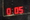 | `0:05` | `0.05` | 0.88 | led7 |
| 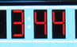 | `3:44` | `199` | 0.54 | led7 |
|  | `9:17` | `4:17` | 0.89 | led7 |
| 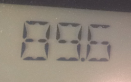 | `89.6` | `896` | 1.00 | lcd |
| 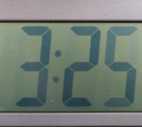 | `3:25` | `325` | 1.00 | lcd |
|  | `4` | `7` | 0.53 | led7 |
|  | `3` | `8` | 0.00 | led7 |
|  | `5:13` | `53` | 0.68 | lcd |
|  | `7` | `1` | 0.94 | flip |
| 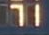 | `71` | `7` | 0.56 | dotmatrix |
|  | `7` | `1` | 0.97 | bulb |
|  | `11` | `1` | 0.03 | broadcast |
|  | `040` | `140` | 0.92 | dotmatrix |
| 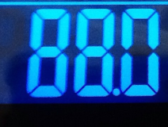 | `88.0` | `880` | 0.99 | lcd |
|  | `0` | `1` | 0.31 | dotmatrix |
| 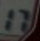 | `17` | `0` | 0.25 | lcd |

#### `ppocr:v6-small-wl` on commons_scoreboards: 55 errors

one character wrong 26, extra character(s) 10, character(s) missing 8, nothing read 5, several characters wrong 3, clock separator missing or wrong 3.

| Crop | Truth | Read | Conf. | Display |
|---|---|---|---:|---|
|  | `KARAGÜMRÜK` | `KARAGOMROK` | 0.99 | dotmatrix |
| 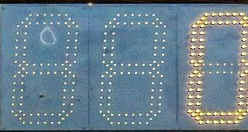 | `0` | `880` | 0.88 | led7 |
|  | `MICHIGAN` | `MICHIOAN` | 0.98 | dotmatrix |
|  | `0` | ∅ | – | dotmatrix |
| 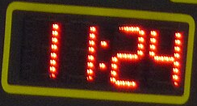 | `11:24` | `1:24` | 0.89 | dotmatrix |
| 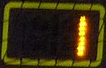 | `1` | `0` | 0.13 | dotmatrix |
|  | `3` | ∅ | – | dotmatrix |
| 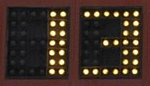 | `13` | `03` | 0.82 | bulb |
|  | `1:11` | `111` | 0.78 | dotmatrix |
|  | `17` | `0` | 0.16 | bulb |
| 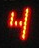 | `4` | ∅ | – | led7 |
|  | `1` | `0` | 0.76 | led7 |
|  | `4` | `1` | 0.08 | bulb |
|  | `3` | `8` | 0.02 | dotmatrix |
|  | `5:59` | `559` | 0.99 | led7 |
|  | `107` | `07` | 0.87 | led7 |

#### `ppocr:v6-tiny-wl` on textocr_scoreboards: 118 errors

character(s) missing 32, one character wrong 30, nothing read 26, clock separator missing or wrong 17, extra character(s) 11, several characters wrong 2.

| Crop | Truth | Read | Conf. | Display |
|---|---|---|---:|---|
|  | `0:00` | `00` | 0.62 | led7 |
| 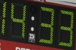 | `14:33` | `3` | 0.11 | led7 |
|  | `03` | `33` | 0.88 | dotmatrix |
| 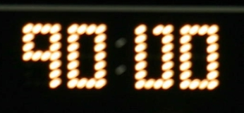 | `90:00` | `9000` | 0.41 | dotmatrix |
| 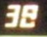 | `38` | `8` | 0.73 | led7 |
|  | `2` | `1` | 0.52 | dotmatrix |
|  | `BAT` | `6.AT` | 0.51 | printed |
|  | `55` | `5` | 0.25 | dotmatrix |
|  | `POINTS` | `PONTS` | 0.93 | printed |
|  | `1` | `7` | 0.37 | flip |
|  | `36.5` | `65` | 0.19 | bulb |
| 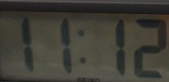 | `11:12` | `2` | 0.60 | lcd |
|  | `YDS` | `YOS` | 0.77 | printed |
| 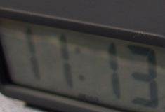 | `11:13` | ∅ | – | lcd |
|  | `0` | ∅ | – | dotmatrix |
|  | `00` | `0` | 0.35 | bulb |

#### `ppocr:v6-tiny-wl` on commons_scoreboards: 125 errors

one character wrong 44, character(s) missing 25, nothing read 20, several characters wrong 14, clock separator missing or wrong 12, extra character(s) 10.

| Crop | Truth | Read | Conf. | Display |
|---|---|---|---:|---|
| 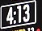 | `4:13` | `413` | 0.87 | broadcast |
|  | `0` | `880` | 0.40 | led7 |
|  | `18` | `19` | 0.74 | dotmatrix |
| 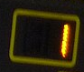 | `1` | `7` | 0.10 | dotmatrix |
| 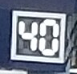 | `40` | `9` | 0.27 | broadcast |
| 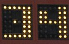 | `34` | `3` | 0.25 | bulb |
|  | `18` | ∅ | – | bulb |
|  | `02:06` | `02016` | 0.67 | broadcast |
|  | `4` | ∅ | – | led7 |
|  | `HOYAS` | `H0VRS` | 0.83 | dotmatrix |
|  | `1` | ∅ | – | broadcast |
|  | `2` | `1` | 0.80 | broadcast |
|  | `10` | `18` | 0.68 | led7 |
| 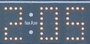 | `2:05` | `0` | 0.69 | bulb |
|  | `4` | ∅ | – | bulb |
| 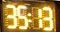 | `35:13` | `35:18` | 0.89 | led7 |

<!-- /tables:galleries -->

What the errors are:

- **Clock separators** (16 of `small`'s 122 errors, 29 of `tiny`'s 243): all the digits right but the colon or point dropped or swapped (`3:25` → `325`, `89.6` → `896`). A Time box knows its format, so inserting the separator into a reading that has all the digits would fix most of them (not measured).
- **Look-alike or dim digits** on dot-matrix, bulb and LCD boards (`7` → `1`, `13` → `03`, `3` → `8`), often with a low confidence: these are what a threshold rejects.
- **Neighbours and truncation**: a digit of the next field at the crop's edge, or a leading `1` missed (`107` → `07`, `11:24` → `1:24`).
- **Letters outside the whitelist**: a Text box's whitelist is ASCII, so Turkish `Ü` can't be read (`KARAGÜMRÜK` → `KARAGOMROK`).
- `tiny` adds many empty readings (46) and dropped characters (57).

## Recommendation

**Adopt PP-OCRv6 `small` with the whitelist decoder as ScoreSight's default recognizer, with `tiny` as the low-CPU choice, and keep Tesseract as an engine and the fallback.**

Why `small` and not `tiny` or `medium`:

| | `v6-tiny-wl` | `v6-small-wl` | `v6-medium-wl` |
|---|---:|---:|---:|
| Exact, both real datasets | 89.5% | 94.7% | 96.1% |
| TextOCR / Commons | 90.8% / 88.0% | 94.7% / 94.7% | 96.2% / 96.1% |
| Errors of 2,320 crops | 243 | 122 | 91 |
| Clocks (TextOCR / Commons) | 79.1% / 79.5% | 84.2% / 94.2% | 89.2% / 96.2% |
| CPU per crop, 1 thread | 3.5 ms | 17.3 ms | 81 ms |
| 10 boxes × 5/s, share of one core | 17% | 87% | 405% |
| Model file | 4.5 MB | 21.2 MB | 76.6 MB |

`small` halves `tiny`'s errors on both real datasets, holds 94.7% on both (where `tiny` drops to 88% on the user-like Commons boxes), and fits the default load on one core. `medium` buys another 1.4 points for 4.7 times the CPU; it makes sense only as an opt-in for a few boxes read at a low rate. `tiny` is the right choice for many boxes at high rates and for weak CPUs, and could be chosen automatically when the OCR rate falls behind the Detections / s setting (the status bar already detects that).

How to adopt it in the app:

1. **An engine option next to Tesseract**: a global setting *Recognizer: PP-OCR small / PP-OCR tiny / Tesseract* (per box later, so that a box can keep a custom `.traineddata`). New setups use PP-OCR `small`; existing ones keep Tesseract until the user switches, since users have tuned their boxes for it.
2. **The raw crop, not ScoreSight's preprocessing.** Give the recognizer the box's region of the frame after the frame-level steps (rotation, crop, stabilization, perspective), but not `preprocess_patch`: binarization costs 28–44 points for every neural recognizer, and the per-box cleanup settings (dilate, skew, vscale, autocrop...) are Tesseract tuning. Give it the **colour** crop: ScoreSight's capture thread converts the frame to gray before OCR, and the gray crop costs `small` 1.2 points (2.1 on Commons, p = 9e-4; see [Preprocessing](#preprocessing-colour-gray-or-binarized)), so the recognizer's crop should be cut from the colour frame.
3. **Decoding** limited to the box's character whitelist (`defaults.CHAR_WHITELISTS`, as the harness does), greedy CTC as in `ocr_eval/engines/ppocr.py`; then ScoreSight's format regex and a confidence threshold of 0.8–0.9, so that an unsure reading becomes `FailedFilter` and the box keeps its last good value.
4. **onnxruntime with one intra-op thread**, the session created lazily on a background thread, the model and its character list bundled (with the Apache-2.0 notice). Reading the boxes one call at a time is fine. With many boxes, two threads make each read 1.6 times faster for 20% more CPU time; never let onnxruntime use every core (5 times the CPU time for 4 times the speed).
5. **Packaging**: `onnxruntime==1.31.0` on Windows, Linux and macOS arm64; on Intel Macs either `onnxruntime==1.23.2` (check its predictions first) or Tesseract only. On Windows that adds 40 MB (onnxruntime) and 21 MB (the `small` model) to the 344 MB app folder (+18%).
6. **Tesseract stays**: as an engine choice, for users' custom models, and as the automatic fallback when onnxruntime or the model can't load (logged, and shown in the status bar). It is not useful as a fallback for unsure readings: it reads only 14 of the crops `small` misses.
7. Independent of the engine: let the Time format accept minutes past 59 (soccer clocks) and the Period format 0 and 5 (they cost every engine up to 1.5 points on Commons), and consider inserting a Time box's separator into a reading that has all the digits.

## What to measure next

1. **Video, not stills.** Real recorded footage (LED refresh and scan lines, motion blur, interlacing, compression) read in ScoreSight's loop with smoothing and "skip similar image", scoring what reaches the outputs over time: wrong values published, and how long a box stays stale. The e2e test's synthetic video shows the pipeline works; labelled real footage needs contributors (Training Dojo).
2. **More real data with user-drawn boxes**: Training Dojo exports from users' own venues (CC0/CC BY), and a human pass over `commons_scoreboards`' labels with `python -m ocr_eval review` (they are model-assisted until then).
3. **Fine-tuning on scoreboard crops.** PP-OCRv6 `tiny` (and `small`) fine-tuned on a separate training set of scoreboard crops (synthetic plus contributed data; never the test splits). `tiny` has the most to gain: closing its gap to `small` would make it the default at a fifth of the cost.
4. **Other machines**: a 4-core laptop CPU, Apple silicon and Linux, where the CPU budget is tighter; onnxruntime 1.23.2 on an Intel Mac (same predictions?); Apple Vision on a Mac.
5. **Cheaper inference**: dynamic int8 quantization of `small` (OnnxTR's dynamic int8 PARSeq lost under a point), and the clock separator fix.

## Caveats

- Stills, one read per crop, default box settings: no temporal smoothing, no per-board tuning (users tune Tesseract boxes, which narrows its gap somewhat), no video artifacts.
- `commons_scoreboards`' labels are model-assisted and not yet human-verified (see [Datasets](#datasets)); `textocr_scoreboards`' transcriptions are human.
- PP-OCRv6 may have been trained on similar public photos (see Contamination).
- Timing is from one fast desktop CPU, with other sessions using 3–9% of it during the chosen repeats; Tesseract measured 1.5 ms per crop here, as in the Linux baseline, so the numbers aren't inflated. Absolute times will differ on other machines; the ratios between engines are the robust part.
- The VLM rows were not re-run (the VLM evaluation was stopped: too slow on a CPU), and some VLM variants were never finished (see the developer guide).
- Apple Vision has never run (it needs a Mac).

## Reproducing

Everything above comes from this folder:

| File | What |
|---|---|
| `results.json.gz` | The accuracy run: every engine variant above on the three datasets, every prediction (`python -m ocr_eval report results.json.gz` renders it; `results.md` is that rendering) |
| `latency.json.gz` | The timing runs: for each engine and thread setting, the least-loaded repeat (no predictions), with every repeat's medians and load in `machine_load` |
| `gray.json.gz` | PP-OCRv6 on the crops in gray, as ScoreSight's capture thread passes them to OCR |
| `startup.json` | The startup measurements |
| `tables.py` | Recomputes every table: `python ocr_eval/results/2026-10-11/tables.py --fill ocr_eval/results/2026-10-11/REPORT.md` |

The accuracy run is

```bash
python -m ocr_eval run --dataset textocr_scoreboards --dataset commons_scoreboards --dataset synthetic_7seg \
    --engine tesseract \
    --engine ppocr:v6-tiny,v6-tiny-wl,v6-small,v6-small-wl,v6-medium,v6-medium-wl,v5-en-mobile-wl \
    --engine onnxtr:parseq,parseq-wl,parseq-int8-wl,vitstr_small-wl,vitstr_small-int8-wl,crnn_mobilenet_v3_small-wl,crnn_mobilenet_v3_small-int8-wl,viptr_tiny-wl \
    --engine windows-ocr:tile-digits --out results/2026-10-11
```

in an environment with `requirements-dev.txt`, `requirements-win.txt` and `requirements-eval.txt`, with `OCR_EVAL_ORT_THREADS=0 OCR_EVAL_ONNX_THREADS=0` to use all cores (the predictions are the same on one). The timing runs are the same command on `--dataset commons_scoreboards --sample 300 --single-latency-samples 300 --warmup 3` with the engines of the latency table, `OCR_EVAL_ORT_THREADS` and `OCR_EVAL_ONNX_THREADS` set to 1, 2, 4 or 0, and `OCR_EVAL_ORT_SPINNING=0` for "no spinning", repeated while recording the machine's load.
